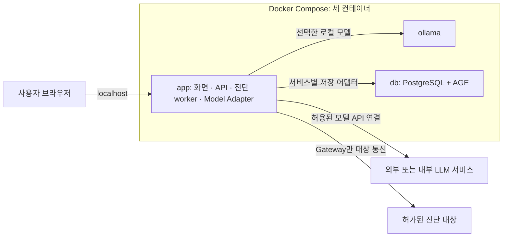

# 로컬 웹 제품의 Docker 배포 구성

상태: **제품 배포 방향 확정 / 패키징 구현 전 (2026-10-22)**. 최종 제품은 사용자가 Docker Compose로 기동하고 같은 컴퓨터의 브라우저에서 접속하는 로컬 웹으로 제공한다. 기본 구성은 `app`·`ollama`·`db` 세 컨테이너다. 현재 웹 UI/API, 전체 서비스 조립, Dockerfile·Compose 설정은 구현되지 않았다. 이 문서는 실행 가능한 설치 안내나 배포 검증 완료 기록이 아니다.

상위 책임과 안전 경계는 [아키텍처 §10](mcp-architecture.md#10-상태장애배포성능)과 [모듈 설계](module-design-confirmed.md)를 따른다. 기존 패키지·담당 배정·공유 계약은 유지한다.

## 1. 세 컨테이너의 책임

| Compose 서비스 | 포함할 기능 | 보관할 데이터 |
|---|---|---|
| `app` | 웹 화면·API, Host의 작업 큐·worker, Gateway·Policy·WebDiag·Evidence·Judge·Report·Knowledge 구현과 모델 어댑터. `app` 조립 루트가 구현을 주입 | 보존이 필요한 비식별 근거 파일·생성 보고서 |
| `ollama` | 로컬 모델 추론. 모델 선택과 호출은 `app`의 Model Adapter를 통해 수행 | 모델 파일·캐시 |
| `db` | PostgreSQL과 AGE 확장. 서비스별 관계형/JSONB 정본·감사 journal, Knowledge 소유 그래프 투영 | DB 데이터·허용된 영속 상태 |

기존 Control·Knowledge·Web Execution은 **논리 영역**이며 기본 로컬 배포에서는 `app` 안에 배치한다. 패키지마다 컨테이너를 만들거나 별도 프런트엔드·API·큐 컨테이너를 기본 구성에 추가하지 않는다. UI 기술 스택과 내부 프로세스 수는 후속 구현에서 정한다. 개발·평가용 대상 앱은 제품의 세 컨테이너와 구분한다.

## 2. 접속과 실행 흐름

- 사용자 접속 포트는 `app`만 호스트의 `127.0.0.1`에 공개한다. 실제 포트 번호는 Compose 구현에서 정한다.
- `app`은 Compose 내부 서비스 이름으로 Ollama와 DB에 연결한다. DB와 Ollama의 포트는 기본 구성에서 호스트에 publish하지 않는다. 브라우저가 이 두 서비스에 직접 접속하거나 자격 증명을 받지 않는다.
- 화면은 대상·등록 설정 선택, 진단 시작, 진행 상태 조회, 중지, 결과·보고서 조회를 제공한다. 임의 URL·모델 출력만으로 실행 허가를 부여하지 않는다.
- 긴 진단은 Host의 worker가 수행한다. 웹 요청 처리와 진단 작업의 수명을 분리해 진단 중에도 상태 조회·중지가 동작하게 한다. 별도 worker 컨테이너를 필수로 두지 않는다.
- 대상 HTTP·브라우저 통신은 `gateway`만 수행한다. Ollama는 진단 대상을 직접 호출하거나 임의 명령·payload를 실행하지 않는다.

### 2.1 개발용 LLM 설정 화면

**개발 편의 결정(2026-10-22):** 개발 단계에서는 웹의 설정 화면에서 모델 연결 프로필을 입력·저장하고 연결을 확인할 수 있게 한다. 설정 변경을 위해 매번 이미지 재빌드나 환경 파일 편집을 요구하지 않는다. 웹 설정 화면과 연결 API의 실제 구현은 후속 작업이다.

| 설정 항목 | 화면 동작 |
|---|---|
| AI 사용과 연결 방식 | AI 보강 끄기, 로컬 Ollama, 외부/내부 LLM API 중 선택 |
| 프로필 이름·공급자 | 저장한 프로필 선택·추가·수정·삭제. 구현·검증된 공급자 어댑터만 선택 가능 |
| 서버 주소 | 선택한 공급자의 endpoint/base URL 설정. Ollama의 기본 연결은 Compose 내부 서비스로 제공 |
| 모델 | 모델 ID 입력·선택. 목록 조회를 지원하면 사용자가 요청했을 때 서버를 통해 조회 |
| API 키 | 필요한 공급자에서 키 입력·교체·삭제. 저장 후에는 키 원문 대신 설정 여부 표시 |
| 호출 한도 | timeout·출력 토큰 상한·호출/재시도 예산 등 지원하는 설정을 유효 범위 안에서 조정 |
| 연결 확인 | 버튼으로 명시적으로 실행하고 연결·인증·모델 접근 성공 또는 구분 가능한 실패 사유 표시 |

브라우저는 `app`의 설정 API만 호출한다. `app`이 지원 공급자·허용 endpoint·설정 범위를 검증하고, AI Reasoner의 Model Adapter를 통해 Ollama 또는 외부/내부 모델 API에 연결한다. 외부 LLM 연결 때문에 제품 컨테이너를 추가하지 않는다. 개발 편의 설정도 해당 환경의 외부 전송 허용 정책을 따르며 임의 endpoint를 무조건 허용하지 않는다.

API 키는 입력 시 서버에 전달하고, 이후 설정 조회 응답·로그·보고서·브라우저 영속 저장소에 원문을 남기지 않는다. 모델 어댑터에는 서버가 관리하는 보호된 자격 참조로 주입한다. 프로필의 비밀 없는 설정과 자격 보관은 분리한다. 키의 서버측 저장·암호화/접근 권한·삭제 처리는 후속 자격 저장 어댑터에서 구현·검증하며, 영속 보관을 검증하기 전에는 세션 동안만 사용할 수 있게 한다.

입력 중인 값은 실행 중인 진단을 바꾸지 않는다. 저장한 프로필을 새 run 시작 시 선택·고정하고, 이후 수정은 다음 run부터 적용한다. 외부 모델 오류 때 다른 모델이나 Ollama로 자동 전환하지 않고 선택한 AI 작업의 실패와 기본 진단의 진행을 구분한다.

연결 확인은 사용자가 버튼을 눌렀을 때만 서버가 수행하며 저장 자체가 모델 호출을 발생시키지 않는다. 대상 진단 자료 대신 최소 합성 입력 또는 공급자가 지원하는 연결/인증 확인 요청을 사용한다. 추론 호출이 필요한 확인은 실행 전에 호출/요금 발생 가능성을 표시하고 호출 횟수·시간을 제한한다. 대상 웹 요청은 0건이며 API 키·응답 원문을 실패 메시지에 노출하지 않는다. 연결 성공과 모델의 진단 품질·구조화 출력/도구 호출 능력 검증은 별개다.

## 3. 영속 데이터와 권한 경계

DB 데이터와 모델 파일은 각각 컨테이너 수명과 분리된 영속 볼륨에 둔다. 재시작 후 보존할 비식별 근거 파일·보고서도 별도 영속 경로에 저장한다. 구체적 볼륨 이름·마운트 경로·보존/삭제·백업/복구는 패키징 구현에서 고정한다. 원문 응답·캡처 핸들·run HMAC 키를 이 영속 영역에 저장하지 않는다.

같은 `app` 컨테이너에 넣어도 서비스별 정본·DB 역할/스키마, Knowledge의 AGE 권한, Policy/Gateway 실행 관문은 유지한다. 원문 응답은 실행 로컬 Evidence 버퍼/비교기에서만 사용하며 UI·Host·모델에는 비식별 공개 계약만 전달한다. 컨테이너 수가 이 권한 격리를 자동 증명하지 않으므로 실제 프로세스·파일·네트워크 권한과 공개 포트 경계는 통합 검증한다.

## 4. 기동·모델 장애·종료

기본 배포 묶음에는 Ollama를 포함하되, 모델 설치·다운로드·로딩·추론 실패가 기본 진단과 웹의 상태 조회를 막지 않게 한다. Ollama 미사용·오류에는 AI 보강의 미수행/실패 사유를 표시하고 기본 진단은 계속한다. 외부/내부 모델 연결의 기존 선택 계약도 유지한다.

DB는 필요한 스키마·권한과 저장/감사 준비가 확인된 뒤 진단을 수락한다. 준비되지 않았거나 장애가 발생하면 상태와 사유를 표시하고, 정책·전송 의도를 기록할 수 없는 상태에서 새 대상 요청을 보내지 않는다. 빈 메모리 저장소로 조용히 대체하지 않는다.

중지·컨테이너 재시작 시 작업 정리·저장 재조정 규칙을 지키고, 이미 발생한 전송이나 불명 상태를 미전송으로 바꾸지 않는다. 상태 복구를 위해 대상 요청을 자동 재전송하지 않는다.

## 5. 후속 구현과 완료 기준

| 남은 작업 | 완료 시 확인할 항목 |
|---|---|
| 웹 UI/API와 `app` 조립 | 브라우저에서 시작·상태·중지·보고서 조회, 실행 중 API 응답 유지 |
| 개발용 LLM 설정 | 공급자·endpoint·모델·자격·한도 설정, 저장과 연결 확인 분리, 새 run에만 적용, 키 원문 비노출·삭제 검증 |
| Dockerfile·Compose | `app`·`ollama`·`db` 기동, 내부 연결, app의 로컬 포트 공개, 준비 상태 확인 |
| 배포 버전·실행 환경 | Python/uv 잠금 유지, PostgreSQL/AGE 호환 버전·이미지 digest, Ollama·모델 버전과 CPU/GPU 실행 조건 고정 |
| 영속화·종료·복구 | 재생성 후 DB·모델·허용된 근거/보고서 보존, 작업 중지·감사·unknown 보존 검증 |
| 장애와 권한 | Ollama 장애에도 기본 경로 유지, DB 장애 시 새 대상 전송 차단, 비밀·원문 비노출과 서비스별 권한 검증 |

`docker compose up -d` 후 localhost 접속은 **제공하려는 사용자 경험**이다. 현재 저장소에는 해당 Compose 설정이 없으므로 이 명령으로 제품을 실행할 수 있다고 안내하지 않는다. 팀원의 기본 모듈 개발·단위 테스트는 기존 uv 환경과 무전송 fake로 계속하며 Docker·Ollama·DB 기동을 선행조건으로 추가하지 않는다.

참고: [Compose 내부 네트워크](https://docs.docker.com/compose/how-tos/networking/), [Docker 포트 공개](https://docs.docker.com/engine/network/port-publishing/), [Ollama Docker 실행](https://docs.ollama.com/docker).
