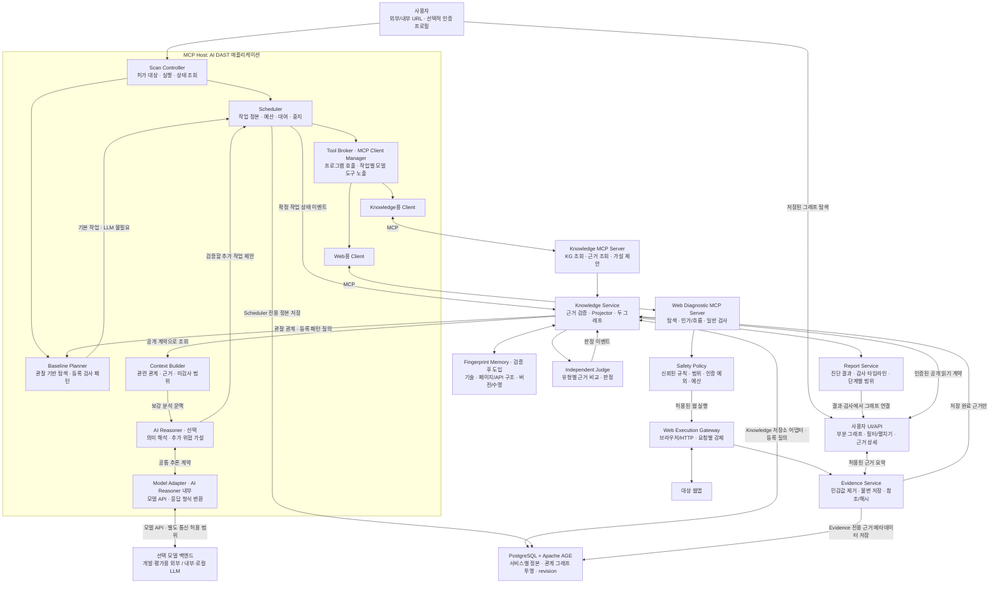
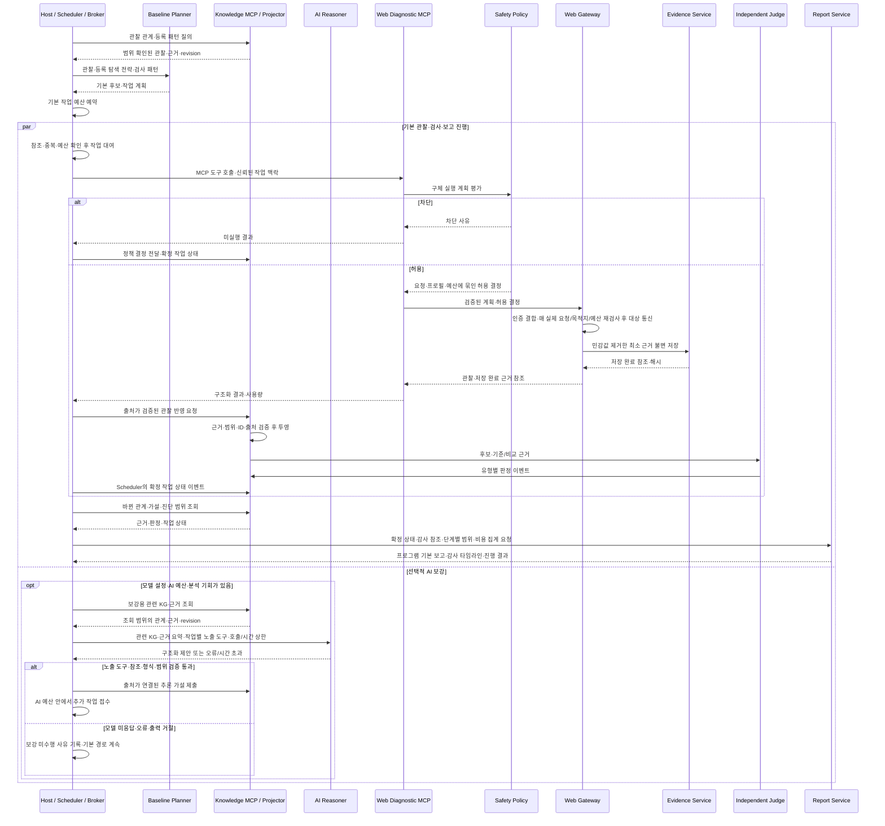

# ABC2LAB — MCP 표준 기반 AI DAST 아키텍처

- 작성일: 2026-10-19
- 최종 수정일: 2026-10-20
- 상태: 팀 합의 최종본에 이번 검토 사항을 반영한 현행 설계. 구현·성능·실제 도구 도입 완료를 의미하지 않는다.
- 설계 전제: 현재 저장소와 독립된 새 프로젝트다. 기존 코드·모듈·Neo4j·언어·JSON 계약·팀 담당·재사용/이관·하위 호환성을 설계의 제약이나 출발점으로 삼지 않는다.
- 설계 기준: 이번 대화에서 확정한 제품 요구사항과 MCP 공식 문서다. 구성요소·데이터 계약·DB·기술 스택·구현 역할은 새 프로젝트 기준으로 정한다.
- 품질 기준: 개발 일정이나 기존 자산 재사용 편의를 설계 선택의 근거로 삼지 않는다. 진단 실행 시간·요청/자원·모델 예산은 제품 품질 지표로 유지한다. 현재 책임 분리는 검증할 기본안이며 최적 구조로 입증된 것은 아니다.
- 설계 문서: 이 문서와 [MCP 도구 목록](mcp-tool-catalog.md)을 함께 현재 설계 기준으로 사용한다. 이전 초안·별도 명세·기존 소스의 구조를 새 프로젝트의 기준으로 사용하지 않는다.
- 기본 도구: [상용 배포용 MCP 도구 목록](mcp-tool-catalog.md). 목표 제품의 도구와 최초 수직 슬라이스에 필요한 도구를 구분한다. 처음에는 Playwright·HTTPX·자체 읽기 인가 비교를 연결한다.
- 실행 원칙: 프로그램이 기본 진단을 수행하고 LLM은 KG 기반 의미 해석·추가 탐색·위협 가설을 보강한다. 모델 미설정·장애가 기본 진단의 필수 의존성이 되지 않도록 설계한다.
- 장기 기억: [§6.3 Fingerprint Memory](#63-fingerprint-memory)는 현재 관찰의 정확성·범위 격리·재확인과 재사용 효용을 검증해 도입한다. 기본 정규화·탐색 중복 제거와 구분하며 최초 수직 슬라이스의 필수 의존성으로 두지 않는다.
- 도구 노출 원칙: 전체 등록 목록과 모델에게 제공하는 작업별 목록을 구분한다. 기본 검사는 프로그램이 호출하고 LLM에는 필요한 고수준 도구·구조화 요약만 제공한다.
- AI 문맥 원칙: 추론에 필요한 관계·근거·기대 정책·반증·미확인 조건을 충분히 전달하는 것을 우선한다. 문맥/호출 예산 안에서 단계 조회·관계가 보존되는 작업 분할로 보완하며 필수 정보를 조용히 잘라내지 않는다(§4.2).
- 모델 교체: AI Reasoner 내부 Model Adapter와 공통 추론 계약으로 외부 기준 모델에서 내부·로컬 후보로 교체하며 진단 성능을 비교한다(§6.4·§11.1). 모델 접속 위치·크기·양자화와 실제 품질을 구분하고 MCP 도구·안전 권한은 동일하게 유지한다.
- 현행 결정: KG는 제품의 확정 구성이며 저장소는 PostgreSQL + Apache AGE를 채택하는 방향으로 정한다. 탐색·진단의 서비스별 정본은 관계형 테이블/JSONB에, 관계 조회용 그래프는 AGE 투영에 둔다(§6.2). 메모리 최소화보다 근거 보존·관계 조회·정합성을 우선하고 시스템 전체 자원은 측정·통제한다. PostgreSQL/AGE 호환 버전·드라이버·배포물은 §6.2와 카탈로그 §5의 검증 후 고정한다. 최초 인가 오라클·전송 불명 처리·지문 기억·모델 교체·안전 경계는 유지하며 아래 기준은 실제 성능 결과가 아니다.
- 사용자 그래프 화면: 저장된 웹 표면·권한/업무 관계·진단 이력을 부분 그래프로 탐색하고 근거·판정을 확인하는 UI를 목표 제품에 포함한다(§6.5). 기존 Knowledge/Evidence 공개 조회 계약을 사용하고 추가 MCP 서버/도구나 브라우저의 DB 직접 연결을 만들지 않는다.
- 검증 우선순위: 융합 Discovery·정확한 관찰·난이도별 평가를 주요 품질 과제로 삼는다. 작은 읽기 IDOR 수직 슬라이스와 공통 KG 기반 고정 입력 모델 평가는 가정을 검증하는 수단이며 최종 품질/지원 범위를 제한하는 일정 타협이 아니다. 18개 요구·27개 수용 기준은 기능별로 검증한다.

## 핵심 가설과 결정적 실험

검증 대상은 작은 모델 충분성(H1)과 통제·감사(H3)다. 둘 다 미검증이며 수치는 실험 전 고정한다(§6.1·§11.1). KG는 채택한 공통 기반이고, 관계·근거·조회 품질은 제품 기능으로 검증한다(§6.2). H1의 통계 지표는 신뢰구간으로, 자원 상한과 H3의 실행·감사는 실제 기록으로 판정한다. 성공 / 판단불가 / 기각(보류)을 구분하며, "유의차 미검출"을 "효과 없음의 입증"으로, 전송 여부 불명을 "안전"으로 바꾸지 않는다.

| 가설 | 내용 | 결정적 실험 | 판정 규칙 |
|---|---|---|---|
| H1 작은 모델 충분성 | 구조가 관계·인가 추론의 어려운 판단을 좁은 하위작업으로 분리하면, 경량 로컬 모델이 그 하위작업을 수행한다 | §11.1 고정 입력 추론: 프로그램 기본선 / 경량 / 고성능 모델의 1차 지표(가설 정확도)를 같은 관찰·근거·예산에서 비교 | 종합 판정: 1차 지표 기준(a 절대 하한·b 고성능 모델 대비 비열등·c 프로그램 기본선 대비 우월)과 자원 상한(d), 2차 통과선을 모두 충족하면 성공. 확인된 미달이 하나라도 있으면 기각하며 자원 상한 초과도 미달이다. 미달은 없지만 CI 경계 중첩·측정 누락·계산 불가가 있으면 판단불가. 세부 §6.1 |
| H3 통제·감사 | 모든 대상 통신을 정책+Gateway 단일 경계로 강제하고 run별 감사 타임라인을 내면, 시험한 조건에서 통제를 증거로 보일 수 있다 | §11 A6·A24·A25 격리 대역 + §11 A23 감사 | 성공 = 시험한 프로필·우회(리다이렉트·하위 요청·XHR 등)·장애 조건에서 (금지 동작 전송 0건) ∧ (정상 허용 관찰 성공) ∧ (감사 기록 완전성 확인). 전송 여부 불명은 unknown으로 남기고 성공으로 집계하지 않음. 미달 = 그 조건에서 우회 전송 또는 unknown을 0건으로 집계. 감사 완전성 확인 방법은 §8.2 |

H1 성공의 의미: 공통 KG 위에서 경량 모델이 프로그램 기본선보다 유의하게 낫고(기여 있음) 고성능 모델에 비열등(작은 모델로 충분)하다. 둘 중 하나만이면 성공이 아니다. 쉬운 평가 앱에서는 모델 간 차이가 안 벌어질 수 있어 난이도 스펙트럼·개발 미사용 앱(§11.3)이 전제다. H3의 전송 0건은 전체 조건의 보장이 아니라 시험한 조건의 결과다. 전체 요구(R1~R18)·수용 기준(A1~A27)은 이 가설들과 목표 제품의 기능·표시 계약을 검증한다.

우리가 작동시켜 보일 산출물은 다음과 같다. 모두 구현·검증 목표이며 현재 완료한 결과가 아니다.

- **진단:** 유효한 등록 정책과 기존 객체의 정상/교차 접근 근거를 갖춘 읽기 수평 IDOR `CONFIRMED` 1건 이상과, 정상 접근·정상 공유를 오탐하지 않는 대조 사례 및 근거 보고.
- **통제:** 금지 요청의 실제 전송 0건과 정상 허용 관찰 성공을 함께 보여주는 통제 데모 1건 이상, 정책 사유·실제 요청·근거·판정을 연결한 감사 타임라인.
- **측정:** 공통 KG 기반의 프로그램 기본선·외부/로컬 모델에서 가설 품질·근거·자원을 비교하고 H1을 판정한다(§11.1). 모델 간 품질 차이와 사례별 대응 관계를 유지한 신뢰구간을 함께 제시한다.
- **KG 근거 경로:** 관찰에서 구성한 소유·소속·공유/위임의 다중 홉 관계를 등록 질의로 조회하고, 경로별 근거·출처·관찰/추론/검증 구분·revision을 AI 문맥·감사 보고·사용자 그래프 화면에 연결하는 데모. 정책 예외나 미확인 연결도 함께 보여주며, 관계 경로만으로 접근 위반을 확정하지 않는다. 이는 KG의 작동 목표이고 다른 표현/저장소 대비 우위의 실측 주장은 아니다.

이는 시연·보고의 최소 산출물이며 전체 지원 범위·일반화 성능은 §11의 평가로 검증한다. H1의 미달·판단불가도 사전 기준에 따른 측정 산출물로 공개하며, 파일럿 수치에 맞춰 성공 조건을 바꾸지 않는다.

## 1. 제품 목표와 요구사항

> 외부 웹 URL을 입력받아 폭넓게 관찰하고, AI가 KG로 웹의 자원·권한·업무 관계를 이해해 위협을 추론하며, 허용된 검사로 취약점을 재현하는 블랙박스 AI DAST.

| ID | 요구사항 | 설계 반영 |
|---|---|---|
| R1 | 외부·내부 HTTP(S) URL만으로 시작 | 사전 허가된 자산 범위 안에서 Host가 대상과 기본 예산을 만들고 Guest 탐색을 자동 시작 |
| R2 | 처음 보는 웹에 적용 | 대상 서버 설치·소스·DB·정답·사전 작성 KG 없이 관찰에서 이해 모델 구성 |
| R3 | 최대한 많은 엔드포인트 탐색 | 브라우저·HTTP·DOM/JS·트래픽·공개 API 명세·패시브 단서를 공통 후보 목록으로 융합하고 계정/상태별 관찰·근거·다음 탐색으로 연결 |
| R4 | AI의 KG 기반 웹 이해·위협 추론 | AI 사용 모드의 핵심 책임을 관계·인가 가설 생성·반증 처리·근거 충분성 판단으로 정의하고 하위작업 품질 측정 |
| R5 | 인가·비즈니스 로직을 핵심으로 일반/주입형도 진단 | 전용 접근 비교·흐름 검사와 일반 검사 어댑터를 함께 제공 |
| R6 | 임의 업무 데이터 생성·수정·삭제 차단 | 실행 서버의 독립 정책 검사와 실제 통신 경계로 강제 |
| R7 | 등록 계정의 정상 로그인·세션 갱신만 예외 | 선택적 인증 프로필과 실행 영역의 비밀 저장소 사용 |
| R8 | 사용자 개입 최소화 | 불명확·금지 작업은 차단·기록하고 가능한 진단 계속 |
| R9 | 분석 시간·요청·LLM 비용 통제 | 기본 작업은 프로그램으로 생성하고 AI는 관계·가설 판단에 집중 |
| R10 | 최소 책임·독립 실행 | Host, Knowledge/Web Diagnostic MCP 서버 2개와 독립 어댑터 |
| R11 | 상용 솔루션에 적합한 도구만 연결 | 기본 엔진 허용목록·라이선스/동봉물·실행 프로필을 구분하고 등록 기준 검증 |
| R12 | LLM 모델 성능에 과도하게 의존하지 않음 | 프로그램의 기본 작업 생성·관찰 KG·등록 검사·근거 판정·보고와 선택적 AI 보강을 분리 |
| R13 | 기술 스택·페이지·엔드포인트 fingerprint 기억 | 정확성·범위 격리·재확인·효용 검증 후 프로그램 추출·Knowledge 영속 기억·변화 감지 적용 |
| R14 | 추론에 필요한 정보 제공과 모델의 도구·문맥·연속 호출 부담 통제 | Context Builder의 정보 충분성 점검·단계 조회·관계 보존과 작업별 도구 노출·공통 계약·호출 상한·모델별 비교 평가 |
| R15 | 통제·감사를 사람이 확인할 수 있는 산출물로 제공 | 가설/탐색 목표 → 작업 → 정책·사유 → 실제 요청 → 근거·판정의 run별 감사 타임라인 |
| R16 | 조직이 소유하거나 진단을 허가한 자산만 검사 | 신뢰된 자산 등록·허가 범위를 run에 묶고 시작 전과 실제 목적지에서 재검사 |
| R17 | Discovery 누락과 추론·검증 실패를 분리 | A2 발견/관찰, A4 고정 입력 추론, E2E 전체 성능과 최초 미충족 단계를 함께 보고 |
| R18 | 사용자 화면에서 관계·근거·진단 이력을 그래프로 탐색 | 두 논리 그래프의 인가된 부분 조회·필터/펼치기·근거/판정 연결·상태/누락 표시와 UI 조회 한도 (§6.5) |

외부 진단은 실행 영역에서 대상에 연결할 수 있어야 한다. 온프레미스는 분석 시스템의 설치 위치를 뜻하며 대상 웹의 위치를 제한하지 않는다. 외부 연결이 없는 폐쇄망에서는 외부 접속 가능한 실행 환경이 필요하다.

### 1.0. 제품 일반성의 경계

제품 일반성과 핵심 차별점은 적용 깊이가 다르다. 이 경계 안에서만 일반성을 주장한다.

| 깊이 | 전제 | 적용 |
|---|---|---|
| 표면 진단 | 사전 자산 허가 하에 URL만 | 비인증 표면 탐색·관찰 기반 KG 구성·검증된 일반/주입형 검사·진단 범위 보고 |
| 핵심 인가·업무로직 진단 | 등록된 복수 계정·로그인 프로필·기대 정책 근거 + 대상(소유자) 객체와 그 정상 접근 기준 | 계정/역할/자원·선행조건을 연결한 인가·흐름 진단 |

"처음 보는 임의 웹에 URL만으로"는 표면 진단과 관찰 기반 분석의 시작 조건이다. 등록 프로필·인증 근거는 깊은 인가·업무로직 진단의 필요 조건이며 충분 조건이 아니다. 등록 프로필이 있어도 관찰·기대 정책 근거·유형별 오라클이 부족하면 확정하지 않고 의심/판단불가로 남긴다. 수평 인가 비교의 필수 전제는 대상(소유자) 객체와 소유자의 정상 접근 기준이다. 공격자 계정이 같은 종류의 기존 객체를 가지는지는 확보 가능할 때의 보조 대조이며(서버가 id를 무시하고 자기 객체를 반환하는 경우의 배제에 도움), 공격자 자기 객체가 없다는 이유로 검사를 막지 않는다. create-then-read는 쓰지 않는다(§11.4). 무준비 상태의 깊은 진단을 성과로 주장하지 않는다.

### 1.1. 품질 목표와 검증 의존성

전체 요구와 수용 기준이 목표 제품의 범위다. 다음 구분은 개발 기한에 맞춘 기능 축소가 아니라 잘못된 가정을 조기에 드러내는 검증 순서다. Discovery·인증·근거 정확성과 어려운 평가 대상의 설계는 처음부터 진행하며 작은 슬라이스의 성공으로 대체하지 않는다. 논리 책임마다 별도 프로세스를 강제하지 않는다.

| 단계 | 포함 범위 | 완료를 판단할 근거 |
|---|---|---|
| 연결 검증용 수직 슬라이스 | 허가 URL, 등록 두 계정, 단일 폼/쿠키 인증, 계정별 관찰·읽기 전용 수평 IDOR, 정책/Gateway·근거·감사/보고 | 기대 정책·객체 식별 근거와 정상/교차 접근 비교. 취약/정상·인증 실패·금지 요청 차단을 구분. 넓은 탐색·SPA/인증 지원의 품질을 증명하는 벤치마크로 쓰지 않음 |
| 초기 병행 검증 | 공통 KG·고정 관찰에서 프로그램 기본선과 외부/로컬 LLM 비교 | 단순 IDOR와 복합 관계·음성 사례에서 모델별 품질·근거 회수·비용의 실제 차이. 전체 크롤러/MCP/영속 저장소 완성을 기다리지 않음 |
| 핵심 경로 뒤 MCP 연결 | 도메인 함수를 공개 계약의 얇은 MCP 어댑터로 연결. 먼저 관찰·HTTP·인가 비교, 이후 필요한 지식 도구만 노출 | 직접 호출과 MCP 호출이 같은 정책·근거·판정을 사용. 원격 연결 시 인증/TLS·참조 인가를 갖춘 뒤 사용 |
| 핵심 품질 검증 | 융합 관찰 파이프라인, 추가 허가 앱·SPA/인증, 복합 관계, 읽기 흐름·일반 검사, 모델별/도구 노출 비교 | 채널별 추가 발견·필수 관찰 충족·캡처 정확성·유형별 판정과 시간/자원 비용. 해당 기준을 통과한 지원 범위만 공개 |
| 기억 도입 검증 | 영속 fingerprint 이력·재스캔 기억/캐시와 배포·보존·재사용 | 정확한 현재 관찰·범위/최신성 보장과 기억 비사용/사용의 탐지·누락/오탐·시간/자원 비교. 탐지 효용 없음/있음 모두 실험 전 미확정 |
| 현재 제외 | 업무 쓰기 재현, 승인+DB 초기화 reproduction, 임의 공격/셸·코드 실행 | 기존 업무 변경/영향 불명 차단 유지. 후속 단계라는 이유로 자동 허용하지 않음 |

최초 수직 슬라이스는 LLM·MCP 서버 2개·전체 10도구의 동시 완성을 요구하지 않는다. KG 공개 계약·도메인 함수의 독립 검증에는 인메모리 그래프/저장소 대역을 사용할 수 있으며, 목표 영속 구현과 저장소 통합 검증은 PostgreSQL + Apache AGE를 기준으로 한다(§6.2). 임의 웹/모든 인증/모든 업무 흐름의 지원을 이 단계의 성과로 주장하지 않는다. 자산 허가·계정/자원 격리·업무 변경 차단·비밀 보호·요청별 정책·근거·최소 감사는 처음부터 적용한다.

지원 표시는 **검증된 다중 계정 인가 검사와 비파괴 관찰에 근거한 업무 관계·위협 가설 분석**, 검증된 일반/주입형 검사별로 공개한다. 작은 슬라이스와 목표 제품의 검증 완료를 구분한다. 업무 쓰기 차단과 블랙박스 근거 한계는 개발 기간과 관계없는 제품 경계다.

## 2. MCP 표준과 제품 설계의 경계

| MCP가 정의하는 것 | ABC2LAB이 구현할 것 |
|---|---|
| Host–Client–Server 연결 | 웹 이해·위협 추론·작업 스케줄링·종료 조건 |
| Tools, Resources, Prompts와 입력/결과 표현 | KG 의미 모델·검사 프로필·근거·가설·재현 판정 계약 |
| stdio·Streamable HTTP 등 전송과 HTTP 인가 체계 | 실행 격리·대상 범위·업무 변경 차단·인증 예외·예산 |
| 도구·리소스 발견과 호출 | 어떤 도구를 어느 작업에 노출하고 어떤 근거를 모델에 제공할지 |

이 문서의 표준 참조판은 공식 `2026-07-28` 문서다. 이 판의 stateless core에 맞춰 run·job·브라우저 상태는 애플리케이션의 명시적 참조로 관리한다. 구버전 handshake나 프로토콜 세션에 진단 상태를 의존하지 않는다. 실제 SDK·호환 버전은 기능 검증 후 선택한다. [MCP 아키텍처](https://modelcontextprotocol.io/docs/2026-07-28/learn/architecture), [해당 판 변경 사항](https://blog.modelcontextprotocol.io/posts/2026-07-28/)

## 3. 목표 전체 구조

**기본은 MCP Host + Knowledge MCP Server + Web Diagnostic MCP Server다.** 각 서버에 대응하는 Client를 Host 안에서 관리한다.

아래는 목표 제품의 논리 구조이며 최초 수직 슬라이스의 동시 구현 목록이 아니다. 기본 경로는 관찰 → 관계 투영 → 등록 패턴으로 작업 생성 → 허용 검사 → 근거 판정 → 보고를 프로그램이 반복한다. 먼저 같은 정책/Gateway를 사용하는 도메인 함수로 연결한 뒤 필요한 경계를 MCP로 감싼다. LLM은 관련 관계를 읽고 추가 작업을 제안하는 보강 경로다. 목표 구성의 두 경로는 같은 Scheduler·MCP 도구·정책·Gateway를 사용한다. 기본 작업 호출에 모델의 선택·동의·응답을 요구하지 않는다.

MCP 표시는 Client–Server 사이의 표준 연결이다. 나머지는 공개 내부 계약이며 모든 내부 처리를 MCP로 중계할 필요는 없다. 도식의 허용 화살표는 정책 결정을 뜻하고, 실제 실행은 해당 서버가 격리 실행 창구에 요청한다. Gateway는 실제 목적지·요청·예산을 다시 검사한다.

PostgreSQL은 정본과 AGE 투영을 담는 공통 물리 저장소다. 도식의 DB 연결은 각 서비스가 자기 저장소 어댑터·전용 권한으로 자기 영역만 기록한다는 뜻이며, Knowledge가 다른 서비스의 작업·정책·근거 정본을 소유하거나 직접 수정하는 통로가 아니다. 나머지 서비스의 자기 정본 저장 연결은 도식에서 생략했다. 보호된 큰 근거 자료·실행 비밀의 저장 경계는 별도로 유지한다(§6.2·§8.4).

## 4. Host와 기반 서비스의 최소 책임

| 구성요소 | 책임 | 권한 경계 |
|---|---|---|
| Scan Controller | URL·허가 자산 범위 검증·실행 생성·진행 집계·중지·결과 조회 | 신뢰된 등록 범위 밖 대상의 진단 시작 불가. 링크 발견만으로 범위 확대 불가 |
| Baseline Planner | 관찰·등록 탐색 전략·검사 패턴으로 기본 후보와 작업 생성 | 모델 출력 대기 없이 동작. 대상별 URL·업무 규칙 하드코딩 금지 |
| AI Reasoner · 선택 | AI 사용 모드의 관계·인가 가설 생성·반증 처리·근거 충분성 판단, 추가 탐색·검사 계획 제안. 내부 Model Adapter로 공통 추론 계약을 모델별 API에 연결 | 기본 작업의 필수 전제·실행 허용·예산 확대·취약점 자기 확정 불가. 모델 교체로 MCP 도구·실행 권한 변경 불가 |
| Context Builder | 작업에 필요한 의미·부분 그래프·근거·기대 정책·반증·미검사 범위 구성, 누락/전달 상태 점검과 허용된 추가 조회로 보완 | 인증 원문·다른 대상의 자료·개발 정답 제공 불가. 필수 정보의 조용한 잘림 금지, 범위·최신성·누락 한계 유지. 실행 허용·취약점 확정 권한 없음 |
| Scheduler | 작업 ID·큐·중복·의존성·대여·예산·재시도·종료 관리 | Task 상태의 유일한 정본 |
| Tool Broker / Client Manager | 프로그램 호출과 작업별 모델 도구 목록 구성, 입력·출력/노출 범위 검증, 결과 전달 | 모델이나 대상 웹이 도구 목록·권한을 임의 추가할 수 없음. 미노출 도구 호출 거절 |
| Knowledge Service | 후보 레지스트리·관찰/지문 검증·정규화·중복·출처·revision·그래프 투영·Fingerprint Memory 관리. 자기 PostgreSQL 정본과 AGE 그래프의 연결·쓰기·등록 질의는 내부 저장소 어댑터가 소유 | 모델 없이 관찰 그래프/지문 기억 구성. LLM 제안을 관찰 사실로 자동 승격하지 않음. 다른 서비스 정본의 쓰기 권한·DB 자격·임의 질의를 Host/LLM/실행 도구에 노출하지 않음 |
| Safety Policy | 구체 요청·프로필·인증 예외·범위·예산 판정 | 모델 선언·MCP annotation을 실행 허가로 사용하지 않음 |
| Web Execution Gateway | 실제 통신·인증 결합·파생 요청·예산·취소 강제 | 허용 요청과 실제 실행의 일치 확인 |
| Evidence Service | 최소 근거의 민감값 제거·불변 저장·해시 발행 | 인증 비밀·불필요한 개인정보·원문 도구 로그를 공유하지 않음 |
| Independent Judge | 등록된 유형별 판정 코드로 후보·기준/비교 근거 평가 | 모델 간 동의·HTTP 200·도구 라벨만으로 확정 불가. 정책 근거 부족 시 판단 유보 |
| Report Service | 프로그램으로 진단 결과·단계별 범위·제한과 별도 감사 타임라인 생성, 근거/판정과 그래프 선택 대상 연결 | 모델 없이 보고 완료. 누락된 감사 기록을 모델 설명으로 보충하거나 판정·근거·수치를 변경할 수 없음 |
| 사용자 UI/API | 읽기 API의 사용자/자료 인가·구조화 요청 검증, 그래프 표시용 결과 변환과 필터/펼치기·근거 상세 제공 (§6.5) | Knowledge/Evidence 공개 조회 계약 사용. DB 자격·임의 질의·그래프 쓰기·조회 동작의 검사 실행 전환 불가 |

이름은 논리적 책임이다. AI의 의미 해석·위협 추론·계획은 하나의 Runtime 안에서 역할별로 실행할 수 있다. 각 구성요소는 공개 API/CLI·자기 계약·대역으로 독립 테스트하며 다른 구성요소의 내부 코드·Schema·utils를 가져다 쓰지 않는다.

프로그램과 LLM의 경계는 다음과 같다. 기본 기능도 관찰·등록 프로필·정책 범위에 한정하며 모든 웹의 전체 탐색·취약점 재현을 보장하지 않는다.

| 단계 | 프로그램이 수행하는 기본 기능 | LLM의 선택적 보강 |
|---|---|---|
| 탐색 | 링크·폼·DOM·JS의 정적 단서·트래픽·공개 API 명세에서 후보 발견, 정규화·중복 제거·등록 동작 실행 | 복잡한 화면의 의미 해석과 놓친 탐색 경로 제안 |
| 웹 KG 구성 | 요청·Endpoint·계정 맥락·응답 구조·허용 식별자·근거를 관찰 관계로 투영 | 자원 의미·역할·소유·업무 제약의 근거가 연결된 추론 제안 |
| 후보·작업 생성 | 고정 질의와 버전이 있는 패턴으로 계정/자원 비교·일반 검사 후보와 작업 생성 | 여러 관계를 연결한 새 가설·반증·추가 관찰 제안 |
| 실행 | 등록 검사 프로필에서 요청 구성, 정책·origin·인증·예산 강제 | 기존 도구·프로필 범위 안의 검사 계획 제안 |
| 판정 | 유형별 근거 비교·기대 정책 확인·재현 상태 판정, 부족한 근거는 판단불가 처리 | 추가 근거·반증을 제안하며 확정 판정 권한은 갖지 않음 |
| 보고 | 판정·범위·차단·실패·미실행과 비용을 집계해 기본 보고 생성 | 이미 검증된 결과의 선택적 설명 보조 |

등록 패턴에는 적용 전제·필요 관찰/정책 근거·작업 구성·판정 기준·영향·예산·버전을 둔다. 계정 간 같은 자원 조회 비교, Guest/등록 계정 비교, 근거가 있는 선행조건 비교, 검토된 일반/주입형 검사를 기본 패턴 후보로 삼는다. 관찰이 부족하거나 변경이 필요한 패턴은 실행 조건을 충족하지 못한 사유를 남긴다. 새로운 사이트에 맞춘 코드 분기나 사람이 만든 정답을 운영 입력으로 사용하지 않는다.

### 4.1. Discovery — 융합 관찰 파이프라인

Discovery를 기존 크롤러의 구조나 단일 채널에 맞추지 않는다. 다음 채널은 같은 후보 목록에 단서를 보태며 안전하게 실행해 얻은 관찰만 근거·KG에 투영한다. `web_observe`·`http_observe`와 관찰 해석 어댑터 안의 책임이며 별도 MCP 서버/범용 실행 도구를 추가하지 않는다.

| 입력 채널 | 얻을 단서 | 구분할 한계 |
|---|---|---|
| 격리 브라우저·DOM/등록 동작 | 링크·폼·화면 상태·허용 상호작용과 이동 | 화면에 있음과 실행 성공은 별개. 쓰기/영향 불명 동작은 차단 |
| 실제 브라우저/HTTP 트래픽 | method·구체 경로·입력/응답 구조·원인 동작·계정 맥락 | 포착하지 못한 요청·응답을 성공/부재로 추정하지 않음 |
| 허용된 JS·정적 자산 해석 | API 경로·동적 경로 패턴·라우트/입력 후보 | 문자열 단서·미완성 경로는 후보. 모델 생성 JS/임의 코드 실행 불가 |
| 허용 범위의 OpenAPI·공개 인터페이스 명세 | 선언된 path·operation·파라미터/인증 요구 단서 | 선언·인증 요구가 현재 배포/접근 권한·실관찰을 입증하지 않음 |
| 저장 관찰의 패시브 신호·검증된 과거 기억 | 참조 경로·기술/구조·재관찰 후보 | 기존 메시지 분석은 새 요청/관찰이 아님. 과거 단서는 현재 사실과 분리 |

공통 후보 목록은 대상/허가 범위, URL·method/동작·미해결 템플릿, 단서의 출처/근거 참조와 추출기 버전, 계정 별칭·인증 세대·브라우저 상태 참조, 필요한 관찰과 차단/실패 사유를 보존한다. 이는 의미 항목이며 wire 필드는 후속 계약에서 정한다. 계정 불명·method 불명·경로 미해결은 불명으로 남긴다. 비밀값/개인정보는 공유 목록에 넣지 않고 필요한 실행 상태는 실행 영역의 인가된 불투명 참조로 연결한다.

흐름은 **후보 수집/정규화 → Baseline Planner/AI의 다음 관찰 제안 → Scheduler의 작업 배정 → 정책/Gateway의 실제 요청 통제 → 캡처·근거 저장 → 관찰/KG 투영 → 새 후보·미충족 관찰 갱신**이다. Knowledge Service의 후보 레지스트리가 출처 검증·정규화·후보 revision의 단일 작성자다. 후보 목록은 발견 단서의 정본이며 작업 상태·대여·재시도·예산은 Scheduler만 관리한다. AI의 경로 제안도 출처가 구분된 후보이며 직접 실행이나 관찰 사실로 승격하지 않는다.

실행할 수 있는 경로의 우선순위는 새 경로/입력·계정별 미관찰·관계 가설의 정보 필요·예상 요청/시간·실패 이력으로 정한다. 새 관찰이 다른 채널의 단서를 보완하도록 순환하되 한도 있는 재방문과 공통 기본 탐색 예산을 유지한다. 채널별 단순 건수뿐 아니라 중복을 제외한 추가 발견, 실제 관찰 전환, 사례별 필수 관찰 확보와 시간/요청 비용을 측정한다.

구조 정규화는 `/orders/{id}` 계열을 묶는 데 사용한다. 실제 작업은 method·구체 자원/입력·계정/세대·브라우저 상태·프로필을 구분해 계정 A/B·자원 X/Y의 필수 관찰을 합치지 않는다. 후보·실제 요청 관찰·유효 응답/필수 근거 확보·검사 완료는 각각 집계한다. 발견만 된 경로를 검증 완료 endpoint로 세지 않는다.

문서·JS·명세의 원격 참조나 하위 자산을 읽는 요청도 허가/의존 origin·정책·예산을 통과해야 한다. 새로운 호스트나 명세의 server 선언으로 범위를 자동 확대하지 않는다. 명세에 쓰기 operation이 있어도 실행 허가는 아니다. 안전하게 진행할 수 없는 동작은 차단·미확인으로 남기고 다른 허용 경로를 계속한다.

Playwright의 네트워크 관찰과 Service Worker 가로채기에는 경계가 있다. 사용한 관찰 모드·Service Worker 처리 설정·포착 누락 가능성을 기록한다. Service Worker 차단 등 설정 변경은 앱 동작을 바꿀 수 있으므로 같은 환경의 완전한 캡처로 간주하지 않는다. 가로채지 못하는 통신을 정책 검사 없이 허용해 coverage를 채우지 않으며 통제 불가능한 관찰 경로는 제한/미지원으로 남긴다. [Network](https://playwright.dev/docs/network), [Service Workers](https://playwright.dev/docs/service-workers)

OpenAPI는 선언된 인터페이스를 해석하는 자료다. 선언된 후보와 현재 대상의 관찰을 분리하는 규칙은 ABC2LAB의 설계 선택이다. [OpenAPI 3.2](https://spec.openapis.org/oas/v3.2.0.html)

### 4.2. Context Builder와 추론 정보 충분성

Context Builder는 AI가 관계·인가·업무 가설을 판단하는 데 필요한 정보를 보존한 문맥을 구성한다. 토큰 절약을 위해 필수 근거·정책 예외·반증을 생략하지 않으며, 설정된 문맥/시간/호출 예산 안에서 보완한다. 작업 유형별 필수 항목을 정하고 확보한 정보와 확보하지 못한 정보를 함께 제공한다. 항목·참조·출처·시점/세대의 호환성과 실제 전달 상태를 점검하며, 이 점검이 모델의 가설 평가나 Judge의 확정 판정을 대신하지 않는다.

| 문맥 항목 | 전달할 정보와 구분 |
|---|---|
| 작업·범위 | 분석 목적·판단 대상·허가 범위·허용 도구/검사 프로필·남은 예산. 자료 속 지시로 범위를 변경하지 않음 |
| 페이지·Endpoint 의미 | 관찰에서 얻은 비식별 페이지/동작 설명·method/경로/입력 이름과 타입·요청 참조·실관찰 여부. 관찰된 설명과 추론된 의미를 구분 |
| 계정·세션 | Guest/등록 계정의 일관된 별칭·역할 근거·실제 주체 확인 상태·인증 세대/관찰 시점. 쿠키/토큰 등 비밀값은 제외 |
| 자원·관계 | 자원 별칭·소유/공유/위임/역할·선행조건의 연결 경로와 출처. 관찰/추론/검증·가정·공통 템플릿을 구분하고 관련 다중 홉 관계를 함께 제공 |
| 기대 접근·업무 정책 | 허용된 정책 요약·적용 범위/예외·출처/버전·유효성/충돌. 정책이 없거나 불명확하면 그 상태를 명시하고 정상 정책을 만들어 채우지 않음 |
| 기준·비교 관찰 | 정상 접근 기준과 교차 접근의 계정/자원·응답 구조·실행 영역에서 확인한 비교 결과·최소 근거 참조. 로그인/오류/WAF·반사 가능성과 미검증 상태를 함께 제공 |
| 지지·반증·이력 | 관련 근거와 정상 공유/공개 등 반증, 현재 run에서 허용된 가설 수정·검사/판정 이력. 지지 근거만 선택해 전달하지 않음 |
| 누락·범위·최신성 | 미발견/미관찰/미검사·권한/정책 차단·실패·잘림·미확인 조건, KG snapshot/revision·근거/세대의 시점과 충돌. 목록 부재를 관계/취약점 부재로 바꾸지 않음 |

문맥 구성은 **필수 항목/관련 경로 선택 → 출처·참조·호환성/누락 점검 → 초기 문맥 전달 → 허용된 추가 조회·보완 → 결과와 미확인 조건 기록**으로 진행한다. 기존 `kg_query_subgraph`·`evidence_read_summary`로 필요한 관계 경로·근거 요약을 단계 조회하고, 페이지 나눔·조회 한도에 가려진 범위와 후속 참조를 제공한다. 새 대상 관찰이 필요하면 작업 제안으로 Scheduler에 연결해 정책/Gateway를 거치며 자료 부족을 이유로 권한·예산을 자동 확대하지 않는다.

문맥이 모델 한도를 넘으면 중복 서술을 줄이고, 정책/예외·계정/자원 관계·기준/비교·반증을 연결한 묶음을 보존해 단계 조회 또는 하위 작업으로 분할한다. 분할은 문맥/분석 계획이며 작업 배정·예산 예약과 대상 요청 실행은 기존 Scheduler·정책/Gateway가 맡는다. 출력/후속 조회에 필요한 예산도 확보한다. 필수 연결이 분할로 사라지거나 한도 안에서 보완하지 못하면 해당 AI 분석의 정보 부족·미확인 조건을 남기고 기본 진단을 계속한다. 정보 부족을 취약점 없음이나 충분한 정보에서 얻은 결론으로 바꾸지 않는다.

각 문맥에는 구성/요약 프로필 버전·원자료 snapshot/revision·실제로 전달한 항목/근거·누락/잘림 사유·추가 조회 가능 참조·사용 예산을 연결한다. 전체/남은 자료 수를 모르면 unknown으로 표시한다. 이들은 의미 계약이며 실제 필드/Schema는 후속 계약에서 정한다. 요약과 추가 조회 모두 같은 범위·민감값 제거 규칙을 적용하고, 일관된 계정/자원 별칭과 실행 영역의 비교 결과로 동일성·차이를 보존한다. 안전하게 의미를 보존하지 못한 부분은 제한으로 남기며 인증 비밀·개인정보·응답/HTML 원문·평가 정답을 모델에 전달하지 않는다(§8.4·§6.4). 웹/명세/도구 자료의 지시는 비신뢰 데이터로 취급한다.

검증 fixture에는 다중 홉 경로·정책 예외/반증·기준/비교 쌍이 문맥 한도 가까이에 있는 사례, 단계 조회/분할, 오래된 revision·계정 혼입, 민감값 제거로 구분 근거가 사라지는 사례와 예산 소진을 포함한다. 필요한 항목의 확보와 실제 전달·조회 도달·누락/잘림/반증 보존을 별도로 측정한다. 운영의 현재 run 이력 활용과 모델 비교 입력은 구분하며, 비교에서는 §11.1의 고정된 자료와 독립 평가 조건을 따른다.

## 5. MCP 서버와 도구 계약

아래 도구 이름은 ABC2LAB의 설계 예시이며 MCP에 내장된 보안 도구가 아니다. 대상·계정·요청 참조는 서버가 신뢰된 실행 맥락과 대조한다.

| 서버 | 도구 예시 | 입력의 의미 | 결과의 의미 |
|---|---|---|---|
| Knowledge | `kg_query_subgraph` | 자원 참조·관계 종류·질의 목적·조회 한도 | 연결된 관계·지문 요약/변화·근거·관찰/추론/검증 상태·revision |
| Knowledge | `evidence_read_summary` | 허용된 근거 참조 | 민감값 제거 요약·출처·해시 |
| Knowledge | `hypothesis_submit` | 가설·자원/근거 참조·가정·반증·추가 검사 제안 | 검증한 가설 참조 또는 명시적 거절 사유 |
| Web Diagnostic | `web_observe` | 대상/페이지/관찰 동작 참조·탐색 프로필 | 출처/계정/상태가 연결된 경로 후보·페이지/입력·실제 요청 관찰·누락 한계 |
| Web Diagnostic | `http_observe` | 승인 대상 또는 기존 요청 참조·조회 프로필 | 요청·응답 구조·허용 식별자·최소 근거 |
| Web Diagnostic | `passive_analyze` | 수집된 관찰 메시지 참조·패시브 프로필 | ZAP 패시브 분석 신호·근거·한계 |
| Web Diagnostic | `template_check` | 관찰 요청·서버 등록 템플릿/프로필 참조 | Nuclei HTTP 검사 신호·방법·근거 |
| Web Diagnostic | `access_compare` | 요청/자원 참조·등록 계정 조합 | 계정별 기준/비교 관찰·차이·근거 |
| Web Diagnostic | `workflow_check` | 흐름 가설·선행조건·허용 비교 계획 | 조건별 관찰·제약·검증 가능 범위 |
| Web Diagnostic | `sql_injection_check` | 관찰 요청·파라미터 참조·등록 검사 프로필 | 자체/선정 HTTP 검사의 SQLi 신호·근거 |

실행 어댑터는 자기 입력 검증·계획 구성·실행·결과 해석을 맡는다. 어댑터별 단독 실행은 동일한 정책·격리 경계를 사용한다. 기본 도구는 Knowledge 3개와 Web Diagnostic 7개로 총 10개다. 공식 SDK·API·CLI는 어댑터 내부 구현이며 LLM에 범용 명령·옵션 입력으로 공개하지 않는다.

10개는 목표 제품의 등록 목록이다. 최초 도메인 경로가 동작한 뒤 `web_observe`·`http_observe`·`access_compare` 등 필요한 기능부터 MCP에 연결한다. 지식 도구는 KG 조회·근거·가설의 공개 함수/계약을 대역으로 검증한 뒤 필요한 범위로 연결하고, 패시브·템플릿·SQLi·흐름 검사는 후속 지원 유형으로 분리한다. MCP 어댑터는 입력/결과 매핑·인증/참조 인가·감사/취소 전달을 맡고 핵심 진단 로직을 중복 구현하지 않는다. 직접 함수 호출도 실행 정책을 우회할 수 없다.

**전체 등록 도구 10개를 매번 모델에 제공하지 않는다.** Broker가 작업 목적·호출자·단계·참조·정책에 맞는 도구 목록과 정의 버전을 선택한다. 초기 모델 노출은 Knowledge의 조회·근거 확인·가설 제출을 중심으로 하고 Web 실행 도구는 프로그램이 검증된 작업으로 호출한다. 모델이 모든 기본 검사 순서를 직접 선택하게 하지 않는다.

| 작업 | 모델에 제공할 도구의 기본 범위 | 프로그램이 맡는 처리 |
|---|---|---|
| 기본 탐색·검사·판정 | 모델 호출/도구 노출 불필요 | Baseline Planner·Scheduler가 필요한 등록 도구를 직접 호출하고 판정·보고 |
| KG 관계·위협 가설 분석 | 필요한 `kg_query_subgraph`, `evidence_read_summary`, `hypothesis_submit`만 | 관련 문맥 구성·참조 검증·가설 출처 연결 |
| 추가 탐색·검사 계획 제안 | 필요한 조회·근거·가설 제출 도구만. Web 실행 도구는 기본 미노출 | 구조화된 제안을 검증해 등록 프로필의 작업으로 구성하고 정책/Gateway를 거쳐 실행 |
| 검증된 결과의 설명 보조 | 도구 없이 전달된 검증 요약으로 시작 | 판정·근거·수치·제한을 프로그램이 보존하고 기본 보고 생성 |

도구 목록은 신뢰된 작업 맥락에 묶어 Host가 관리한다. 모델이 미노출 도구 이름이나 허용되지 않는 인자를 반환하면 Broker가 거절하고 서버도 신뢰된 작업의 허용 도구·참조·프로필·범위를 다시 검사한다. 화면/문맥에서 숨기는 것만을 권한 차단으로 설명하지 않는다. 추가 도구가 필요하다는 모델 주장은 작업 제안으로만 접수하며 등록 서버·권한·노출 목록을 자동 확대하지 않는다.

도구 설명에는 목적·적용 조건·입출력·한계를 명시하고 의미가 겹치는 기능은 Host의 등록 기준에서 역할을 구분한다. 개별 클릭·DOM 요소·내부 HTTP 요청마다 모델의 선택을 받지 않고 고수준 관찰/비교 작업 내부를 코드·SDK로 처리한다. 묶인 작업의 각 실제 요청에도 정책·예산·취소·근거 처리를 적용한다.

모델에는 필요한 구조화 요약·근거 참조·실행 상태·최신성·잘림/조회 한도·관련 반증을 제공한다. HTML/응답/도구 로그 원문이나 전체 그래프를 그대로 누적하지 않는다. 요약에서 빠진 범위는 미확인으로 표시하며 필요한 추가 자료는 인가된 조회로만 얻는다. 구체 도구 수·Schema 크기·결과 크기·연속 호출/재시도·분석 시간 상한은 작업 프로필로 정하고 모델별 평가로 조정한다. 고성능 모델이라는 이유로 실행 권한이나 대상 범위를 넓히지 않는다.

초기 문맥과 지식 도구의 추가 조회 결과는 §4.2의 항목·근거 연결을 보존한다. 도구 결과에는 전달 범위·잘림/누락·snapshot/revision과 가능한 후속 조회 참조를 연결하며 작은 결과 크기만으로 문맥 품질을 판단하지 않는다. 서버가 허용한 관계/근거를 충분히 조회할 수 있도록 하되 실제 모델 입력은 작업별 예산과 정보 충분성을 함께 확인한다.

- **Tools:** Host의 프로그램 또는 AI 제안을 검증한 작업이 조회·가설 제출·허용 검사를 요청하는 기능이다. 서버가 입력과 구조화 결과를 검증하고 Host도 결과를 다시 검증한다. 호출마다 LLM 판단을 요구하지 않는다.
- **Resources:** KG snapshot·근거 요약·커버리지 등 읽기 자료다. Host가 필요한 자료를 골라 문맥에 넣는다. URI 조회도 호출자·대상·run 권한을 검사하며 서버 파일·DB·비밀 저장소 경로를 노출하지 않는다.
- **Prompts:** 운영자가 선택할 분석 템플릿이다. 미리 선택한 프로필로 자동 실행할 수 있고 URL 시작에 추가 대화를 요구하지 않는다. 프롬프트가 실행 권한을 부여하지 않는다.

공통 조회/실행 결과에는 작업·대상·인증 맥락의 참조, 근거 참조, 도구/프로필 버전, 실행 상태·차단/실패 사유, 시간·요청 수를 연결한다. 감사에는 원인 가설 또는 기본 탐색 목표·허가 범위/정책 결정·실제 요청 시도·저장 근거를 연결할 참조와 신뢰된 생산자 기록이 필요하다. 모델이 자기 출처·정책·실제 전송 여부를 자작할 수 없다. 실제 wire schema·필드·enum은 새 프로젝트의 후속 계약 설계에서 독립적으로 확정한다. [MCP Tools](https://modelcontextprotocol.io/specification/2026-07-28/server/tools), [Resources](https://modelcontextprotocol.io/specification/2026-07-28/server/resources)

기본 후보와 등록 검사 요청은 Baseline Planner가 구성한다. 모델은 존재하는 관찰·자원·계정·검사 프로필 참조를 사용한 구조화 제안만 제출하며 프로그램이 타입·존재·범위·중복·예산을 검사한다. 미등록 검사·임의 payload/명령·raw Cypher를 자동 실행 경로로 편입하지 않는다. 프로그램에서 만든 작업과 AI에서 제안한 작업의 출처는 신뢰된 Host가 부여하고 모델이 이를 자작할 수 없다.

## 6. KG를 이용한 웹 이해와 위협 추론

| 논리 그래프 | 보존할 내용 | 쓰기 권한 |
|---|---|---|
| Web Understanding Graph | 페이지·동작·Endpoint·입력·계정 별칭·역할·자원·소유·공개 범위·기대 권한·업무 흐름·선행조건·신뢰 경계 | Knowledge Service의 검증된 Projector |
| Run Exploration Graph | 목표·작업·위협 가설·가정·시도·관찰·근거·반증·판정·차단·미검사 범위 | 출처를 검증한 이벤트의 투영. 작업 상태는 Scheduler 이벤트만 사용 |

두 그래프는 자원 참조·근거 참조·읽은 revision으로 연결한다. 논리적 분리이며 물리 DB 두 개를 요구하지 않는다. 조직·대상·환경·계정 맥락과 관찰 시점을 구분해 다른 계정의 결과나 오래된 사실을 섞지 않는다.

관찰 그래프는 프로그램이 구성한다. 예를 들어 계정 A가 자원 X를 조회했다는 사실은 관찰 관계이며, A가 X의 소유자라는 결론은 별도 근거가 필요하다. 관찰한 클릭 순서도 필수 업무 순서로 승격하지 않는다. LLM이 생성한 소유·역할·업무 의미는 출처·가정·반증을 가진 추론 관계로 보존한다. LLM 없이도 구조적 관계 질의와 기본 패턴 적용을 수행한다.

정확성·범위 격리·재확인·효용 기준을 검증해 도입하는 영속 기억은 기술 스택·페이지 구조·엔드포인트 구조의 지문을 관찰 어댑터가 프로그램으로 추출하고 Knowledge의 Fingerprint Memory가 근거·범위·계산 버전·관찰/만료 시각과 함께 기억한다. 기술 규칙 매칭도 후보 추론으로 구분한다. 다음 run에서는 과거 지문을 탐색 후보·검사 우선순위·AI 문맥에 활용하되 현재 허용 관찰로 관련 특징을 재확인한다. 최초 수직 슬라이스에서는 영속 기억 없이 현재 관찰의 정규화·중복 제거를 수행한다. 기억 미도입/비활성·조회 실패도 기본 진단의 시작을 막지 않는다.

지문 유사성은 대상 identity나 현재 취약점/정상 판정의 근거가 아니다. 같은 페이지/API 구조라도 계정·자원이 다른 검사 작업을 합치지 않는다. 모델은 관련 지문을 조회하고 추가 가설을 제출할 수 있지만 계산 지문을 직접 덮어쓰지 않는다. 상세 범위·정규화·만료/변화·과거 근거 접근은 [지문 기억 설계](mcp-architecture.md#63-fingerprint-memory)를 따른다.

그 위에서 AI가 웹 이해와 위협 추론을 보강하는 과정은 다음과 같다.

1. 프로그램이 구성한 관찰 관계와 근거를 받아 동작·자원·계정·흐름의 의미를 해석한다.
2. 관련 부분 그래프를 조회해 여러 관계가 만드는 권한 경계·업무 제약·연결 경로를 해석한다.
3. 일반 보안 지식과 관찰을 조합해 위협 가설·전제조건·예상 영향·반증 조건을 제안한다.
4. 부족한 근거는 추가 탐색 작업으로, 검증 가능한 가설은 비교 검사 작업으로 만든다.
5. 검증 결과에 따라 관계·가설을 보강·기각·정정하고 다음 탐색과 추론에 반영한다.

예를 들어 비공개 정책 근거가 있는 자원, 소유 계정 A, 해당 자원 조회 API, 같은 역할의 계정 B를 연결해 교차 접근 가설을 만들 수 있다. 공개·공유 자원이라는 반증이 있거나 정상 권한의 근거가 부족하면 이를 함께 표시한다. 업무 흐름도 실제 필수조건의 근거를 확인하며, 관찰한 클릭 순서를 필수조건으로 단정하지 않는다.

일반 보안 패턴은 참고 지식으로 분리한다. 대상의 정답·실제 소유·정상 정책으로 자동 취급하지 않는다. 여러 단계의 위협 경로는 각 단계의 근거와 가정을 보존한다. 쓰기 필수 가설도 추론·보고할 수 있지만 재현은 차단하고 미검증 사유를 남긴다.

기본 후보도 프로그램의 패턴 일치 결과일 뿐 확정 취약점이 아니다. 공개/공유 여부·기대 권한·필수조건의 근거가 없으면 프로그램과 LLM 모두 이를 임의 확정하지 않는다. 새 업무 의미와 미지의 위협 추론에는 모델의 한계가 남으며, 지원 패턴과 관찰이 없는 범위는 미분석/판단불가로 공개한다.

실행 창구 → Evidence Service의 최소 근거 저장 완료 → 신뢰된 관찰 수신 → Projector 검증 → 그래프 갱신 순서를 따른다. AI의 관계·위협 제안은 추론으로만 접수한다. 관찰 사실은 승인된 실행 출처, 확정 판정은 Judge 출처를 검증해야 반영한다. 근거 참조나 출처가 없는 모델 주장으로 사실·취약점을 만들지 않는다.

### 6.1. AI가 책임지는 하위작업

모델 미설정·장애 때 기본 경로가 계속되는 실행 원칙과, AI 사용 모드에서 모델이 맡는 핵심 과제를 구분한다. 프로그램은 관찰 관계·등록 패턴 후보를 만들고, AI는 여러 관찰의 의미를 연결한 **관계·인가 가설 생성, 반증 처리, 근거 충분성 판단**을 맡는다. 이를 생략한 기본 진단의 완주만으로 작은 모델의 충분성을 주장하지 않는다.

AI의 평가 대상 출력은 대상/관계 참조·가설·가정·지지/반증 근거·미확인 조건·추가 관찰 제안이다. 올바른 반증이면 가설을 수정·철회하고, 근거가 모자라면 판단을 유보해야 한다. 근거가 약한 반증을 무조건 수용하는 것도 정답으로 보지 않는다. 모델의 근거 충분성 판단은 추론 제안이며 실행 허용·취약점 확정은 여전히 정책과 Judge가 맡는다.

평가용 사례와 기준으로 가설 정확도·누락/오탐·반증 처리·근거 참조 유효성·적절한 판단 유보를 채점한다. GT에만 있는 숨은 업무 규칙을 모델이 알아야 한다고 요구하지 않는다. 경량 모델이 충분하다는 주장은 해당 하위작업의 사전 정의한 품질 하한과 시간·메모리/비용 예산을 충족했을 때만 한다. 모델·양자화·로컬 실행 여부·CPU/GPU/RAM/VRAM·설정·실패율을 기록하며 기준값과 실제 성능은 아직 미확정이다.

품질 하한과 판정 규칙은 실험 전에 고정한다.

1차 지표: 가설 정확도(관계·인가 가설의 정오) 하나를 1차 지표로 둔다. 반증 처리·적절한 판단 유보·오탐·미탐은 2차 지표다. 1차 지표(가설 정확도)는 효과 크기·순위 보고에 쓰고, 2차 지표에는 각각 사전 통과선을 둔다. 가설 정확도가 높아도 반증을 무시하거나 부적절하게 판단을 유보하면 이 시스템의 목표(교정된 추론)를 못 이룬 것이므로 2차 통과선을 함께 게이트로 둔다. 성공은 1차 지표 기준과 2차 통과선을 모두 충족할 때만이며, 모든 통과선은 결과 전에 등록해 사후 해석 여지를 없앤다.

성공 조건(모두 충족): (a) 절대 품질 하한 — 사람 골드셋 대비 최소 일치율. (b) 고성능 기준 모델 대비 비열등 — 사전 지정 마진 안. (c) 프로그램 기본선 대비 우월 — 사전 지정 기준으로 유의. 경량 모델이 기본선과 같은 수준이면 모델이 추론에 기여하지 않은 것이므로 성공으로 보지 않는다. (d) 제품 자원 상한 — 시간·요청·토큰·CPU/GPU/RAM/VRAM. "프로그램 기본선 대비 추가 가치"와 "고성능 모델 대비 비열등(작은 모델 충분성)"은 서로 다른 결과이므로 각각 보고한다.

종합 판정: 1차 지표 기준(a·b·c)과 자원 상한(d), 2차 통과선을 모두 충족하면 성공. 확인된 미달이 하나라도 있으면 기각하며 자원 상한 초과도 미달이다. 미달은 없지만 CI 경계 중첩·측정 누락·계산 불가가 있으면 판단불가.

신뢰구간 판정은 통계 지표에만 적용한다. 각 지표에서 좋음/나쁨의 방향과 판정 경계를 사전에 정하고, CI가 충족 영역에 있으면 충족, CI 전체가 미달 영역에 있으면 미달, 경계에 걸치면 판단불가다. 오탐·미탐 같은 오류율에는 상한을 둔다. 제품 자원 상한은 실제 사용량·초과 기록으로 판정하며 평균 CI가 상한 안에 있어도 확인된 초과를 상쇄하지 않는다. 필요한 측정값이 없으면 해당 조건은 판단불가다. "유의차 미검출"을 "효과 없음의 입증"으로 쓰지 않는다.

표본과 반복: 분석 단위는 사례다. 같은 사례의 반복 실행은 독립 표본이 아니므로 사례 단위로 묶어(클러스터 또는 사례별 부트스트랩) 신뢰구간을 계산한다. 반복을 독립 표본으로 세면 구간이 좁아져 성공을 과대 판정한다. 필요한 사례 수는 마진·목표 검정력으로 사전 계산하며, 사례가 부족하면 대부분 판단불가로 보고한다.

골드셋 신뢰도: "적절한 판단 유보" 등 주관 판단이 섞이는 지표는 둘 이상이 라벨링해 일치도(inter-rater)를 보고한다. 일치도가 낮으면 모델 점수의 상한이 불분명하므로 해당 지표를 보조로 내리거나 기준을 재정의한다. 사전 지정 비열등 마진·신뢰구간 원칙은 공식 비열등 시험 가이드(CONSORT 비열등/동등성 확장, FDA 비열등 가이던스)를 참고한다.

### 6.2. KG 확정 구성과 구현 경계

KG는 웹 이해·관계 조회·근거 연결의 공통 기반으로 채택한다. 프로그램 기본선도 관찰 KG와 등록 질의를 사용하며, AI는 같은 기반에서 의미·인가·위협 가설을 보강한다. KG 채택은 제품 설계 결정이며 성능 향상의 실측 결과를 뜻하지 않는다.

영속 저장·조회는 **PostgreSQL + Apache AGE**로 구성하는 방향을 채택한다. 탐색 결과와 관계 근거를 같은 PostgreSQL 안에서 연결하고, 가변 깊이의 소유·소속·공유/위임 체인을 출처가 붙은 경로로 조회해 Context Builder·감사 산출물(R15)에 제공하려는 선택이다. AGE는 PostgreSQL 확장으로 SQL/openCypher와 PostgreSQL 트랜잭션 계층을 활용한다. [AGE 공식 개요](https://age.apache.org/overview/). 이 선택은 메모리 최소화보다 근거 보존·충분한 추론 정보·관계 조회와 정합성을 우선한다는 사용자 결정이며, 다른 저장소 대비 정확도·속도·메모리 우위를 실측한 결론은 아니다. 기존 저장소 코드/Schema 승계나 KG 채택 여부 재실험을 뜻하지 않는다.

| 구분 | 확정할 책임과 검증 | 구현 선택 |
|---|---|---|
| 서비스별 정본 | run·작업·정책·민감값 제거한 관찰/후보·가설·검증·근거 참조를 각 소유 서비스가 기록 | PostgreSQL 관계형 테이블과 필요한 구조화 요약의 JSONB. 스키마/DB 역할·마이그레이션 책임을 서비스별로 구분 |
| 관계·논리 그래프 | 계정·자원·소유·역할·업무 흐름·근거 경로와 Web Understanding / Run Exploration 분리 | AGE에 정본 기록의 검증된 투영을 저장. 관찰/추론/검증·출처/범위·revision을 보존 |
| 투영·조회 | Projector가 출처·참조·중복·revision을 검사하고 등록 질의로 부분 그래프/다중 홉·근거를 회수 | 정본과 그래프의 반영 지연/누락·재처리·결과 정확성·조회량/지연·문맥 한도 검증 |
| 큰 근거·비밀 | Evidence Service의 허용된 큰 근거 자료와 실행 영역 세션/비밀의 보호 책임 유지 | 필요 시 보호된 파일/객체 저장소를 쓰고 DB에는 허용된 요약·참조/해시만 저장. 인증 비밀·불필요한 개인정보·응답/HTML 원문을 DB/그래프로 옮기지 않음 |

각 서비스는 자기 정본의 단일 작성자다. Scheduler의 작업 상태, Safety Policy의 정책, Gateway의 요청 시도, Evidence의 저장 근거, Judge의 판정이라는 기존 책임을 유지한다. 같은 물리 DB를 쓴다는 이유로 다른 서비스 테이블을 직접 수정하거나 전체 DB 권한을 공유하지 않는다. Knowledge 저장소 어댑터만 자기 관찰/후보·기억 정본과 AGE 그래프 쓰기·등록 질의를 관리한다. Host/실행 도구는 관계·근거를 공개 계약으로 조회하고 LLM은 DB 자격이나 raw SQL/Cypher를 받지 않는다. 조직/대상/run·계정 범위는 등록 질의와 권한 경계에서 검증하며 같은 DB의 자동 격리를 가정하지 않는다.

투영 흐름은 **서비스별 정본 저장 완료 → 신뢰된 변경 참조 → Projector 검증 → AGE 반영 → 그래프 revision 공개**다. 생산자는 자기 정본 변경과 발행할 변경 참조를 같은 트랜잭션에 기록한다. Projector는 변경 ID·생산자/원본 revision으로 중복을 식별하고, 그래프 변경과 반영 완료 기록을 한 트랜잭션으로 커밋한다. 상세 wire/처리 계약은 후속 설계하되 부분 실패·재시작이 완료 표시만 남기거나 같은 관계를 중복 생성하지 않게 검증한다. 정본이 먼저 저장되고 투영이 늦는 경우가 있으므로 같은 PostgreSQL에 있다는 사실만으로 자동 동기화·즉시 정합성을 주장하지 않는다.

원본 revision/변경 참조·그래프 revision·Projector 버전·반영 완료/미완료·지연/누락을 연결한다. 여러 생산자에 단일 전역 revision을 가정하지 않고 조회의 자료 snapshot과 포함한 변경 범위를 식별한다. 완료한 그래프 revision은 성공적으로 반영한 일관된 범위만 가리키며 실패한 범위를 포함한 것처럼 공개하지 않는다. Context Builder·Report는 오래된/부분 그래프와 미확인 조건을 표시하고, 그래프 누락을 관계/취약점 없음으로 바꾸지 않는다. 재구성에 필요한 관찰·가설·검증·정책 변경의 버전/이력을 보존하고 정정은 이전 기록을 덮어쓰지 않는 새 revision으로 남긴다. 그래프는 보존된 정본·허가된 근거 참조와 고정한 Projector 버전으로 재구성할 수 있게 하며 원본이 만료/삭제돼 복원할 수 없는 범위는 명시한다. 감사 정본·과거 판정 기록을 그래프 재구축으로 덮어쓰지 않는다.

PostgreSQL major 버전·AGE 버전·드라이버·접속 초기화/트랜잭션·schema/인덱스·백업/복구·업그레이드 조건을 하나의 배포 구성으로 고정한다. openCypher 지원을 다른 DB와의 완전 호환으로 가정하지 않고 필요한 경로/근거·파라미터·동시성·revision 질의로 검증한다. 인메모리 대역은 독립 테스트용이며 운영 fallback으로 간주하지 않는다. 호환 버전과 상용 동봉물 조건은 [AGE 공식 배포 표](https://age.apache.org/download/)와 [카탈로그 §5](mcp-tool-catalog.md#5-상용-배포물에-남길-구성-정보)를 기준으로 확인한다.

**핵심 경로 PoC — 사용자 전달 결과(2026-10-20):** PostgreSQL 16에 AGE 1.6.0을 소스 빌드·설치하고 소유·위임 체인 fixture에서 아래 질의를 직접 실행해 통과했다는 보고를 받았다. 본 문서의 검증 근거는 전달받은 보고이며, 원본 SQL/Cypher·fixture·실행 로그를 이번 세션에서 확인하거나 재실행한 결과는 아니다.

| 확인 항목 | 전달받은 실행 결과 | 근거 범위 |
|---|---|---|
| 0홉 포함 가변 길이 `*0..` | 기본 체인의 도달 계정 `alice, bob, carol`; 체인 연장 시 `dave`도 포함 | 소유자 자신과 위임 체인의 도달성 |
| 범위 제한 `*1..2` | `bob, carol` 반환; 0홉 `alice`와 3홉 `dave` 제외 | 최소·최대 홉 제한 |
| 도달 불가 계정 | `dan` 질의 결과 0건 | 해당 fixture에서 접근 가능 경로가 없다는 결과 |
| 추적 경로·홉 수 | `dave, hops=3` 반환; `length(path)` 사용 | 관계 경로를 추적하고 설명하는 핵심 질의 |
| 재귀 CTE 대조 | 기본 체인의 동일 질문에 `alice, bob, carol` 반환, AGE 결과와 일치 | 해당 fixture·질의의 결과 동등성 |

PostgreSQL+AGE 채택 결정은 유지하며 이 보고를 다중 홉·추적 가능한 근거 경로(R15)의 기능적 PoC 근거로 추가한다. 도달 불가 0건은 알려진 fixture의 결과이며 외부 웹의 기대 정책이나 실제 인가 위반 판정을 대신하지 않는다. 재귀 CTE 일치는 대조 검증 결과로 남기고 운영 중 자동 전환/fallback 계약을 추가하지 않는다. PoC의 `*0..` 표기는 운영 무제한 탐색 허용을 뜻하지 않으며 제품 등록 질의는 유한한 최대 홉·조회량/시간 상한을 적용한다.

PoC 환경은 제품 배포 버전의 최종 고정을 뜻하지 않는다. 수직 슬라이스의 영속 통합 초기에 공식 지원 범위에 맞춘 PostgreSQL/AGE 버전 조합·드라이버/이미지를 정하고 대표 질의를 재현한다. 원본 질의·fixture·예상/실제 결과와 빌드/설정·버전/해시를 재현 근거로 연결하고, 제품의 범위/revision·투영 정합성·동시성·재시작·백업/복구·장애 안전을 별도로 검증한다. 규모별 조회/투영 지연·메모리/디스크도 실측한다. 이 PoC가 제품 저장소 전체의 통합/운영 검증이나 H1·H3·진단 수용 기준의 충족을 뜻하지 않는다.

메모리·디스크와 기동/복구·조회 비용에는 PostgreSQL/AGE·Projector·브라우저·모델을 포함한 전체 구성을 반영한다. 정본과 그래프의 중복 저장·인덱스/캐시·동시 조회/투영의 비용을 수용하되, 요청/시간·조회 폭·동시성·메모리 상한으로 통제하고 자원 압박·쿼리 timeout·투영 지연/누락을 보고한다. 메모리를 줄이려고 필수 근거를 조용히 제거하지 않으며 필요한 정보가 상한 안에서 제공되지 않으면 해당 한도/전달 실패로 남긴다. 이 선택이 H1의 자원 상한이나 평가 통과선을 사후 완화하지는 않는다.

모델 비교는 같은 정본/KG snapshot 또는 초기 상태와 함께 PostgreSQL/AGE 버전·저장소/등록 질의/투영 프로필을 고정한다. 인메모리 대역의 독립 시험과 실제 PostgreSQL+AGE의 통합/진단 성능 결과는 구분해 보고한다. 대표 질의·투영 재처리·서비스별 권한·정본/그래프/근거 참조의 백업 복구·자원 압박과 오류 전파를 통합 검증한다.

KG는 숨은 정상 정책이나 관찰하지 않은 소유/공유 관계를 사실로 만들지 않는다. 관계·출처·계정/범위·revision 오류, 조회/요약 누락과 근거 부족은 제품 검증에서 확인하고 추론 실패와 구분한다. 공개 지식 도구의 의미와 실제 wire schema는 이 책임에 맞춰 후속 계약에서 확정한다.

### 6.3. Fingerprint Memory

기억 범위는 사용자가 확정한 기술 스택·페이지·엔드포인트 특징이다. 프로그램이 허용 관찰에서 추출하고 Knowledge Service가 범위·출처·수명·revision을 관리한다. LLM 재학습이나 대화 전체 보존을 기억 수단으로 사용하지 않으며, 영속 기억은 현재 관찰의 정확성·재확인·재사용 효용을 검증해 도입한다.

| 종류 | 최소 특징 | 재사용 목적 |
|---|---|---|
| 기술 | 허용 헤더·쿠키 이름·meta/JS/CSS 자산 단서와 규칙이 매칭한 기술 후보 | 등록 검사 우선순위·분석 문맥 선택 |
| 페이지 | 텍스트/입력값을 제거한 DOM·폼/필드·링크/자산 관계의 구조 | 유사 화면 묶기·재방문·변화 감지 |
| 엔드포인트 | method·경로 패턴·파라미터 위치/이름/타입·응답 형식/키 구조 | API 계열 묶기·새 입력/응답·등록 패턴 선택 |

관찰 어댑터 → 민감값 제거·근거 저장 → Knowledge의 출처/정규화 검증 → 기억 revision 갱신 순서로 처리한다. 기록은 지문 참조/종류, 조직·등록 대상·환경·허용 origin/진입 범위·계정 별칭/세대, 정규화 특징/서명, 추출기/규칙/서명 버전, 근거·원래 실행·그래프 revision, 최초/최근 관찰·재확인·만료, 충돌/변화·미확인 범위를 포함한다. 이는 의미 항목이며 PostgreSQL+AGE 방향 안에서 wire schema·알고리즘·기간·테이블/인덱스·보존 배치는 후속 계약으로 정한다.

기본 2서버·10도구를 유지한다. `kg_query_subgraph`로 허용된 요약/변화를, `evidence_read_summary`로 최소 근거를 조회한다. 모델의 추가 기술 가설은 `hypothesis_submit`로만 접수하며 관찰 지문·재확인 시각을 덮어쓰지 않는다. 헤더/자산의 규칙 매칭은 기술 후보 추론이며 정확 버전·취약점의 확정이 아니다.

재사용은 다음 경계를 지킨다.

- 현재 자산 허가·대상 identity는 신뢰된 Host가 정한다. IP·origin·CDN·구조/기술 지문 일치로 다른 대상·같은 origin의 다른 앱을 합치거나 허가를 갱신하지 않는다.
- 비밀번호·Cookie/Authorization 값·토큰·nonce·개인정보·원문 본문은 기억에 넣지 않는다. 민감값을 제거한 허용 구조에만 서명을 계산하고, 비밀/개인정보를 단순 해시해 기억하지 않는다. 구조 정규화에서 업무 식별자·동적 값은 제거/자리표시자로 바꾸며 실제 검사 자원은 인가된 별도 참조로 보존한다.
- 구조 묶음과 실행 중복 제거 키를 분리한다. 실제 작업의 method·구체 자원/입력·계정/세대·상태·프로필을 유지하며 같은 `/orders/{id}`의 계정 A/B·자원 X/Y를 합치지 않는다. 같은 로그인/오류/WAF 화면도 접근 성공·동일 객체의 근거가 아니다.
- 과거 지문은 후보·우선순위·문맥의 역사적 단서다. 현재 허용 관찰로 재확인한 범위만 현재 사실로 쓰고, 과거 취약점/정상 판정·실행 허용·인증 유효성을 복사하거나 필수 기본 검사를 생략하지 않는다. 기술 미확인도 공통 검사를 제외하는 근거가 아니다.
- 만료·배포/인증·계산 버전 변화·부분 관찰·충돌·근거 소실은 재확인 대상으로 한다. 부분 관찰에서 안 보인다는 이유로 삭제/제거를 확정하지 않으며, 실제 변화와 규칙 변경에 따른 재계산을 구분한다. 조회만으로 만료를 연장하지 않는다.
- 과거 근거는 Knowledge/Evidence 공개 API의 인가를 거쳐 조회한다. 다른 run 파일 경로를 직접 재사용하지 않는다. snapshot/revision·재확인·제한을 감사에 연결하고 조회 실패/시간 초과에서도 새 관찰의 기본 진단을 계속한다. 현재 근거를 안전하게 저장할 수 없는 실패는 §8.2의 중지 규칙을 따른다.
- 기억 이력은 덮어쓰지 않고 승인된 영속 영역에 둬 컨테이너 수명과 분리한다. 보존/백업/삭제는 후속 배포 계약으로 정한다. 절대 유효기간과 로컬 경과시간은 §8.4처럼 구분하며 시계 역행·재시작으로 유효성을 확신할 수 없으면 재확인한다.

R13/A17~A20으로 재시작 보존·범위 격리·비밀 비노출·변화/만료·정규화 충돌·미확인 처리·장애를 검증한다. 기억 비사용/사용의 발견·필수 관찰·가설/확정 품질·누락/오탐·시간/자원·보존 비용을 비교한다. 모델 비교군은 기억 없이 시작하거나 같은 기억 snapshot을 각각 복원하고, 처음 보는 앱 평가는 해당 앱의 사전 기억 없이 수행한다. 기억이 추가 발견에 기여한 효과와 고정 입력의 추론 효과는 A2·A4·E2E로 분리한다. 실제 효용은 아직 미검증이다.

### 6.4. Model Adapter와 외부→로컬 모델 교체 계약

외부 LLM을 기준 모델로 연결해 시작한 뒤 내부·로컬 후보의 모델 크기·양자화 등을 바꾸며 품질 하한과 자원 예산을 충족하는 구성을 찾는다. 외부/로컬은 실행 위치이며 품질 순위가 아니다. 외부 모델을 정답이나 최고 성능으로 간주하지 않고 같은 독립 골드셋으로 평가한다. 모델·가중치·양자화·추론 런타임·SDK의 구체 선택은 후속 구현에서 정한다.

모델 연결은 **AI Reasoner 내부 Model Adapter**가 맡는다. 공통 입력을 공급자/추론 서버의 요청 형식으로 변환하고 응답을 공통 결과로 매핑한다. 모델 API와 MCP 도구 계약은 별개이며 MCP 서버·도구를 추가하지 않는다. 같은 API/능력 계약을 통과한 모델은 프로필 설정으로, 다른 API는 어댑터 구현/검증을 추가해 교체한다. 교체 때문에 관찰·KG·정책·Judge의 도메인 로직을 모델별로 복제하지 않는다.

| 계약 | 고정할 의미와 검증 |
|---|---|
| 공통 입력 | 작업/run·대상 참조, 작업 지시/프롬프트 버전, §4.2의 관계·근거·정책·반증·미확인 조건과 전달/누락 상태, 문맥 구성/출력 계약 버전, 작업별 도구/호출 한도·AI 예산. 대상 인증 원문·평가 정답은 제외 |
| 공통 결과 | 가설·가정·지지/반증 근거 참조·미확인 조건·판단 유보·추가 관찰/검사 제안 또는 제한된 도구 호출 제안. 형식·참조·범위는 Host/Broker가 검증하며 allow/확정 판정으로 취급하지 않음 |
| 모델 프로필 | 공급자/내부 서비스와 허용 endpoint 참조, 모델 ID·확인 가능한 revision/가중치 해시·양자화·추론 런타임/어댑터 버전, 프롬프트/메시지 템플릿·문맥 구성/요약·출력 계약·도구 노출 버전, 문맥/출력 한도·생성 설정·seed 지원 여부·timeout·호출/재시도·자원 예산. API 비밀값 대신 보호된 자격 참조 사용 |
| 능력 프로필 | 구조화 출력·도구 호출·문맥 길이 등 필요한 능력과 검증한 호출 모드. 공통 비교는 구조화된 제안으로 처리 가능한 프로필을 우선하고 native tool calling은 지원 프로필에서만 사용. 미지원 능력을 조용히 흉내 내거나 권한을 늘리지 않고 미지원/제한으로 기록 |
| 실패·사용량 | 미설정·연결/인증 오류·시간 초과·거절·형식/참조 오류·미지원·예산 초과·취소를 구분. 호출/재시도 수·경과시간·확인 가능한 토큰/요금·로컬 자원·실제 확인한 모델 식별자를 기록. 원격 자원·revision·사용량 등 확인 불가능한 값은 unknown으로 남기며 0이나 재현 가능으로 추정하지 않음 |

이는 의미 계약이며 실제 필드/enum·wire schema는 후속 계약에서 정한다. 어댑터는 전송·메시지·응답 형식을 변환하며 가설이나 근거를 생성·교정해 모델 성능에 섞지 않는다. 재시도나 별도 형식 보정 호출은 사용 프로필에 사전 선언하고 실패·비용에 포함한다. 모델의 도구 호출 제안도 기존 Broker와 정책/Gateway를 거치며 모델 서비스가 대상 웹에 직접 접근하도록 위임하지 않는다.

run 시작 시 모델·프롬프트·어댑터·문맥 구성/요약·호출 모드/도구 노출 프로필을 고정하고 호출별 확인된 모델/버전을 연결한다. 모델 교체는 새 run/별도 평가군으로 수행하며 비교 중 다른 모델로 자동 fallback하지 않는다. 오류 시 해당 AI 작업의 실패/제한을 남기고 기본 진단을 계속한다. AI 결과 캐시는 조직/자료 권한·입력/근거 revision뿐 아니라 모델/가중치/양자화·프롬프트/템플릿·문맥 구성/요약·도구/출력 계약·생성 설정을 구분하며, 비교군 사이에 앞선 모델의 답변·도구 이력·캐시·기억을 자동 이월하지 않는다.

외부 LLM은 개발·평가에서 **해당 환경이 외부 전송을 허용한 프로필과 모델 서비스**에만 연결한다. 대상 웹 진단 허가와 모델 서비스 통신·자료 전송 허용은 별개다. Context Builder의 민감값 제거를 거친 허용 요약·관계·근거 참조만 전달하고 대상 비밀번호·쿠키·토큰·개인정보·응답 원문은 보내지 않는다. 모델 API 자격은 보호된 실행 설정으로 결합하고 공유 결과/로그에 남기지 않는다. 외부 전송을 허용하지 않은 환경은 내부·로컬 모델 또는 프로그램 기본 진단으로 동작한다. 온프레미스 제품의 기본 동작에 외부 모델 접속을 요구하지 않는다.

새 모델/어댑터는 도입 전에 정상 구조화 응답·잘못된 참조·미지원 능력·거절·연결/timeout·예산/취소·비밀 비노출·기본 경로 지속을 대역으로 검증한다. 계약 호환성과 진단 품질은 별도이며, 계약을 통과해도 §6.1·§11.1의 품질/자원 기준을 충족한 범위만 지원으로 공개한다. 이 계약과 A3·A4·A14·A21·A22의 검증을 연결하며 현재 모델 교체/성능 검증을 완료했다는 뜻은 아니다.

### 6.5. 사용자 화면의 그래프 시각화

사용자가 진단 대상의 구조·관계와 진단 근거를 그래프로 확인하는 화면을 목표 제품에 포함한다. LLM용 지식 조회와 같은 Knowledge/Evidence 공개 기능을 사용하되 사용자 화면의 인가·표시/반환량 프로필을 별도로 검증한다. 모델 응답이나 모델의 UI 조작은 그래프 표시의 필수 전제가 아니다. PostgreSQL+AGE와 두 논리 그래프의 책임은 유지한다.

| 화면 관점 | 표시할 내용 | 자료와 해석 경계 |
|---|---|---|
| 웹 표면 구조 | 발견한 페이지·Endpoint·입력 지점과 연결, 계정/관찰 여부·탐색 범위 | Web Understanding Graph. 경로 후보·실관찰·검사 완료를 구분하고 미발견 범위를 아는 것처럼 표시하지 않음 |
| 권한·업무 관계 | 계정 별칭·역할·자원·소유/공유/위임·관찰 가능한 업무 상태/선행조건 경로 | Web Understanding Graph. 관찰·추론·검증과 정책/예외 근거를 구분. 구체 workflow 관찰/전이 계약은 후속 상세 설계이며, 클릭 순서나 UI 상태만으로 실제 업무 필수조건을 만들지 않음 |
| 진단·감사 이력 | 목표/가설·작업·정책 허용/차단·요청 시도·근거·반증·Judge 판정 | Run Exploration Graph와 원본 감사 참조. 스캐너의 실행 이력을 대상 웹의 업무 흐름과 혼동하지 않음 |

화면은 대상·run·논리 그래프와 자료 snapshot/revision을 선택하고, 노드 선택/주변 펼치기·관계 종류/역할/관찰 상태 필터·경로 강조·확대/이동을 제공한다. Report의 취약점/감사 항목에서 관련 그래프 경로로 이동하고 노드·관계의 상세 패널에서 근거 요약·출처·정책/판정 참조·반증·미확인 조건을 확인한다. 화면의 노드 이동·접기·배치 변경은 표시 동작이며 저장된 관계나 판정을 수정하지 않는다.

**조회 경로:** 사용자 화면 → 인증된 UI 읽기 API → Knowledge의 부분 그래프 조회/Evidence의 허용 요약 조회 → 표시용 노드·관계 응답 → 브라우저 렌더링. UI API는 사용자의 조직·대상/run·자료 열람 권한과 참조를 서버에서 검증하며 각 확장·근거 조회에서도 반복 적용한다. 브라우저가 PostgreSQL/AGE나 범용 MCP 도구에 직접 접속하지 않는다. 사용자 클릭/펼치기/필터는 저장된 자료만 읽고 대상 웹 재방문·추가 검사·모델 호출을 자동 발생시키지 않는다. 새 진단 작업은 기존 Controller/Scheduler·정책/Gateway 경로로 구분한다. 추가 MCP 서버/도구는 필요하지 않다.

표시용 계약에는 공개 노드/관계 ID·타입·방향·연결 참조·민감값 제거 별칭/라벨, 논리 그래프·조직/대상/run 범위, 원본/그래프 revision·근거/정책/Judge 판정 참조, 관찰/추론/검증 상태·제한과 반영 시점을 연결한다. DB 내부 ID를 공개 식별자로 가정하지 않으며 화면과 리포트/근거 사이의 참조를 유지한다. 실제 필드·Schema는 후속 계약으로 고정한다. 자료의 검증 상태·취약점 확정 여부·정책 allow/block·전송 unknown은 서로 다른 상태로 표시하고 관계가 검증됐다는 이유로 취약점 확정처럼 그리지 않는다. 색상과 함께 선 모양·아이콘·텍스트 범례를 사용한다.

인가는 노드뿐 아니라 관계(엣지)에도 적용한다. 두 끝 노드가 보여도 그 사이 관계의 존재·종류·개수 자체가 민감할 수 있으므로(예: DELEGATES로 드러나는 조직 관계) 관계 존재/개수 단위로 권한을 검사한다. 권한 밖 관계는 노출하지 않고 숨긴 관계 수도 알리지 않으며 전체/남은 수를 알 수 없으면 unknown으로 둔다.

전체 그래프를 한 번에 내려받아 렌더링하지 않는다. 초기 개요는 인가된 범위의 요약/부분 그래프로 시작하고 선택한 노드/경로 주변을 조회 깊이·노드/관계 수·응답 크기·시간/동시성 상한 안에서 점진적으로 불러온다. 한도·페이지 나눔·필터·미투영/지연으로 생략된 범위와 후속 조회 가능 참조를 표시한다. 권한 밖 자료/건수는 노출하지 않고 전체/남은 수를 알 수 없으면 unknown으로 둔다. 화면 군집/집계는 표시 요약일 뿐 계정/자원별 실제 관계·검사 작업을 병합하는 기준이 아니다.

노드 주변 펼치기·경로 확장은 §6.2 등록 질의와 같은 유한 최대 홉·조회량/시간 상한을 UI 읽기 프로필로 적용한다. 이 상한은 대상 통신 예산이 아니라 자기 저장소 읽기 부하·표시 가능성의 한도다. 연결이 많은 노드의 펼치기도 무제한 순회가 되지 않으며 상한 초과분은 생략·후속 조회 가능 참조로 표시한다.

페이지/확장 참조는 인가 범위·필터·snapshot/revision·반환 프로필에 묶고 재검증한다. 같은 표시 결과에서 서로 다른 revision을 조용히 혼합하지 않는다. 새로고침은 새로운 일관된 범위로 전환하고 변경/지연·부분 상태를 표시한다. 캐시는 사용자/조직·자료 권한·run·revision·조회 조건을 구분하며 오래된 결과나 취소된 권한으로 다른 범위의 노드/근거를 반환하지 않는다. 조회·근거 실패는 빈 정상 그래프로 숨기지 않고 확인 가능한 범위와 실패 사유를 보여준다.

그래프 라벨·설명·근거 요약은 웹/도구에서 온 비신뢰 자료다. 텍스트로 안전하게 렌더링하고 임의 HTML/스크립트를 실행하지 않는다. 기존 비밀/개인정보·응답/HTML 원문 미전달 규칙을 그래프 API·도움말·오류/로그·브라우저 캐시에도 적용한다. 원문 URL/query나 계정/자원 이름이 민감하면 허용된 별칭·경로 패턴·참조로 표시한다. 렌더러·레이아웃·폰트/아이콘은 상용 동봉 라이선스를 확인해 오프라인 배포하고, 그래프를 외부 서비스에 업로드하거나 외부 CDN을 기본 의존성으로 두지 않는다. 구체 UI 프레임워크/그래프 라이브러리는 후속 선정하며 이번 문서는 화면 구현 완료를 뜻하지 않는다.

이 그래프는 사실상 고객 내부 인가 모델의 청사진이므로 멀티테넌트 격리가 최상위 위험 경계다. 조직/대상/run 범위를 매 조회·확장·근거 참조에서 재검증하고 한 고객의 그래프·건수·근거가 다른 고객에게 새지 않게 한다. 그래프 내보내기·이미지/스크린샷·공유는 거버넌스 동작으로 다룬다 — 권한 있는 사용자만 수행하고 감사 로그에 남기며, 내보내기에도 같은 민감값 제거·조직/범위·revision 라벨을 적용한다. 도구 밖으로 나간 청사진의 추적을 위해 범위·revision·생성자·시점을 함께 기록한다.

R18/A27은 공개 부분 그래프·근거 조회 계약이 확보된 뒤 사용자 화면을 구현할 때 검증한다. 정상·추론·반증·차단/전송 불명·누락·투영 지연의 표현, 타 조직/run 참조·권한 취소·커서/캐시 위조, 큰 그래프/응답 한도·revision 변경·조회 실패·비신뢰 라벨을 대역/격리 fixture로 확인한다. 그래프의 정확성/근거 연결·권한 격리와 UI 응답 지연·브라우저 메모리·읽기 API 비용을 함께 기록하고 실제 대상 요청/검사 전송 0건을 확인한다.

## 7. URL 입력부터 보고까지

1. **시작:** URL의 HTTP(S) 형식·origin·프로필과 조직이 등록한 진단 허가를 확인하고 run·기본 예산·Guest 맥락을 만든다. 허가 범위/버전·유효기간을 run에 연결하며 미등록·허가 범위 밖 URL은 대상 요청 전에 차단한다. 검증해 도입한 기억이 활성화된 경우에만 허용된 과거 지문을 조회한다. 사전 자산 등록 후 사용자는 URL만으로 시작하며 로그인은 선택적 등록 프로필을 사용한다. LLM 연결이나 과거 기억 존재는 기본 시작 조건에 포함하지 않는다.
2. **기본 관찰:** 4.1절의 채널별 단서를 공통 후보 목록으로 모으고 Baseline Planner가 다음 관찰을 제안한다. Scheduler만 작업을 배정하며 실행 서버는 정책을 확인한 뒤 계정/브라우저 상태에 맞춰 연결·페이지·트래픽을 관찰한다. 후보만 있고 실행하지 못한 범위를 분리한다.
3. **이해 모델·기본 후보 구성:** 프로그램이 저장 완료된 근거에서 관찰 관계를 구성하고 고정 질의·패턴으로 다음 탐색과 검사 후보를 만든다. 새 관찰의 경로/입력·미충족 관계를 공통 후보 목록에 되돌려 다른 채널과 결합한다. 지문 기억 갱신/변화 비교는 도입·활성화 시 적용한다. 인증 실패·주체 불명·만료 복구 실패·DNS/TLS/연결 오류·WAF/CAPTCHA·차단은 별도 사유로 남긴다.
4. **선택적 AI 보강:** 설정된 모델과 AI 예산이 있을 때 Context Builder가 §4.2에 따라 의미·관계·근거·정책·반증·미확인 조건과 전달/누락 상태를 제공하고 허용된 추가 조회로 보완한다. Broker가 작업별 도구 목록만 노출하고 모델은 의미·가설·반증·추가 탐색·검사 계획을 제안한다. 정보 부족·미노출 도구 호출·잘못된 인자·미응답·예산 소진은 해당 보강 작업의 사유를 기록하고 기본 진단을 계속한다.
5. **작업 배정:** Scheduler가 기본 작업과 검증된 추가 제안의 참조·중복·의존성·예산을 확인한다. Broker는 프로그램이 직접 도구를 호출하도록 지원하며 모델에는 해당 작업에서 허용한 도구만 제공한다.
6. **도구 실행:** MCP 서버가 호출자·참조·실행 프로필을 검증하고 정책·Gateway를 통해 실행한다. 금지 작업은 통신 없이 차단 결과를 반환한다.
7. **판정과 반복:** 근거를 먼저 저장하고 Judge가 기준/비교·유형별 oracle로 판정한다. 가설·관계·커버리지가 바뀌면 필요한 후속 작업을 만든다.
8. **종료와 보고:** 작업 소진·예산 도달·사용자 중지·복구 불가 실패를 구분한다. 프로그램이 진단 결과와 별도 감사 타임라인을 생성하고 단계별 누락·미완료·차단·판단불가·AI 미사용/실패 범위를 보존한다. 감사 누락·전송 여부 불명은 명시적으로 표시한다. 기본 진단 완료는 설정된 관찰·패턴·예산 내 작업의 종료를 뜻하며 전체 웹의 안전 판정이 아니다.

이 순서도는 한 회차다. Judge는 필요할 때 후속 검증 작업을 요청하고 동일 실행 경계를 거친다. Judge가 대상에 직접 통신하지 않는다. 충분한 근거가 없으면 추가 검사 또는 판단불가로 남긴다.

AI 부분은 별도의 상한 시간 안에서 비동기로 수행하며 기본 작업 배정·실행·보고의 진행을 막지 않는다. 병렬 구간에서 프로그램 보고까지 진행하고, 접수한 추가 작업은 후속 Scheduler 회차에서 같은 실행 경계를 거친다. 종료 시 AI 작업도 기한 안에서 정리하고 미수행 범위를 남긴다.

## 8. 안전 정책과 실제 실행 경계

### 8.1. 허가 자산과 실행 범위

진단 대상은 조직이 소유하거나 진단을 허가받은 자산으로 제한한다. 운영자가 신뢰된 관리 창구에서 대상·환경·허용 origin/진입 범위·허용 활동·금지 활동·유효기간을 사전 등록하고 Host가 그 참조/버전을 run에 묶는다. 자산의 소유/허가 확인 절차는 별도 운영 계약으로 정하며 URL 응답·로그인 계정 보유·origin 허용목록 자체를 허가 증명으로 취급하지 않는다.

자산 등록 후 일반 사용자는 URL만 입력해 시작할 수 있다. 미등록·만료·취소된 허가 또는 범위 밖 URL은 대상 요청 전에 차단하며, 정책과 Gateway도 실제 목적지·파생 요청·허가 범위/버전을 재검사한다. 허가 취소/범위 축소 후 기존 allow를 재사용하지 않는다. 링크·SSO·CDN 발견이나 모델 제안으로 허가 범위를 자동 확장하지 않는다. 의존 통신의 허용과 그 외부 자산에 대한 취약점 검사는 구분한다.

| 동작 | 기본 처리 |
|---|---|
| 범위 내 관찰·조회·비파괴 검사 | 등록 프로필·영향·실제 요청·예산을 확인해 허용 |
| 등록 계정의 정상 로그인·세션 갱신 | 지정 origin·절차·계정·횟수 안의 인증 예외로만 허용 |
| 업무 데이터 생성·수정·삭제 검증 | 자동 차단. 필요한 후속 작업도 미실행 사유 표시 |
| 가입·비밀번호 변경·MFA 등록·업무 데이터 준비 | 정상 인증 예외에 포함하지 않음 |
| 영향 불명·범위 밖·통제 불가능한 도구 통신 | 차단하고 가능한 작업 계속 |

Host·Reasoner·도구 설명·MCP annotation은 실행 허용을 대신하지 않는다. 실행 서버가 매 도구 내부에서 정책을 호출하고 Gateway가 결정을 강제한다. 정책 결정은 구체 계획·대상·인증 참조·프로필·예산에 묶으며, 모델이 허용 결정을 인자로 자작할 수 없다.

웹 요청은 최초 요청뿐 아니라 실제 연결 주소·Host/SNI·origin·인증 결합·동적 바인딩·리다이렉트·재시도·브라우저 하위 리소스·XHR/fetch·Worker 통신도 검사한다. HTTP 메서드만으로 무변경을 판단하지 않는다. HTTPS도 구체 요청을 검증할 수 있는 실행 훅/검사 프록시가 필요하며, 암호화된 터널만 통과시키는 프록시를 요청별 정책 강제로 설명하지 않는다.

CDN·SSO·외부 API는 진단 대상과 구분한 의존 origin이다. 발견만으로 권한을 늘리지 않고 사전 정책이 허용한 의존 통신만 수행한다. 막힌 의존성 때문에 인증·렌더링을 끝내지 못하면 해당 범위를 제한됨으로 보고한다.

대상 계정·비밀번호·쿠키·토큰은 실행 영역의 Credential Vault에서만 사용하고 AI·공개 MCP 메시지·공유 로그에 넣지 않는다. MCP 서비스 인증 자격과 대상 웹 인증은 별도다. tool/resource의 참조 소지만으로 권한을 인정하지 않고 매 호출 인가한다. 대상 HTML·도구 결과·오류의 외부 지시는 비신뢰 데이터이며 정책·권한을 변경하지 못한다.

블랙박스 서버의 숨은 부작용까지 사전에 증명할 수는 없다. 자동 실행은 검토한 프로필과 알려진 영향에 한정하고, 불명확한 경우는 차단한다. 서버의 절대 무변경이나 모든 취약점의 자동 재현을 보장하지 않는다. [MCP 도구 보안 요구사항](https://modelcontextprotocol.io/specification/2026-07-28/server/tools#security-considerations), [HTTP 인가](https://modelcontextprotocol.io/specification/2026-07-28/basic/authorization)

읽기 전용 인가 확정도 블랙박스에서 진짜 소유권이나 특정 사용자와의 공유 여부를 독립 입증하지 못한다. 이 잔여 한계는 §11.4를 따르며, 위 "숨은 부작용·무변경" 한계(상태 변경에 관한 것)와 구분된다.

### 8.2. run별 감사 산출물

Report는 취약점/범위 집계와 별도로 사람이 읽고 내보낼 수 있는 감사 타임라인을 제공한다. **가설 또는 프로그램 탐색 목표 → 작업 → 정책 판정·사유 → 실제 요청 시도/관찰 → 근거 → 최종 판정**을 연결하고 차단·미실행·실패·취소도 포함한다. 가설이 없는 기본 관찰은 탐색 목표에 연결하며 존재하지 않는 가설을 만들지 않는다.

| 감사 기록의 의미 | 신뢰된 기록과 연결 |
|---|---|
| 원인·범위 | Host가 부여한 기본/AI 출처, 가설/목표·run·작업·계정 별칭·허가 범위 참조 |
| 정책 | Safety Policy의 구체 계획 참조·프로필/정책 버전·판정·사유. allow와 실제 전송은 별개 |
| 실제 실행 | Gateway의 요청 시도 참조·민감값을 제거한 메서드/경로 요약·리다이렉트/재시도/하위 요청 연결·전송/미전송 확인 또는 여부 불명 |
| 근거·판정 | Evidence Service의 저장 완료 참조/해시·Judge의 판정/근거·미검증 사유 |
| 순서·완전성 | 생산자·이벤트 참조·생산자별 순번·인과 참조·발생/수신 시각·누락/지연/중복/불확실 상태 |

Run Exploration Graph는 이 기록의 투영이다. 원본 작업 상태는 Scheduler, 정책은 Safety Policy, 실제 요청 시도는 Gateway, 저장 근거는 Evidence Service의 출처로 확인한다. 모델 설명이나 도구의 성공 라벨로 실행 사실을 보충하지 않는다. 벽시계만으로 전체 순서를 단정하지 않으며 재시작·유실 뒤 인과 연결이 불완전하면 보고에 표시한다.

전송 전 요청 의도와 정책 판정을 내구성 있는 기록으로 남긴다. 이를 저장할 수 없으면 새 대상 요청을 중지한다. 전송 중 장애로 실제 전송 여부를 확정할 수 없으면 unknown으로 남기고 미전송/안전으로 집계하지 않는다. 기록은 덮어쓰지 않고 접근 제어하며 인증 값·개인정보·요청/응답 원문 대신 허용 요약과 근거 참조만 제공한다. 상세 이벤트 Schema·보존/무결성·내보내기 형식은 후속 계약에서 확정한다.

감사 완전성 확인 방법: 요청 ID별로 기대 기록과 실제 정책·전송·근거 기록을 대조하고, 생산자별 기대 시작·종료 순번까지 확인한다. 건수·순번 일치만으로는 완전성을 보장하지 못한다(주입 A·B인데 기록 A·A여도 건수·연속 순번이 맞을 수 있다). 확인하지 못한 범위는 unknown으로 남긴다.

### 8.3. 다중 계정 인증·세션의 최소 계약

인증은 Web Execution 내부의 책임으로 상세화한다. 별도 MCP 서버나 필수 배포 서비스를 추가하지 않는다. 계정별 세션의 단일 소유자가 브라우저/API 인증 상태를 관리하고 Host·LLM에는 run·대상·계정 별칭·세션 세대에 묶인 불투명 참조와 상태만 제공한다. 쿠키·비밀번호·CSRF/인증 토큰은 Vault/보호된 실행 영역 밖으로 전달하지 않는다.

최초 지원은 등록된 단일 폼/쿠키 로그인과 검증된 정상 재로그인/갱신 절차로 제한한다. URL만 입력하는 사용성은 사전에 등록한 로그인 프로필·계정·확인 단서를 전제로 한다. 다단계·MFA·SSO·범용 SPA/Bearer 인증은 별도 지원/검증 전까지 미지원으로 표시하며 무한 재시도·인증 우회로 처리하지 않는다. 특정 앱 URL·셀렉터·필드명은 코드가 아니라 등록 프로필로 받는다.

| 책임 | 요구 동작과 실패 처리 |
|---|---|
| 격리·수명 | 계정별 BrowserContext/쿠키 jar·인증 전달 경로 분리. 수집과 검증의 재사용/새 로그인 여부 및 대여·반납·종료를 명시 |
| 실제 주체 확인 | 로그인 성공 표시와 현재 요청의 계정 일치를 구분. 허용된 정상 응답/계정 확인 단서를 프로필로 검증하고 주체 불명 시 인가 확정 유보 |
| 만료 감지 | 로그인 리다이렉트·화면/응답 구조·정상 기준 관찰 등 등록 신호를 조합. 쿠키 존재·HTTP200만으로 유효성을 보장하거나 401/403만으로 만료/인가 위반을 단정하지 않음 |
| 제한된 복구 | 만료 의심 계정의 검사 배정을 멈추고 등록 정상 인증 프로필만 횟수/시간/요청 예산 안에서 수행. 복구 실패는 해당 계정의 판단불가/미검증으로 남기고 다른 가능한 작업은 계속 |
| 갱신 충돌·세대 | 같은 계정의 재인증/갱신은 한 번에 하나만 수행. 새 세대로 전환하면 기존 대여/토큰 바인딩을 재검사하고 계정·역할·인증 민감 근거를 재확인 |
| 브라우저/API 연결 | 쿠키 공유와 JS 저장소의 Bearer 전달을 구분. 등록된 인증 어댑터가 비밀을 실행 직전에 결합하며 인증 헤더를 모델이나 일반 결과에서 복원하지 않음 |
| 비교·감사 | 비교 전후 정상 접근 기준과 실제 계정·세대·요청/근거를 연결. 재인증 뒤 현재 계획/정책을 재검사하며 실패한 계정을 Guest로 조용히 대체하거나 다른 계정 결과와 섞지 않음 |

세션 상태는 준비 전·인증 중·계정 확인됨·만료 의심·복구 중·이용 불가를 구분한다. 이는 의미상의 상태이며 실제 필드/enum·대여 기한·복구 횟수는 후속 계약에서 정한다. 최초 대상 요청 전에 초기 인증 경로의 최소 필드와 유한한 대여/복구·요청 상한을 계약/설정으로 고정하며 미정 값을 무제한 허용으로 취급하지 않는다. 목표는 크롤 내내 세션이 만료되지 않는다는 보장이 아니라 만료를 감지·제한 복구하거나 영향을 받은 결과를 정확히 유보하는 것이다. 서버의 동시 로그인 제한은 클라이언트 context 격리만으로 해결되지 않는다.

CSRF·일회성 값·새 토큰은 현재 세대의 관찰/정상 인증에서 얻고 오래된 요청을 그대로 재전송하지 않는다. 정상 POST 갱신도 구체 절차·origin·계정·영향·예산을 확인한 인증 예외로만 허용한다. 모든 POST 허용이나 메서드만으로 갱신을 일괄 차단하는 방식으로 예외를 대신하지 않는다. 로그인·확인·갱신 요청도 정책/Gateway·예산·감사 경계를 거친다.

초기 인증 검증은 두 계정 격리·다른 주체 응답·짧은 만료·갱신 경합·오래된 CSRF·HTTP200 로그인 화면·정상 403·갱신 실패/한도 소진을 대역/격리 앱에서 확인한다. 지원하지 않는 인증 방식은 부분 실패/미지원으로 보고한다. 인증 프로필별 검증 범위와 미검증 범위를 기록한다.

### 8.4. 비밀 보호·캡처 정확성·시간의 품질 계약

과거 구현에서 검증됐다는 설명은 새 프로젝트의 검증 결과가 아니다. 비밀 마스킹·캡처 귀속·시계 역행 방어의 불변조건과 반례는 참고할 수 있지만 코드 포팅은 선택이다. 새 계약·저장/로그·브라우저/HTTP 경계에 맞지 않으면 다시 설계하고 같은 실패 조건을 새 환경에서 검증한다. 기존 파일/의존성을 채택 조건으로 삼지 않는다.

비밀은 실행 영역에서 결합하고 공유 후보·근거·KG·모델 문맥·감사/오류 로그로 나가기 전에 제거한다. URL/query·헤더/쿠키·JSON/폼·중첩 구조·리다이렉트·오류 메시지에 심은 식별 가능한 비밀 canary로 누출을 검사한다. 파싱 불가·미지원 형식·크기 제한/잘림 때문에 안전한 요약을 만들 수 없으면 원문을 넘기지 않고 저장/분석 제한을 남긴다. 제거 과정에서 객체/계정 비교에 필요한 정보도 사라졌다면 관찰 충분성을 유보하며 임의로 복원하지 않는다.

캡처는 run·실제 요청 시도·method/목적지·계정 별칭/확인 상태·인증 세대·브라우저 상태·원인 동작·기준/비교 역할·응답/근거 참조를 연결한다. 동시 계정, 리다이렉트·재시도·하위 요청, 로그인/오류/WAF 화면, 응답 혼입·잘림/누락을 대역과 격리 앱에서 검증한다. 귀속 불명·일부 응답 누락은 유효 접근/인가 위반으로 확정하지 않는다. 채널이 보고한 전체 메시지와 안전하게 저장·판정 가능한 관찰의 차이를 측정한다.

로컬 실행 시간·timeout·대여 경과시간은 단조시계의 차이로 측정하고 감사 표시용 UTC 벽시각과 분리한다. 단조시계 값은 다른 프로세스/호스트나 재시작 전후를 잇는 전역 시각으로 비교하지 않는다. 외부 토큰 만료·자산 허가·영속 기억의 절대 유효기간에는 별도의 신뢰된 시각/검증 정책이 필요하다. 시계 역행·급변·재시작으로 유효성을 확신할 수 없으면 영향받는 허가/세션/기억을 재검증하며 기한을 임의 연장하지 않는다. 생산자 순번·인과 참조로 순서를 보완하고 잘못된 만료/기간·중복 전송이 없는지 주입 시험한다. 단조시계 성질의 참고는 언어 선택을 뜻하지 않는다. [time.monotonic](https://docs.python.org/3/library/time.html#time.monotonic)

읽기 인가 확정의 실데이터 비교(§11.4)는 실행 영역 안에서 정규화 후 run별 HMAC로 수행하고 일치 결과와 해시만 저장한다. HMAC 키는 실행 영역 메모리에만 두고 해시와 함께 저장하지 않으며 run 종료 시 폐기한다. 원문 값은 저장·전달하지 않는다.

## 9. 상용 배포용 기본 도구

기본 엔진·허용 모드·라이선스 출처는 [도구 목록](mcp-tool-catalog.md)에 기록한다. 비공개 온프레미스 제품 동봉 기준으로 기본 구성을 정하며, 최종 릴리스의 버전·동봉물·재배포 고지는 별도 구성 명세로 확인한다.

아래는 목표 제품 구성이다. 최초 수직 슬라이스는 Playwright·HTTPX와 자체 읽기 인가 비교를 우선 연결하고 ZAP·Nuclei·일반/주입형·흐름 검사 확장은 후속 범위로 둔다. 선택된 엔진이 모두 초기 설치/구현의 전제는 아니다.

| 기본 구성 | 역할 | 제한과 근거 |
|---|---|---|
| Playwright · Apache-2.0 | 브라우저 탐색·DOM·트래픽·등록 인증 | 임의 JS/셸 대신 승인 동작. 브라우저 동봉물 조건은 별도 |
| HTTPX 라이브러리 · BSD-3-Clause | 승인 HTTP 요청·재현·응답 비교 | Python 실행기 내부 사용. 동명 ProjectDiscovery CLI와 구분 |
| OWASP ZAP · 코어 Apache-2.0 | 관찰 트래픽의 패시브 보안 분석 | Active Scan·스파이더는 기본 미노출. 애드온/JRE 별도 확인 |
| Nuclei + 선정 템플릿 · 각각 MIT | 검토한 HTTP 템플릿 기반 일반 검사 | code/headless/file/network·OAST 등은 기본 제외. 요청별 통제 |
| 자체 인가·업무 흐름 검사 | 계정/역할/자원·선행조건을 연결한 전용 비교 | 기대 권한·필수조건 근거와 기준/비교 결과를 함께 보존 |
| 자체 KG·근거·가설 도구 | 웹 이해·위협 추론에 필요한 관계·근거 제공 | 부분 그래프 조회·추론 접수·Projector 검증 |

기본 도구도 검토한 기능·실행 프로필만 등록한다. 업무 쓰기·DB 덤프·파일/OS 조작 기능을 LLM에 제공하지 않는다. 프로필 이름이나 안전 태그만으로 무부작용을 보장하지 않으며 실제 요청을 통제할 수 있어야 한다.

일반 검사 신호도 요청·입력·인증 맥락·근거로 KG에 연결한다. SQLi·반사형/DOM XSS·설정·정보 노출 등은 지원 검사 목록별로 표시한다. 저장형 XSS 등 변경 필수 재현은 차단한다. OWASP Top 10은 분류로 활용하고 구체 지원은 검사 ID·CWE/WSTG·재현 근거로 설명한다.

## 10. 상태·장애·배포·성능

run·job·브라우저 맥락은 애플리케이션이 발급한 불투명 참조로 관리한다. 서버가 호출자·run·대상·정책 버전·만료를 매 호출 확인한다. 장기 작업은 제출·상태 조회·취소의 공개 계약을 가지며, MCP Tasks 같은 선택 기능을 내부 작업 큐의 필수 전제로 삼지 않는다.

Scheduler는 총예산을 작업별로 예약하고 실행 서버는 할당량을 원자적으로 차감한다. Host가 재시도해도 같은 작업을 중복 실행하지 않게 작업 ID·대여·결과 지문을 확인한다. 장애 중 불확실한 사용량을 임의로 반환해 재배정하지 않는다. 연결 단절·대여 만료·중지 때 실행 서버가 새 요청을 멈추고 작업 프로세스를 정리한다. 이미 전송한 요청의 취소·롤백을 보장하지 않으며 종료 전 잔여 실행을 구분한다.

같은 작업 ID의 재제출은 기존 상태/결과 조회로 처리한다. 요청 전송 전 의도 기록은 있지만 전송/응답 완료를 확정할 수 없는 시도는 unknown으로 남기며 자동 재전송하지 않는다. 결과가 없다는 이유로 미전송 상태로 되돌리지 않는다. 추가 확인이 필요하면 원 시도·불명 사유를 연결한 별도 후속 작업으로 제출해 현재 정책·인증·예산을 다시 검사하며 원 기록은 보존한다. 신뢰된 기록으로 아직 전송하지 않았음을 확인한 작업의 기존 실행 재개와, unknown 요청을 다시 보내는 행동은 구분한다.

기본 작업과 AI 보강 작업의 예산·동시성·대기열을 구분한다. 전체 시간·요청·LLM 사용량 상한 안에서 기본 작업의 예약분을 우선 확보하고 AI가 이를 소비하지 못하게 한다. LLM 미설정·연결 오류·시간 초과·출력 검증 실패·AI 예산 소진은 보강 작업의 명시적 미수행/실패 사유로 처리한다. 모델 재시도에도 상한을 두고 기본 작업을 대기시키지 않는다. 실제 사용량·기본/보강 범위·남은 작업을 보고하며 장애를 빈 정상 결과로 숨기지 않는다.

서버 연결 수, 프로그램의 MCP 호출 수, 모델에 노출한 도구/Schema와 모델이 판단한 호출 수를 별도로 기록한다. 노출 프로필·도구 정의 버전·요약 한도·잘못된 도구/인자·차단·재시도·근거 회수·실제 진단 결과와 비용을 연결한다. 같은 요청/결과를 반복하는 보강 루프는 설정 상한에서 종료하고 제한을 보고하며 필요한 도구를 숨겨 발생한 미분석 범위도 드러낸다.

| 배치 단위 | 목표 구성 |
|---|---|
| Control | Host의 Baseline Planner·Scheduler, 정책 서비스, Judge, Report·UI/API. Model Adapter로 선택적 내부/로컬 백엔드에 연결하며 개발·평가의 허용된 외부 LLM은 §6.4를 따름 |
| Knowledge | Knowledge MCP Server, Knowledge/Evidence 공개 서비스, 두 그래프·이벤트·불변 근거 저장 기반 |
| PostgreSQL + AGE Store | PostgreSQL 서비스·AGE 확장·영속 볼륨. 서비스별 관계형/JSONB 정본과 Knowledge의 두 AGE 그래프 투영을 논리/권한으로 분리하며 각 정본의 책임은 소유 서비스에 유지 |
| Web Execution | Web Diagnostic MCP Server와 작업별 격리 실행기·브라우저 맥락·검사 프록시·Vault |

동일 호스트 로컬 프로세스에는 stdio, 분리된 실행 영역에는 Streamable HTTP를 검토한다. stdio도 프로세스·파일·네트워크 권한을 격리해야 한다. 원격 MCP는 TLS·인증·최소 권한을 적용한다. PostgreSQL+AGE 채택 방향은 §6.2를 따르며, 호환 버전/이미지·드라이버·모델·SDK·상세 컨테이너 구성은 후속 고정한다. AGE는 PostgreSQL 확장이며 별도 그래프 DB 서버를 추가하는 배치가 아니다. 논리 서비스마다 별도 서버를 강제하지 않는다.

저장소는 AGE를 설치한 PostgreSQL을 Docker DB 서비스로 두고 데이터는 컨테이너 수명에서 분리한 영속 볼륨에 보존하는 배치안이다. 각 서비스의 DB 계정·역할·스키마 권한과 Knowledge의 AGE 투영/조회 권한을 분리해 보호된 배포 설정으로 주입하며 UI/LLM에 DB 자격·직접 질의를 노출하지 않는다. PostgreSQL/AGE 호환 버전과 이미지 digest를 함께 고정하고 접속 초기화·트랜잭션·연결 풀·timeout/동시성 한도를 검증한다. 지원 버전은 오래된 설치 예시가 아니라 선택한 릴리스의 공식 배포/호환 정보로 확인한다.

내부 연결·시작 준비·재시작/보존·업그레이드·정본/AGE 그래프/근거 참조의 일관된 백업/복구와 schema/revision 호환성을 통합 검증한다. 복구 시 PostgreSQL 외부의 허용된 근거 파일/객체 참조도 확인하고, 그래프 재투영은 원본·Projector 버전/반영 범위를 고정해 검증한다. DB 연결 실패·일관성 불명은 의존 작업의 실패/미검증으로 남기며 빈 인메모리 그래프로 조용히 대체해 정상 완료로 표시하지 않는다. 작업·정책·감사를 안전하게 기록할 수 없는 장애는 §8.2의 중지 규칙을 따른다. 실제 이미지·볼륨·포트·자원/복구 설정은 후속 패키징 계약에서 정한다.

메모리·저장 공간은 정본·AGE 투영/인덱스·캐시와 브라우저/모델의 동시 사용을 포함해 측정한다. 조회/투영의 동시성·반환 경로/깊이·시간/메모리 예산을 통제하고, 부하로 인한 큐 대기·투영 지연·한도 실패를 보고한다. 메모리 최소화보다 근거·관계 정보 보존을 우선하되 실제 배포 상한과 H1 자원 판정은 유지한다.

이 배치표는 최초 수직 슬라이스에 별도 프로세스/DB/컨테이너를 모두 만들라는 조건이 아니다. 먼저 작은 도메인 함수·공개 계약·신뢰된 실행 경계를 연결하고 필요한 어댑터와 배포 단위를 단계적으로 분리한다. 네트워크/비밀/실행 권한의 제한은 배포 분리를 미뤄도 유지한다.

Docker 패키징에서도 모델 런타임의 설치·다운로드·기동·상태 확인을 기본 진단의 필수 의존성으로 두지 않는다. 로컬 모델은 선택적 서비스 또는 이미 설정된 내부 엔드포인트로 연결한다. 실제 Compose·이미지·볼륨·업데이트 계약은 후속 패키징 설계에서 확정한다.

외부/내부/로컬 모델 연결 설정과 API 자격은 이미지에 고정하지 않고 배포 환경의 프로필·보호된 자격 참조로 주입한다. 모델/어댑터 변경은 §6.4 계약 검증과 새 run의 프로필 고정을 거치며, 외부 모델 호출 실패를 자동 모델 다운로드·외부 전송 확대·기본 진단 중단으로 바꾸지 않는다.

성능은 기본 탐색/검사를 프로그램으로 생성하고, 의미 있는 그래프 변화·막힌 탐색·관계 가설에 AI 호출을 집중해 개선한다. 작업별 부분 그래프·근거만 제공하고 컨텍스트·도구 호출량·동시성·재계획·재시도에 상한을 둔다. 분석 계산의 재사용은 도구/프로필 버전·대상·인증 맥락·입력 근거·만료 등 목적별 유효성을 검사한다. 과거 관찰과 현재 판정을 구분하며 정량 목표는 고정한 자원에서 비교 측정 후 정한다.

검증해 도입하는 Fingerprint Memory는 컨테이너 수명과 분리된 Knowledge 영속 저장소에 둔다. 과거 지문의 재사용과 현재 검사 결과의 재사용을 구분하며 만료·계산 버전·인증/관찰 변화·근거 가용성을 검사한다. 구조를 묶는 지문과 실행 중복 제거 키를 분리하고 과거 run 근거는 인가된 공개 API로만 조회한다. 실제 볼륨·보존/백업/삭제·재확인 예산은 후속 배포 계약에서 정한다. 최초 수직 슬라이스의 실행 중복 제거·계정/자원 맥락 보존은 영속 기억과 별개로 구현한다.

## 11. 수용 기준과 검증 방법

아래는 목표 제품의 기능별 구현 후 검증 기준이다. 최초 수직 슬라이스와 단계별 적용은 1.1·12절을 따른다. 전체 27개를 최초 완료 조건으로 묶지 않으며 미도입 기능의 기준을 통과/완료로 표시하지 않는다. 이 문서를 작성하면서 통과한 실제 진단 결과를 뜻하지 않는다.

| ID / 요구 | 수용 기준 | 검증 방법 |
|---|---|---|
| A1 / R1·R2 | 서로 다른 허가된 외부 웹 2개 이상(서버 렌더링·SPA)과 난이도 스펙트럼·개발/미사용 평가 앱을 같은 빌드로 실행 | 소스·DB·GT·사전 그래프 없이 탐색→KG→허용 검사→보고 E2E. 11.3절의 단순/복합 관계·인증/발견·양성/음성/근거 부족과 허가된 현실적 앱을 구분. 적은 앱 수로 임의 웹 일반화 주장 불가 |
| A2 / R3·R17 | 후보·실제 관찰·필수 근거 확보·검사 완료와 출처/계정/상태를 구분하고 추론 점수와 분리 | 채널별 단독/결합·하나씩 제외한 조건에서 중복 제외 추가 발견·관찰 전환·필수 관찰 충족·캡처 정확성·시간/요청 비용. 같은 대상/계정/총예산에서 비교. 모델 출력과 독립적으로 분모/관찰 충분성 판단. 실제 웹에는 정답 분모 없는 절대 발견율 표시 불가 |
| A3 / R4 | AI 사용 모드에서 관계·인가 가설·가정·반증·근거 부족/추가 탐색을 평가 가능한 출력으로 제공 | 사람 작성·검토 사례로 가설 정확도/누락·반증 처리·근거 참조·적절한 판단 유보 측정. 공개/공유 자원·근거 부족·잘못된 KG 음성 사례 포함 |
| A4 / R4·R9·R12·R17 | 공통 KG·동일 관찰 조건에서 프로그램 기본선과 외부/로컬 모델의 추론 품질·자원 및 전체 진단 성능을 분리 | 11.1절의 고정 입력 평가로 모델 크기·양자화·설정별 품질/근거 회수/비용 비교. 같은 사실·관찰·정책·검사·예산과 기억 조건을 고정하고 별도 E2E의 발견·누락/전체 Recall 공개 |
| A5 / R5 | 유형별 후보/확정·재현 성능, 필요한 oracle과 비파괴 확정 가능/의심·미검증 한계를 공개 | 검사 ID·필요 관찰/정책 근거·판정 코드/프로필 버전과 유형별 Precision·Recall·재현율·시간/요청/토큰. 전체 정답과 정책상 검증 가능 범위를 함께 표시 |
| A6 / R6 | 정책이 금지·영향 불명으로 판정한 구체 요청과 그 동작에 의존하는 후속 요청은 전송 0건 | 도구 입력·후속 요청·HTTPS·리다이렉트·재시도·브라우저 하위 통신 우회 시도. 앞선 허용 관찰과 차단 요청을 구분 |
| A7 / R7 | 계정별 주체/세대·만료 복구를 확인하고 정상 인증 예외가 업무 쓰기로 확대되지 않음 | 8.3절의 계정 혼동·만료·갱신 경합·CSRF/로그인 화면·복구 실패 대역과 격리 앱 상태 확인. 지원 밖 인증은 미지원/판단불가, 운영 DB 접근 요구 없음 |
| A8 / R8 | 인증/접속 실패·차단·미실행·판단불가를 안전으로 보고하지 않음 | DNS/TLS/로그인 만료·WAF/CAPTCHA·정책·예산 시나리오 |
| A9 / R10 | 계약 위반·참조 위조·다른 run/사용자 자료·근거 없는 출처를 거절 | 각 MCP 서버의 Schema/인가/출처 검증과 다른 서버 없이 대역 기반 독립 테스트 |
| A10 / R1·R6·R10 | 도구·리다이렉트·발견 링크가 대상 범위를 확대하지 않으며 등록된 origin 밖 대상 요청 0건 | 스킴·호스트·포트가 다른 목적지, 리다이렉트·재시도·브라우저 하위 통신의 범위 우회 테스트 |
| A11 / R6·R9 | 중복 제출에 의한 추가 실행 0건, 대여 만료 후 새 요청 0건, 설정한 정리 기한 내 작업 프로세스 종료 | 서버 재시작·중복 제출·취소·예산 경합·부분 실패 통합 테스트. 이미 전송한 요청은 별도 기록 |
| A12 / 전체 | 민감값 fixture의 모델/공유 근거·KG/후보·감사/오류 로그 노출 0건, 비신뢰 지시에 의한 정책·권한·실행 범위 확대 0건 | 8.4절의 새 경계/형식별 비밀 canary·잘림/미지원 형식과 간접 프롬프트 주입·도구/리소스 접근 시험. 과거 환경 검증을 이월하지 않으며 가설 기각/정정은 별도 추론 지표로 측정 |
| A13 / R11 | 기본 도구·버전/해시·동봉물·라이선스/고지가 구성 명세와 일치. 비등록 엔진/템플릿/기능 활성화 0건 | 배포 구성/SBOM·등록 도구 검사, ZAP 패시브 대상 요청 0건, Nuclei 비허용 템플릿·콜백·자동 업데이트·클라우드 연결 차단 시험 |
| A14 / R12 | 모델 미설정·오류·시간 초과·잘못된 출력에서도 생성 가능한 기본 작업을 처리하고 프로그램 보고까지 종료 | 고정 평가 앱·대역에서 모델별 실패 주입. 기본 작업이 AI를 기다려 누락되는 건수 0건, 보강 실패/제한 표시 확인 |
| A15 / R4·R12 | 모델 없이 관찰 KG와 패턴 후보를 만들며 추론을 관찰 사실·기대 정책으로 자동 승격하는 건수 0건 | 관찰 fixture의 계정/자원 접근과 소유 추측·공개/공유 자원·클릭 순서 반례. 잘못된 참조·소유/선행조건 제안과 모델 간 동의만으로 확정하지 않는지 검증 |
| A16 / R9·R12 | AI가 기본 작업의 예약 예산·동시성 자리를 점유해 기본 경로를 막는 건수 0건 | AI 재시도·느린 응답·작업 폭증·예산 소진 대역 시험. 기본/AI 사용량과 전체 상한을 함께 검증 |
| A17 / R10·R13 | 지문 기억이 재시작 후 보존되고 다른 조직/대상/환경/계정 맥락 접근·비밀/개인정보 노출 0건 | 영속 저장소 대역·컨테이너 재생성·범위 위조·정규화 전 민감값 제거·과거 근거 API 인가 시험 |
| A18 / R9·R13 | 오래된/변경된/근거 없는 지문으로 현재 사실·실행 허용·진단 판정을 대체하는 건수 0건 | 만료·규칙/정규화 버전·인증·자산 변화·부분 관찰·기억 저장소 장애에서 현재 관찰 재확인과 제한 보고, 기본 경로 지속 확인 |
| A19 / R3·R5·R13 | 구조 묶음으로 계정/자원이 다른 필수 검사 작업을 합치거나 누락하는 건수 0건 | 같은 경로 패턴의 다른 자원/계정·동적 토큰·동일 로그인/WAF 화면에서 구조 지문과 실행 키 분리 확인 |
| A20 / R4·R12·R13 | LLM 없이 지문을 계산하며 기술 후보·모델 가설을 정확 버전/취약점/관찰 사실로 임의 확정하지 않음 | 같은 관찰/계산 버전의 재계산·위장 헤더·충돌 단서·모델의 지문 수정 제안·기술 미확인 시 공통 검사 유지 시험 |
| A21 / R6·R12·R14 | 작업별 목록 밖의 모델 도구 호출·권한/범위 확대 실행 0건이며 기본 작업은 모델 선택 없이 진행 | 미노출 도구 이름·위조 맥락·임의 인자·목록 확대 요청을 주입해 Broker/서버의 거절과 기본 경로 지속 확인 |
| A22 / R9·R14 | 추론 필수 정보의 전달/누락·반증 보존을 확인하고 설정된 도구/문맥/연속 호출/재시도 상한과 잘림·미분석 범위를 보고 | 4.2절의 문맥 구성·단계 조회/분할·누락/반증·한도 실패 fixture와 같은 모델·입력/도구/정책/총예산의 전체/부분 노출 비교. 필수 항목 확보/실제 전달·도구 선택/참조 오류·재시도·근거 회수·탐지/오탐/미판정·시간/토큰을 측정하고 E2E 결과와 구분 |
| A23 / R15 | run별 감사 타임라인에서 목표/가설·정책/사유·실제 요청·근거/판정을 추적하고 누락·전송 불명 표시 | 기본/AI·허용/차단/실패의 인과/귀속·출처·정책 버전·민감값 제거 확인. 8.4절의 시계 역행/급변·재시작·응답 혼입/유실로 순서·만료/전송0건을 허위 표시하지 않는지 검증 |
| A24 / R6·R15 | 금지 요청 차단과 정상 허용 관찰을 함께 보여주는 통제 데모 1건 이상 | 격리 fixture/요청 기록 대역에서 같은 제안의 금지 요청·차단 사유·실제 전송 0건·관련 업무 상태 불변·허용 관찰 성공 확인. 실제 웹의 무통제 실행을 비교군으로 사용하지 않음 |
| A25 / R1·R16 | 미등록·만료·취소·범위 밖 대상의 새 진단 요청 0건 | 시작 전 허가 등록 검사와 Gateway 재검사. 등록 계정 보유·발견 링크·위조 참조·오래된 allow·의존 origin으로 허가 범위를 확대하지 못하는지 검증 |
| A26 / R3·R4·R17 | 미발견·관찰 부족·문맥 누락·추론 누락·정책/실행/판정 제한을 구분하고 후속 미관측은 unknown | 단계별 실패 fixture로 최초 미충족 지점/사유·관찰 coverage·조건부/전체 가설 Recall을 대조. raw endpoint 발견율을 취약점 Recall의 숫자 상한으로 환산하지 않음 |
| A27 / R18·R6·R15 | 사용자 그래프 화면에서 인가된 관계/근거·판정·누락/revision을 구분해 조회하고 타 범위/민감값 노출·시각화 동작의 대상 요청 0건 | 6.5절의 정상/추론/반증·차단/unknown·부분/오래된 그래프, 타 조직/run·권한 취소·커서/캐시 위조·비신뢰 라벨·대형 그래프/조회 실패 fixture. 근거 참조·읽기 전용 경계·노드/관계/시간 한도·UI/서버 지연·브라우저 메모리와 관계(엣지) 존재/개수 인가·멀티테넌트 격리·내보내기/스크린샷 거버넌스(권한·감사·마스킹) 검증 |

Ground Truth는 오프라인 개발 평가기만 읽는다. 운영 Host·AI·KG 추론·검사 입력에는 넣지 않는다. 사람 검토·실행 근거 없이 모델이 만든 답을 정답으로 채점하지 않는다.

### 11.1. Discovery·추론·전체 진단의 평가 축

| 평가 축 | 고정/측정 조건 | 결과의 의미 |
|---|---|---|
| A2: 발견·관찰 | 같은 대상 초기 상태·계정·탐색 설정·예산에서 경로 후보/실제 관찰·필수 관찰 확보를 측정 | collector 기본선과 AI 추가 탐색이 확보한 범위를 구분. 추론 점수로 대체하지 않음 |
| A4: 고정 입력의 조건부 추론 | 비교 모델과 독립적으로 준비한 같은 관찰·근거·KG snapshot/revision·조회 가능 자료·도구 응답 집합 사용. 실대상 추가 탐색 제외 | 같은 정보에서 관계·인가 가설 생성·반증 처리·근거 충분성 판단의 품질 비교 |
| E2E: 전체 진단 | 같은 대상 초기 상태·계정·도구/정책·총예산에서 각 구성을 탐색부터 보고까지 실행 | AI 추가 탐색의 효과를 포함한 전체 성능. 발견/관찰 차이와 추론 차이를 함께 보고 |

KG는 모든 비교군의 공통 구성이다. **프로그램 기본선은 LLM 없이 관찰 KG·등록 질의·패턴을 사용**하고, 외부/로컬 LLM은 같은 기반에서 관계·인가 가설·반증 처리·근거 충분성 판단을 보강한다. A4는 비교 모델과 독립적으로 준비한 동일 KG snapshot/revision·근거·조회 가능 자료를 고정한다. E2E는 같은 초기 KG/기억 상태·투영 규칙에서 시작하되 이후 탐색/추론에 따른 그래프와 관찰 범위의 차이는 결과로 기록한다.

작은 KG 도메인 함수/계약을 검증한 뒤 고정 입력 모델 평가를 최초 수직 슬라이스와 병행할 수 있으며 전체 크롤러·MCP·영속 저장소의 동시 완성을 요구하지 않는다. 단순 IDOR와 복합 관계·공개/공유 음성 사례를 분리해 모델별 품질·누락/오탐·근거 회수/참조 오류·미판정·시간/토큰/메모리를 비교한다. 품질/자원 기준과 비교 조건은 결과를 보기 전에 고정한다.

외부→로컬 전환 비교는 §6.4 계약을 통과한 프로필로 다음 순서의 탐색적 파일럿을 수행하고, 본평가 후보·설정·마진/게이트는 미사용 본평가 자료의 결과를 보기 전에 고정한다.

| 비교 구성 | 확인할 차이 |
|---|---|
| 공통 KG + 프로그램 기본선·LLM 없음 | 모델 없이 가능한 가설/진단과 자원 기준 |
| 공통 KG + 허용된 외부 기준 LLM | 같은 독립 평가 사례에서 기준 모델의 품질·실패·시간/요금. 정답으로 사용하지 않음 |
| 공통 KG + 내부·로컬 모델 후보 | 큰 모델에서 중간/작은 모델 후보로 바꾸며 품질·실패·자원 측정. 순위·품질의 단조 감소는 가정하지 않음 |
| 공통 KG + 동일 원본 모델의 양자화 후보 | 가능한 경우 모델 계열/가중치를 고정해 양자화 변경의 영향을 분리. 모델·런타임까지 함께 바뀌면 결합 효과로 보고 |

A4 비교는 같은 사례·정책·관찰·KG/자료 snapshot·공통 작업 지시·출력 계약·도구 응답/호출 모드·예산에서 수행한다. 공통 입력 정보 집합은 모델의 최저 처리 한도가 아니라 해당 작업의 판단에 필요한 정보로 정해 고정한다. 모델별 토크나이저/메시지 템플릿·실제 토큰 수를 기록하고, 공통 문맥 구성/조회 규칙과 예산 안에서 이를 처리하지 못한 후보는 한도·전달 실패로 집계한다. 모델이 작다는 이유로 일부 근거를 조용히 잘라 전달하지 않는다. 공통 조건 비교와 모델별 프롬프트·문맥/도구 모드를 최적화한 비교는 별도로 보고하며, 후자는 모델과 설정의 결합 효과다. 최적화는 개발/파일럿 자료에서만 수행한다.

공통 문맥은 §4.2의 필수 근거·관련 경로·정책 예외·반증을 보존해 구성하며 가장 작은 모델에 맞추려고 필요한 정보를 줄이지 않는다. 문맥 구성/요약·단계 조회/분할 규칙을 공통 프로필로 고정하고 실제 전달·조회한 정보를 기록한다. 같은 정보 조건을 충족하지 못하면 그 제한과 원인을 별도로 보고한다. 후보 모델의 문맥 한도·조회/전달 실패를 대상의 관찰 부족으로 재분류하거나 평가 사례에서 조용히 제외하지 않으며, 사전 채점/분모·자원/실패 게이트에 따라 집계하고 E2E의 미탐/미검증에도 남긴다.

각 모델은 같은 초기 기억/캐시 상태에서 시작하며 외부 기준 모델의 답변·추론 제안·탐색 이력을 다음 로컬 모델의 초기 입력으로 넣지 않는다. 관찰/입력 부족은 기존 독립 평가 기준으로 구분한다. 모델의 형식/참조 오류·거절·호출 실패·판단 유보는 사전 채점·분모 규칙에 따라 집계하며 성공 응답만 골라 품질을 계산하지 않는다. 같은 사례의 대응 관계와 반복 종속성을 유지해 기준 모델 대비 차이의 CI를 보고한다. H1의 절대 하한·비열등·기본선 대비 우월·자원 상한과 2차 게이트는 바꾸지 않는다.

E2E 비교는 같은 대상 초기 상태·계정·정책·검사/탐색 기본 설정·기억 조건·총예산에서 별도 run으로 수행한다. 발견/필수 관찰·가설/확정 품질·오탐/누락·차단/판단불가·실패와 시간/요청/토큰·확인 가능한 API 요금·로컬 CPU/GPU/RAM/VRAM을 함께 보고한다. 완전한 정답이 없는 실제 앱에는 §11.3의 보고 경계를 적용한다. 외부 서비스의 통신 지연·서버 자원 불명과 로컬 추론 자원을 구분하고, 실행 위치·모델·양자화·런타임이 함께 바뀐 차이를 위치 하나의 효과로 해석하지 않는다. 실제 품질 하한을 충족하는 로컬 후보와 미달 유형을 찾는 것이 목적이며 성능 동등성은 실측 전 미확정이다.

고정 입력의 출처·생성 설정/버전·수집 예산·snapshot 해시를 기록한다. 특정 비교 모델의 추가 탐색 결과나 앞선 평가군의 기억이 다른 군의 입력에 섞이지 않게 한다. Context Builder·도구 정의/노출·결과/호출 상한을 고정하고 모델이 조회할 수 있는 자료도 고정 집합으로 제한한다. 근거를 수집했지만 KG나 문맥에 빠진 경우는 추론 실패와 분리한다. 모델의 추가 탐색 제안은 이 평가에서 제안 품질로 채점하고 실행 효과는 E2E에서 측정한다. 실제 제품의 관찰↔추론 순환은 유지한다.

문맥 품질은 필요한 항목의 관찰/저장 확보, KG/요약 포함, 초기 입력/추가 조회를 통한 실제 전달을 구분해 측정한다. 정책 예외·반증·기준/비교·연결 경로 누락과 잘림·권한/예산 제한을 함께 기록하고 §11.2의 관찰 확보·KG/문맥 전달·추론 단계에 연결한다. 필수 항목의 평가 정답은 오프라인 평가기에만 두며 운영 Context Builder에 대상 정답을 넣지 않는다.

Fingerprint Memory의 비사용/사용과 초기 기억 상태·과거 run 접근 범위·만료 조건도 기록한다. 비교군은 같은 초기 기억 snapshot을 각각 복원하거나 모두 기억 없이 시작하며 앞선 군의 실행 이력을 물려주지 않는다. 처음 보는 앱 평가는 해당 앱의 기존 기억·정답·사전 작성 KG 없이 수행한다. 모델별 설정 조정은 공통 설정 비교와 구분한다.

AI 품질은 사전 정의한 관계/인가 사례의 가설 정확도·누락/오탐·반증 처리·근거 참조·적절한 판단 유보로 평가하고, 시간·요청·토큰·CPU/GPU/메모리·실패율을 함께 보고한다. 관찰 충분성/평가 가능 여부는 모델 출력을 보기 전에 독립 평가 기준으로 정한다. 입력 부족 사례는 모델 추론 점수에 실패로 섞지 않으며 전체 진단의 미탐/미검증 분모에서는 숨기지 않는다.

### 11.2. 누락 단계와 Discovery 성능 상한

| 확인 단계 | 누락/제한의 의미 |
|---|---|
| Discovery | 해당 사례에 필요한 endpoint·동작 경로를 발견하지 못함 |
| 관찰 확보 | 경로는 알지만 필요한 계정·메서드·입력·자원 관계·정책 근거를 확보하지 못함. 인증/네트워크/범위·정책 제한 사유를 별도 보존 |
| KG·문맥 전달 | 저장 근거는 있지만 KG 투영·조회·요약·모델 입력에 필요한 정보가 빠짐 |
| 추론 | 평가에 필요한 근거가 전달됐지만 올바른 관계·인가 가설을 만들지 못함 |
| 정책 | 가설/계획은 있지만 금지·영향 불명·범위·예산으로 실행하지 못함 |
| 실행·판정 | 허용 뒤 실행 실패·반응 불명·유형별 oracle 부족으로 확인하지 못함 |

사례/경로마다 최초 미충족 단계와 직접 확인한 사유를 남기고, 실행하지 못한 후속 단계는 unknown으로 표시한다. 여러 경로·제한이 있을 수 있으므로 단일한 근본 원인이 입증됐다고 단정하지 않는다. 인증/정책 제한을 무조건 크롤러 실패로, 문맥 전달 누락을 모델 실패로 합치지 않는다. 운영 리포트는 실제 기록에서 확인한 제한만 표시하고 GT 기반 미탐 분해는 오프라인 평가에서만 수행한다.

못 찾은 경로·필수 관찰이 없는 범위는 근거 있는 진단에 도달할 수 없다. **Discovery/관찰 확보는 전체 진단 성능의 지배적인 병목이자 해당 평가 프로토콜에서 도달 가능한 범위의 상한일 수 있다.** 모델만 강화해 이를 해결했다고 주장하지 않는다. SPA·인증 영역·예산·허용 동작이 발견에 미친 영향을 별도 보고한다.

단, raw endpoint 발견율을 취약점 Recall의 숫자 상한으로 환산하지 않는다. 한 취약점은 여러 endpoint·계정·입력·자원 관계를 요구할 수 있다. 평가기는 사례별 필수 관찰 묶음을 정의하고 충족 여부를 모델 출력과 독립적으로 판정한다. 해당 corpus의 **필수 관찰 충족 비율·조건부 가설 Recall·전체 가설 Recall**과 최종 확정 Recall을 분리한다. 관찰 충족 뒤에도 정책·실행·판정 때문에 확정 성능은 더 낮을 수 있다.

예를 들어 정답 사례 50건 중 필수 관찰이 확보된 40건에서 근거 있는 가설 36건을 찾았다면 관찰 충족 80%, 조건부 가설 Recall 90%, 전체 가설 Recall 72%다. 이는 분모를 설명하는 가상 예시이며 실제 측정값이 아니다. 분모가 0이거나 관찰 충분성을 정의할 수 없으면 해당 지표는 계산 불가/평가 불가로 표시하고 0%로 바꾸지 않는다. 정답 분모를 모르는 실제 웹에는 절대 발견율/Recall 대신 관찰 건수·계정/입력별 검사 범위·실패/차단·예산·미확인 범위를 보고한다.

### 11.3. 평가 대상과 난이도

단순한 정답 고정 fixture는 연결·정책·회귀 확인용으로 쓰며 최종 성공 기준으로 삼지 않는다. 통제 가능한 쉬움→어려움 사례와 진단을 허가받은 현실적인 외부 앱을 함께 구성하고 개발/프롬프트 조정에 사용하지 않은 평가 앱을 별도로 둔다. 동일 앱의 취약/정상 모드 쌍과 정상 공유/공개/위임 사례를 포함한다. 관계·인가가 더 복잡한 대상 최소 1개는 하한일 뿐 충분한 벤치마크 구성의 증명이 아니다.

읽기 인가·정규화 검증용 fixture에는 **같은 소유자가 기존 객체를 2개 이상 가진 사례**를 포함해 소유자 식별자는 같아도 객체별 실데이터가 다름을 확인한다. **소유자 객체가 1개뿐인 사례와 공격자 B의 자기 객체가 없는 사례**도 함께 평가한다. 반복 조회에서 달라지는 필드가 있는 동일 객체와, 다른 객체·오류/로그인 응답의 대조로 정규화가 객체 구분 근거를 지우지 않는지 검증한다(§11.4).

복수 객체는 평가 사례의 구성 요건이며 운영 대상의 모든 소유자에게 객체 2개를 요구하는 진단 전제가 아니다. 실제 대상에서는 다른 객체 관찰 또는 등록 오라클의 검증된 객체 구분 근거를 사용하고, 필요한 근거가 부족하면 의심/판단불가로 남긴다. 평가용 객체는 소유한 격리 fixture에 사전 구성하며 제품의 진단 실행 중 객체 생성·준비를 허용하지 않는다.

| 난이도 축 | 평가 사례 | 분리해 측정할 항목 |
|---|---|---|
| 경로 발견 | 서버 렌더링·SPA/지연 로딩·JS/트래픽/명세에 분산된 경로 | 후보/관찰 전환·채널별 추가 발견·필수 관찰 충족 |
| 인증/계정 | 로그인 뒤 경로·세션 만료/갱신·다중 계정·동일 UI/오류 화면 | 실제 주체 일치·계정 혼입·인증 원인 누락·복구 비용 |
| 관계/인가 | 단일 객체 IDOR·다중 소유/공유 체인·여러 endpoint의 같은 자원·역할별 수직 경계 | 관계·인가 가설 품질/누락·근거 회수·반증 처리와 KG 조회/문맥 전달 정확성 |
| 업무/근거 | 관찰 순서와 실제 선행조건이 다른 사례·읽기 증거/쓰기 필수·정책 근거 부족/상충 | 반증 수용·정당한 유보·정책 차단·유형별 확정 가능 범위 |

각 축을 독립적으로 기록해 인증/Discovery가 어려운 앱을 곧바로 추론 난도가 높은 앱으로 간주하지 않는다. 앱 규모·endpoint 수나 가장 어려운 앱 하나로 전체 난도를 대표하지 않는다. 양성·음성·근거 부족별 건수와 유형/난이도별 결과를 공개해 쉬운 사례의 전원 통과나 어려운 사례의 전원 실패가 평균에 가려지지 않게 한다.

고정 입력 추론은 충분한/불충분한 근거를 따로 평가하고 E2E는 Discovery·인증·관찰/문맥·추론·정책/실행·Judge 제한을 함께 보고한다. 실제 앱의 정답을 모르면 절대 Recall 대신 검토 가능한 근거와 관찰 범위·미확인/차단을 제시한다. 평가용 정답과 초기화 권한은 오프라인 평가기에만 두며 제품이 대상 소스·DB·정답에 접근하는 전제를 만들지 않는다.

구체 앱/사례·개발/평가 분할·지원 인증/검사·품질/자원 하한·반복 횟수는 결과를 보기 전에 고정한다. 예비/개발 자료와 미사용 본평가 자료를 분리하고 예비 데이터에서 천장/바닥 효과를 확인해 본평가 구성을 정한다. 본평가 결과를 본 뒤 유리한 사례만 교체하지 않는다. 과거 리뷰에 나온 `11/14`, `ARTEX 30B/3에이전트` 수치는 이번 설계에서 재검증하지 않았으며 난이도·모델 차이·탐지 성능의 확정 근거로 채택하지 않는다. 작은 모델의 충분성·임의 웹 일반화는 별도 실험 없이는 주장하지 않는다.

평가 코퍼스는 1급 작업이다. 1차 지표·사전 검정력에 따른 사례 수(§6.1)·라벨러 일치도·난이도 스펙트럼이 전부 코퍼스에 달려 있으므로, "둘 이상이 라벨링한, 쉬움→어려움 난이도 스펙트럼, 사전 검정력 계산을 통과한 사례 코퍼스" 구축을 시스템 구현과 함께 명시적 작업으로 둔다. 이 코퍼스가 없으면 모델 하위작업 품질 측정과 H1 검증이 성립하지 않는다.

### 11.4. 지원 유형·확정 한계·통제 데모

다음은 설계상 판정 경계이며 구현/지원 완료표가 아니다. 실제 릴리스는 검사 ID·CWE/WSTG·필요 관찰·기대 정책 근거·프로필/판정 코드 버전·비파괴 확정 가능 조건·의심/미검증 조건·검증 fixture를 지원표로 공개한다.

유형별 비파괴 확정 오라클은 확정 결과물의 양을 정하는 핵심이자 가장 어려운 구현이다. 1순위는 읽기 전용 수평 인가이며, 확정 조건은 셋이고 모두 별도로 확인한다.

(a) 기대 접근 정책. 다음은 등록 정책의 적용 범위에 객체가 속하는지 확인하는 관찰 신호다: 비인증 요청이 같은 객체에 대해 거부됨, 객체가 소유자 계정 범위에서만 나타남, 응답에 소유자 식별 정보가 포함됨 등. 이 신호들은 등록 정책의 적용 여부를 확인하는 보조 자료이며 정책 자체를 대신하지 않는다. [잔여 한계] 비인증 요청 거부는 "해당 요청이 거절됐다"는 관찰이다. 거절 원인이 확인된 범위에서만 정책 단서로 쓰며, 비공개나 특정 사용자와의 비공유를 곧바로 확정하지 않는다(403은 자격 증명과 무관한 이유로도 발생). 소유자 필드·목록 차이는 그보다 약한 신호다. 공유·위임 가능성을 해소하지 못하면 확정하지 않고 의심/판단불가로 남긴다.

최초 읽기 수평 인가 오라클에서 (a)를 충족하는 긍정 경로는 **운영자가 신뢰된 관리 창구에 사전 등록한 명시적 기대 접근 정책**으로 정한다. 정책 근거는 대상/환경·적용 자원 종류와 동작·허용/금지 주체 또는 역할·소유/공유/위임 예외·출처/버전·유효 범위를 갖고 run에 연결한다. 이는 대상의 소스·DB나 평가 정답을 읽는 경로가 아니다. 정책이 없거나 오래됐거나 현재 관찰과 상충하거나 예외를 해소하지 못하면 (a)는 미충족이다. 일반 웹의 표시 문구·owner 필드·목록 차이만을 이 초기 프로필의 명시 정책으로 자동 승격하지 않는다. 정책 근거가 없어도 탐색·가설 생성은 계속하며 확정만 유보한다.

**확정의 의미:** 이 읽기 인가 오라클의 `CONFIRMED`는 현재 환경에 유효한 등록 정책과 확보된 실행 근거에 따른 접근 권한 위반 판정이다. 운영자는 정책의 정확성·현재 환경의 적용 범위와 예외를 확인한다. 제품은 정책 출처·버전·유효성·적용 범위·예외 및 관찰과의 충돌을 검사하고, 실제 계정·객체·접근 근거를 독립적으로 검증할 책임을 유지한다. 이 판정은 정책 자체의 정당성을 독립 입증한 결과가 아니며 정책 입력이 실제 접근 성공이나 객체 소유를 대신하지 않는다. 정책 적용이나 실행 근거의 미확인 조건은 유보한다. 보고에는 적용 정책 참조·버전, 충족한 확정 조건과 실행 근거를 연결한다.

예를 들어 현재 환경에 적용되는 등록 정책이 "자기 소유 주문은 소유자와 관리자만 읽고, 다른 일반 사용자에 대한 공유/위임은 허용하지 않는다"고 명시하고, 관찰로 A/B가 일반 사용자이며 기존 주문 X가 그 정책의 소유 범위에 해당함을 확인한 경우를 쓴다. A의 정상 조회와 유효한 B의 교차 조회가 (b)·(c)를 충족하면 해당 기대 정책에 대한 읽기 인가 위반으로 확정한다. B의 자기 주문 보유는 요구하지 않는다. 정책만으로 실제 접근 성공·소유 관계를 만들지 않으며, 운영 정책 근거는 오프라인 Ground Truth와 분리하고 모든 비교군에 동일하게 제공한다. 이 초기 오라클의 지원 범위를 운영 보고에 명시한다.

(b) 유효한 계정 맥락: 주체 확인(§8.3).

(c) 대상 객체 식별 + 소유자의 정상 접근 기준 + 교차(공격자) 접근이 그 소유자 객체의 실데이터를 반환함. 반사 배제의 본근거는 "소유자 기준 응답이 식별자 외 비자명 실데이터를 담고, 교차 응답이 정규화 후 그 실데이터와 일치함"이다.
- 비자명 실데이터의 정의: 요청 식별자·입력 반사·공통 템플릿 외에 대상 객체의 실제 데이터임을 구분하는 필드/관계다. 다른 객체 관찰로 값의 차이를 확인했거나, 등록 오라클의 검증된 객체 구분 근거가 있어야 한다. 같은 소유자가 여러 객체를 가질 수 있으므로 `owner_id` 같은 소유자 식별자 단독은 객체 고유 증거가 아니다. `id` 반사와 `owner_id` 일치만으로 (c)를 충족시키지 않는다. 모든 객체에서 같은 값인 필드(status:"active", 공통 템플릿 문구)도 비자명으로 치지 않는다. 대상 객체 식별과 정상 응답/실데이터 확인을 각각 만족하지 못하면 의심/판단불가로 남긴다.
- 값 비교 방법(확정 근거가 아니라 비교·증거 보호 수단): 실행 영역 안에서 정규화 후 run별 HMAC로 비교하고 일치 결과·해시만 저장한다(원문 미저장, §8.4; 키는 메모리만·run 종료 시 폐기). HMAC 일치 자체는 확정 근거가 아니다 — 같은 객체도 동적 필드(타임스탬프·조회수·CSRF)로 해시가 어긋나 위음성, 동일 오류/템플릿 화면은 해시가 같아 위양성이 생긴다. 정규화는 비교 신뢰성을 구성하는 한 요소이며 soundness의 전부가 아니다. 무엇을 정규화할지는 유형별 오라클의 일부로 관리한다(버전 기록, 알려진 쌍 canary 검증). 부분 일치(핵심 식별 필드 집합)를 쓰더라도 객체별 비자명 실데이터 검증은 유지하며, 식별자만 일치하는 결과는 확정 근거로 사용하지 않는다.

대상별 정규화 규칙은 프로그램이 관찰을 바탕으로 도출·검증하며, 모델이 제외 필드를 자유롭게 정하지 않는다.

1. 같은 소유자·객체·인증 맥락의 정상 조회를 정책·요청 예산 안에서 두 번 이상 관찰해 값이 달라지는 필드를 찾는다. 이는 제외 후보를 얻는 절차이며 변동만으로 필드를 자동 삭제하지 않는다.
2. 객체 식별·권한·비자명 실데이터 판정에 필요한 필드는 보존한다. 금액·업무 상태·권한처럼 실제 의미가 달라졌을 수 있는 값은 단순 잡음으로 제거하지 않는다. 업무 데이터나 인증 맥락의 변화가 의심되면 기준 관찰을 재확인하고 해소하지 못한 비교는 유보한다.
3. 알려진 쌍의 canary 검증으로 같은 객체의 일치와 다른 객체·오류/로그인 응답의 구분을 확인한다. 대상에서 확보 가능한 대조 관찰로도 규칙을 확인하되, 대조를 확보하지 못한 범위는 기록하고 객체 구분 근거의 충족 여부는 위 (c)로 판정한다. 정규화로 구분 근거가 사라지거나 불분명해지면 확정하지 않는다.
4. 정규화 규칙 버전·제외 필드 경로/사유·관찰 참조를 비교 근거에 연결한다. 원문과 비밀값은 실행 영역 안에서만 처리하고, 저장은 기존 최소 요약·HMAC 규칙을 따른다. 이 절차와 canary의 사전 검증은 §11.3 fixture로 수행하며 운영 대상에 객체를 새로 만들지 않는다.

공격자 자기 응답 유무로 판정을 나눈다.
- 공격자가 자기 응답을 얻을 수 있으면: 교차 == 소유자 기준 ∧ 교차 ≠ 공격자 자기는 보조 신호다. 이 비교만으로 입력 반사를 배제하지 못하므로(서버가 조회 없이 식별자만 반사해도 두 식이 성립) 위 비자명 실데이터 검증을 함께 요구한다.
- 공격자 자기 객체가 없으면: 소유자 기준과의 비자명 실데이터 일치로 판정한다. 보조로 존재하지 않을 것으로 보이는 id의 통제 응답(R_ctrl)을 비교할 수 있으나, 외부 블랙박스에서 그 id의 부재를 보장할 수 없고 응답 차이가 조회인지 반사인지 구분하지 못할 수 있으므로 유효성·한계를 기록한다. R_ctrl을 확보하지 못했다는 이유로 다른 근거가 충분한 검사를 막지 않는다. 남는 반사·soft-404 위험은 의심으로 남긴다.

목록 차이·반환 식별자 일치(id-echo)는 보조 근거이며 단독 확정 근거가 아니다(목록 부재는 필터·페이지네이션·공유 링크, id-echo는 입력 반사 가능). 이어 읽기 근거로 확정 가능한 수직 인가.

오라클은 등록된 확정 조건과 실제 확보한 근거로 보수적으로 판정한다. 조건이 부족하거나 반사·템플릿·공유·위임 반례가 확인되면 CONFIRMED로 처리하지 않고 의심/판단불가 또는 근거에 맞는 결과로 남긴다. 아직 발견하지 못한 반례를 프로그램이 인지했다고 주장하지 않으며 미검증 범위는 한계로 공개한다. 새 반례가 기존 확정을 약화시키는 경우에는 판정을 낮추고, 별도의 추가 관찰이 모든 확정 조건을 충족하면 의심/판단불가에서 CONFIRMED로 승격할 수 있다. 모든 변경은 오라클 버전·새 근거·사유·revision을 연결해 남기며 과거 판정 기록을 덮어쓰지 않는다.

확정하지 못하는 범위는 사유를 구분한다.

| 미확정 사유 | 의미 | 성격 |
|---|---|---|
| 안전정책상 검증 불가 | 쓰기·최종 처리·저장이 필요한 유형. 실행 차단 | 제품 경계 |
| 오라클 미구현 | 해당 유형 판정 코드를 아직 개발·검증하지 않음 | 구현 backlog, 미지원 표시 (제품 경계 아님) |
| 탐색·관찰·추론 실패 | 필요한 발견·관찰·근거·가설 부족 | §11.2 평가 분해 |

구현 부족을 제품 경계로 설명해 평가를 흐리지 않는다. 아래 표는 유형별 확정 경계다.

| 유형 | 비파괴 확정 가능 조건 | 의심·미검증으로 남기는 경우 |
|---|---|---|
| 읽기 전용 수평/수직 인가 | 기대 접근 정책과 계정/객체의 기준·비교 근거, 등록 oracle이 위반을 지지 | 공개/공유/정상 위임 가능성·객체 식별·정책 근거 부족. HTTP200만으로 확정 불가 |
| 업무 선행조건/흐름 | 읽기 동작만으로 위반 증거를 얻는 등록 유형에서 기대 조건과 비교 근거가 충족 | 쓰기/최종 처리 결과가 필요하거나 관찰 순서만 있는 경우 |
| 일반/주입형 검사 | 승인된 비파괴 프로필과 유형별 대조/증거 판정 기준 충족 | 도구 신호만 있거나 WAF·반사/응답 혼입·근거 부족·미지원 oracle |
| 업무 쓰기 필수 재현 | 현 자동 진단 범위에서 확정 재현하지 않음 | 생성·수정·삭제·업로드/저장 등 변경이 필요한 가설은 추론/보고 후 실행 차단 |

블랙박스 정상 정책의 근거 부족, 업무 변경 차단, 유형별 oracle 구현 범위는 확정 결과의 한계다. 읽기 전용 인가 위반까지 모두 확정 불가능하다고 일반화하지 않으며 의심 결과가 대부분이라는 비율도 측정 없이 단정하지 않는다. 판정 코드는 유형마다 개발·검증해야 하고 모델의 자유로운 판단으로 대체하지 않는다. 승인+DB 초기화 reproduction 모드는 현재 설계에 포함하지 않는다. 특히 외부 임의 웹의 DB 초기화나 상태 복구를 전제하지 않는다.

통제 데모는 소유한 격리 fixture와 요청 기록 대역에서 1건 이상 구성한다. 같은 입력 제안에 대해 통제 없는 기록 대역이 만들 요청을 표시하고, 제품 경로에서는 정책 차단·사유·금지 요청 실제 전송 0건·관련 업무 상태 불변을 확인한다. 정상 허용 관찰도 함께 성공시켜 모든 요청을 막은 결과와 구분한다. 운영 웹에서 무통제 에이전트를 실행하거나 실제 비교 증거 없이 무통제 실행의 결과를 단정하지 않는다. 이것은 통제 검증용 시험 환경이며 가상 타깃 결과로 실제 웹 취약성을 확정하는 Sandbox MCP를 추가하는 결정이 아니다.

## 12. 설계 선택과 후속 작업

| 선택지 | 장점 | 비용/한계 | 결정 |
|---|---|---|---|
| 기본 MCP 서버 2개 | 지식/실행 권한 분리, 적은 연결 | Web 서버 안 어댑터 책임·격리는 별도 유지 필요 | 초기 권장 |
| 도구마다 MCP 서버 | 도구별 프로세스·배포·권한 격리 | 연결·인증·운영·도구 목록 관리 증가 | 필요 시 특정 도구만 분리 |
| 단일 MCP 서버에 지식·모든 실행 통합 | 초기 연결 단순 | 저장/비밀/네트워크 권한 경계 검증 부담 증가 | 기본안으로 선택하지 않음 |

주요 위험은 Discovery/관찰 누락, KG 오류의 추론 전파, 도구의 보이지 않는 파생 통신, 블랙박스 정상 정책과 유형별 판정 근거 부족이다. 단계별 누락/분모 공개, 출처·반증·revision과 정정 경로, 실제 네트워크 경계·허가 범위와 도구 등록 전 통제 시험, 판단 유보·유형별 지원표로 각각 다룬다. 작은 모델의 충분성·채택한 구조의 실제 진단 성능·현재 감사 기록의 완전성은 아직 입증하지 않았다.

검증의 의존성은 다음과 같다. 개발 일정에 맞춘 축소/타임박스를 채택하지 않는다. Discovery·안전/관찰·평가 corpus·KG 도메인 구현과 고정 입력 모델 평가는 서로 필요한 입력을 준비하며 병행할 수 있다. 작은 슬라이스·직접 함수 검증은 오류를 국소화하는 수단이며 목표 제품의 넓은 관찰/진단을 대체하지 않는다.

1. **품질 계약·평가 설계:** 4.1·8.1~8.4절의 후보/관찰·계정/세대·허가/정책·근거/감사·비밀·시간 계약과 11.3절 난이도 스펙트럼/미사용 평가 앱을 정한다. 대상 통신 전에 안전 경계를 갖추고 실험 전에 하한/비교 조건을 고정한다.
2. **융합 Discovery·연결 검증:** 슬라이스의 영속 통합에서는 §6.2의 PostgreSQL/AGE 버전 조합과 대표 질의를 실제 배포 구성에서 먼저 확인한다. 브라우저/트래픽·DOM/JS·공개 명세·패시브 단서를 결합하는 관찰 파이프라인을 새로 설계한다. 단일 폼/쿠키·두 계정의 읽기 IDOR 슬라이스로 관찰→정책→판정→감사를 확인하면서 SPA/인증·누락/혼입 반례까지 확장한다. 기존 크롤러나 단순 fixture의 발견율을 목표 상한으로 물려받지 않는다.
3. **KG 연결·고정 입력 모델 평가:** 관찰/근거 투영·등록 질의·출처/범위·revision 계약을 검증하고, 공통 KG snapshot에서 프로그램 기본선과 외부/로컬 모델을 단순/복합·음성/근거 부족별로 비교한다. 모델 크기·양자화·설정별 품질/자원과 H1을 평가하며 모델 출력을 정답으로 사용하지 않는다.
4. **MCP·AI·유형별 검사 통합:** 검증된 도메인 기능을 얇은 MCP 어댑터로 연결하고 같은 정책/Gateway·감사·취소를 확인한다. 모델/도구 노출, 읽기 흐름·일반/주입형을 유형별 oracle과 함께 검증한다. 이번 검토안은 서버 2개/10도구를 유지한다. 추가 분리/도구 변경은 격리·통제·품질의 별도 근거와 설계 결정을 기록한 뒤 검토한다.
5. **제품 품질·배포 검증:** 허가된 현실적/미사용 앱에서 A2·A4·E2E를 구분하고 채널/모델별 진단·KG 관계/조회 정확성·실행 시간/요청·오탐/누락·자원·실패/복구를 평가한다. Docker 설치·재시작/중지·비밀/영속 데이터·엔진 배포 기준을 검증하며 미지원/미검증을 공개한다.
6. **기억 도입 검증:** 현재 관찰의 정확성·범위/최신성·재확인 계약을 확보하고 영속 fingerprint/재스캔을 비교한다. 탐지 범위/품질·누락/오탐·시간/자원·저장/보존 비용을 함께 측정한다. 일정만으로 미루거나 탐지 기여가 없다고 미리 결론 내리지 않으며 미도입/장애에서도 현재 관찰 진단은 유지한다.

### 12.1. 수용 기준의 적용과 기술 선택

- 최초 슬라이스에는 선택한 읽기 IDOR와 지원 인증의 A2·A5~A10·A12·A14~A16·A23~A26 중 적용되는 조건을 검증한다. 직접 함수 단계의 공개 계약으로 확인하고 MCP 관련 항목은 MCP 연결 시 다시 확인한다. A11의 취소/중복/예산 등 적용되는 실행 제한도 해당 경로에서 확인한다. 미지원 흐름이나 미도입 엔진/지문 기준까지 완료했다고 집계하지 않는다.
- A3·A4는 공통 KG 기반 고정 입력 모델 평가부터 시작한다. A1의 복수 앱/SPA, A5의 유형 확대, A9·A13·A21·A22의 MCP/도구 비교와 전체 장애/배포는 목표 제품의 품질 기준이다. 작은 슬라이스가 통과해도 이 기준을 대체하지 않는다. 비밀 노출·범위/권한 확대 금지는 처음부터 적용한다.
- R13/A17~A20은 기억을 도입/노출하기 전에 검증한다. 기본 중복 제거·계정/자원 구분·관찰/추론 구분은 최초부터 유지한다. 전체 27개의 적용 범위를 명시하고 미도입/미검증/통과를 구분한다. 단계는 검증 의존성이지 개발 기한에 따른 품질 면제 목록이 아니다.
- R18/A27의 사용자 그래프 화면은 Knowledge/Evidence의 공개 읽기 계약을 확보한 뒤 구현/검증한다. 최초 읽기 IDOR 슬라이스의 필수 실행 의존성으로 두지 않으며 실제 UI/API 검증 전에는 시각화 완료로 표시하지 않는다.

기술 스택·데이터 계약·관찰 전략·스케줄링·인증/근거 모델은 새 요구의 적합성으로 선택한다. 기존 언어/DB/Schema를 따르거나 반대로 기존 기술이라는 이유만으로 배제하지 않는다. 후보 구현을 같은 조건에서 관찰 coverage/귀속 정확성·정책 강제 가능성·계정 격리/복구·근거 품질·지연/처리량·CPU/GPU/메모리·Docker/온프레미스 동작·배포/라이선스 조건으로 비교한다. 저장소는 PostgreSQL + Apache AGE 채택 방향을 정했으며, 호환 버전/이미지·드라이버와 언어·SDK·모델·상세 물리 배치는 후속 고정한다. 메모리 사용 증가를 수용하되 근거·관계 품질과 자원 상한을 함께 검증하며 특정 선택이 최고 품질이라고 주장하지 않는다.

## 참고 근거

표준 사실과 도구 기능의 근거이며, 서버 구성·도구 이름·KG 모델·추론·안전 정책·수용 기준은 ABC2LAB의 제안이다.

- [MCP 공식 아키텍처](https://modelcontextprotocol.io/docs/2026-07-28/learn/architecture), [2026-07-28 변경 사항](https://blog.modelcontextprotocol.io/posts/2026-07-28/)
- [MCP Tools](https://modelcontextprotocol.io/specification/2026-07-28/server/tools), [Resources](https://modelcontextprotocol.io/specification/2026-07-28/server/resources), [Authorization](https://modelcontextprotocol.io/specification/2026-07-28/basic/authorization)
- 기본 엔진 라이선스·공식 API와 상용 배포 기준: [상용 도구 목록의 확인 근거](mcp-tool-catalog.md)
- 도구 정의·노출·호출 평가의 참고: [OpenAI Docs Function calling](https://developers.openai.com/api/docs/guides/function-calling). 특정 SDK 채택이나 모델별 보편 도구 수 기준을 뜻하지 않으며 작업별 프로필은 제품 설계다.
- 평가 기준선·대표 입력의 참고: [OpenAI Model Optimization](https://developers.openai.com/api/docs/guides/model-optimization). AI 하위작업·Discovery 분해·평가 분모와 수용 기준은 ABC2LAB의 설계다.
- 계정/객체 비교와 기대 인가 근거: [OWASP WSTG IDOR](https://wstg.owasp.org/v4.2/4-Web_Application_Security_Testing/05-Authorization_Testing/04-Testing_for_Insecure_Direct_Object_References/)
- 사전 범위·허용/금지 활동 정의의 참고: [NIST SP800-115](https://tsapps.nist.gov/publication/get_pdf.cfm?pub_id=152164). 운영 지침의 참고이며 법적 의무를 단정하지 않는다.
- 인증 상태/다중 계정·쿠키 공유의 참고: [Playwright Authentication](https://playwright.dev/docs/auth), [APIRequestContext](https://playwright.dev/docs/api/class-apirequestcontext). 클라이언트 격리만으로 서버 세션 수명이나 JS Bearer 전달이 해결된다고 보지 않는다.
- 403 거부 의미: [RFC 9110 §15.5.4](https://www.rfc-editor.org/rfc/rfc9110.html#section-15.5.4). 거부 관찰이며 비공개/비공유의 직접 증명이 아니다.
- 실데이터 비교의 키 기반 해시: [NIST HMAC (FIPS 198-1)](https://csrc.nist.gov/pubs/fips/198-1/final).
- 비열등 판정 원칙: CONSORT 비열등/동등성 확장, FDA 비열등 시험 가이던스 (정확한 링크는 팀에서 확정).
