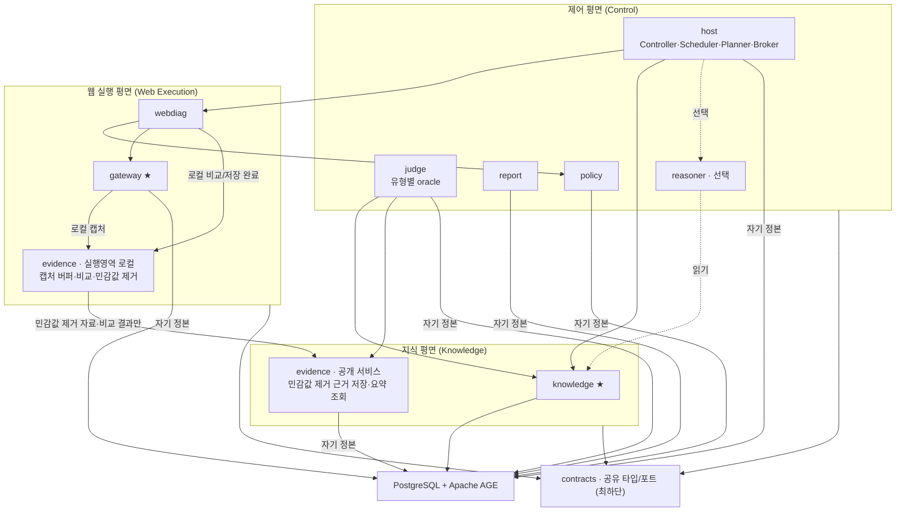
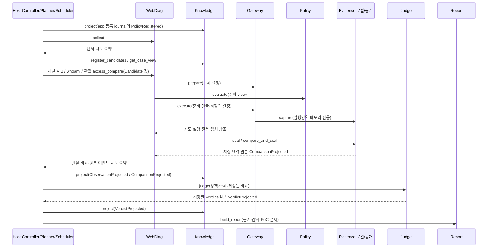

# ABC2LAB — 모듈 설계 (신규 저장소 · 최초 수직 슬라이스 포함) v0.3 (검토 반영)

- 작성일: 2026-10-20
- v0.2: 1차 피드백 — evidence 순환/원문 생명주기, 교차접근 불변식·블로커 승격, 전송 unknown 재현, 공학/연구 범위 주석, 슬라이스 S1/S2 분할·위임으로 KG 결정적화.
- v0.3: 2차 피드백 — **S2 위임 억제의 `DELEGATES` 간선은 등록 정책 출처만**(관찰 위임의 순환·공격자 오염 미탐 차단)·3갈래 판정, reachable 홉 상한 포트 계약화, `compare_and_seal` 명칭 통일, §13-2 D-0 승격.
- 검토 반영(2026-10-20): 제한/부분 조회의 미도달과 확정 가능한 부재 구분, 위임 적용 범위·명시 금지/불명 분리, 서비스별 DB 책임, 실행영역 내부 비교와 공개 근거 저장 분리, 공통 KG 기반 모델 평가 표현을 보정했다. 문서 판 번호와 기존 절 번호는 유지한다.
- 실행 규격 보완(2026-10-21): I/O 서비스 포트는 async, 순수 계산·유한 메모리 인계는 sync로 구분한다. Host 유한 큐·S1 worker 1개와 취소/timeout·동시성·자원 정리의 구체 기준은 [S1 API 설계 v0.5](s1-api-spec.md#22-비동기-호출과-작업-실행)에 기록한다. [PoC 보고서 계약](poc-report-design.md)은 실행 근거와 등록 요청 레시피를 연결하며 보고 작성 중 재전송하지 않는다. 팀 리뷰에 따라 Host의 Knowledge 호출 조정과 contracts의 결정적 fingerprint codec 소유권을 명시했다.
- **구현 기준:** 포트/어댑터·조립 루트·S1/S2 골격은 유지한다. 상세 wire schema·배포 구성과 검증 fixture는 아래 의미 계약을 따라 확정하며, 구현 중 드러나는 결함은 고친다. 이 문서는 구현 착수 기준이며 설계/구현/검증의 완료 선언이 아니다.
- 기준 문서: [mcp-architecture.md](mcp-architecture.md), [mcp-tool-catalog.md](mcp-tool-catalog.md). 충돌하면 아키텍처가 이긴다.
- 구현 저장소 방향: **별도 신규 레포에서 그린필드로 구현한다.** 초기 설계 기준으로 위 아키텍처·도구 카탈로그와 이 모듈 설계 문서 3개를 가져간다. 기존 레포의 코드/계약을 호환·이관하는 방식은 전제하지 않는다.
- 참조 표기: §6.2·§8.1~8.4·§11.1/11.3/11.4처럼 소수점이 있는 절 번호는 기준 아키텍처 문서의 절이다. §1~§14와 §13-5 같은 항목 표기는 이 문서 안의 절/목록을 가리킨다.
- 성격: 아키텍처 §4 논리 구성요소를 **코드 패키지 경계·의존 방향·공개 포트**로 내린 구현 설계. 설계 기록이며 구현 완료·성능 검증이 아니다. wire schema·DB 테이블·enum 최종값은 각 패키지 후속 계약에서 정한다.
- 하드코딩 금지: 예시 값(계정 A/B, 자원 X, `/orders/{id}`)은 설명용. 대상 앱 URL·셀렉터·필드명·계정 ID는 코드가 아니라 등록 프로필/설정으로 받는다.

## 0. 이 문서가 확정한 것 (세 설계 병합)

세 초안을 레벨별로 합쳤다.

- **뼈대 = 백지 모듈설계(greenfield):** uv 워크스페이스 멀티패키지 + 포트/어댑터 + 조립 루트. 의존/import 검사로 내부 구현 접근을 검증하고, 대역↔AGE·직접↔MCP·외부↔로컬 모델 교체를 포트 뒤에 둔다. 슬라이스와 목표 제품은 같은 책임 경계를 사용하며 실제 프로세스/통신/DB 권한은 배포·실행 경계에서도 검증한다. 다른 모듈 내부 import 금지·공개 계약으로만 독립 테스트하는 원칙을 유지한다.
- **오라클·통제 평면 계약 = 슬라이스 계약설계(vertical-slice-design):** 읽기 수평 IDOR 오라클 (a)(b)(c)·정규화·HMAC·보수적 판정과 2단계 통제 평면을 계약 수준으로 채웠다(§6·§7).
- **구체성 = 슬라이스 모듈설계(slice):** 공개 포트 시그니처·단일 통신구/단일 DB·import 경계 테스트·구현 순서를 가져오되 아래 결함은 폐기·교체했다.

**폐기한 것 (slice 초안의 오라클 결함 — §7 상자 참조):** `BA==AA ∧ BA≠BB` HMAC 매치를 확정 근거로 쓰는 4응답 오라클, R_BB(공격자 자기 객체) 필수화, `OWNS`의 관찰 투영, `GET/HEAD만`으로 읽기전용 보장. 아키텍처 §11.4·§6.2와 정책/Gateway의 요청별 검증 원칙을 따른다.

---

## 1. 설계 결정

1. **uv 워크스페이스(모노레포 · 다중 패키지).** 아키텍처의 "각 구성요소는 공개 계약·대역으로 독립 테스트하며 다른 구성요소 내부 코드·Schema·utils를 가져다 쓰지 않는다"를 패키지 경계로 강제. 내부 import는 의존 선언이 없어 즉시 드러난다.
2. **패키지 경계 = 담당자 경계.** 팀의 "남의 모듈 폴더 안 고침·필요하면 그 담당자 리뷰 PR" 규칙을 패키지 단위로 적용한다. 한 사람이 여러 패키지를 맡을 수 있으며, 담당자↔패키지 매핑은 §13-1과 [모듈 개발 가이드](../module-development.md#담당-배정)에 기록한다.
3. **포트·어댑터(헥사고날).** 각 서비스는 포트(Protocol)를 노출하고 코어 구현을 둔다. MCP 서버는 포트 위 어댑터 하나일 뿐. 슬라이스는 직접 호출로 시작, MCP는 코어 변경 없이 덧댄다.
4. **조립 루트(composition root)를 별도 패키지로.** 어떤 코어도 다른 코어를 직접 생성하지 않는다. `app`이 구현을 포트에 주입한다. 인메모리 대역↔AGE, 대역 Gateway↔실제 Gateway, 외부↔로컬 모델을 여기서 교체. 슬라이스·평가·운영이 같은 코어에 다른 조립만 쓴다.
5. **의존은 아래로만.** `contracts`가 최하단(아무것에도 의존 안 함). 위 계층은 아래 계층의 **포트**에만 의존(구현 의존 금지, 의존 역전).
6. **기본 로컬 배포 = `app`·`ollama`·`db` 세 컨테이너.** [로컬 웹 배포 구성](local-deployment.md)을 따른다. 화면·API·진단 worker와 Control/Knowledge/Web Execution의 서비스 구현은 `app`, 로컬 모델은 `ollama`, PostgreSQL+AGE는 `db`에 둔다. 패키지마다 컨테이너를 만들지 않는다. `evidence`의 실행 로컬 비교기와 공개 저장/조회는 각각 Web Execution과 Knowledge의 논리 책임을 유지하며 원문을 Control/UI/모델에 전달하지 않는다. 같은 컨테이너에 있어도 서비스별 DB 역할·범위와 실행 권한을 검증하고, 프로세스 분리 시 직렬화·인증·인가·취소/실패 계약을 추가 검증한다.
7. **새 레포와 작업 지침.** 기존 레포의 팀 작업·실행 결과·이력은 보존하고 신규 레포의 실행/검증 경로를 독립적으로 구성한다. 공통 규칙은 [CONTRIBUTING.md](../../CONTRIBUTING.md), 개인 AI 하네스는 각자의 로컬에서 현재 설계에 맞춰 관리한다. 옛 8모듈·Neo4j·기존 JSON/명세 계약·담당 매핑을 그대로 복사해 새 설계의 제약으로 만들지 않는다. 관찰/교차 검증 책임 분리·정책/Gateway 통제·비밀 보호·근거/감사·GT 분리는 유지한다. 검증된 처리 메커니즘을 가져오는 경우에도 새 포트/계약과 실행 환경에서 재검증한다. 신규 레포 선택 자체는 진단 성능 입증이 아니며 S1/S2와 H1 평가는 그대로 수행한다. 레포 이름·원격 주소·초기 CI 등 생성/운영 세부는 후속 작업으로 정한다.

---

## 2. 워크스페이스 레이아웃

```
abc2lab/                     # uv workspace root (pyproject.toml: [tool.uv.workspace])
├── packages/
│   ├── contracts/           # abc2lab-contracts — 공유 타입 + 포트 Protocol (최하단)
│   ├── host/                # abc2lab-host — Controller·Scheduler·Planner·Broker
│   ├── knowledge/           # abc2lab-knowledge — Service·Projector·Store(·Fingerprint:후속)
│   ├── evidence/            # abc2lab-evidence — 실행영역 로컬 캡처/비교 + 공개 민감값 제거 근거 저장/조회
│   ├── webdiag/             # abc2lab-webdiag — Discovery·Observe·Access·Auth(·Checks:후속)
│   ├── policy/              # abc2lab-policy — Safety Policy
│   ├── gateway/             # abc2lab-gateway — Web Execution Gateway + Credential Vault
│   ├── judge/               # abc2lab-judge — 유형별 oracle(판정 코드) + 독립 판정
│   ├── reasoner/            # abc2lab-reasoner — Context·Adapter·Agent (선택·Phase)
│   ├── report/              # abc2lab-report — 결과 + 감사 타임라인
│   ├── mcp-knowledge/       # KnowledgePort의 MCP 어댑터 (Phase 2)
│   └── mcp-webdiag/         # WebDiagPort의 MCP 어댑터 (Phase 2)
├── app/                     # abc2lab-app — 조립 루트·엔트리포인트(의존성 주입)
├── ui/                      # 사용자 그래프 화면 (R18, 별도 빌드, Phase)
├── target-app/              # 평가용 테스트 앱 (소유 격리 fixture)
├── eval/                    # 평가 하네스 + 코퍼스 (GT는 평가기만 읽음, 1급 작업)
└── pyproject.toml           # 워크스페이스 정의
```

각 패키지는 자기 `src/`·`tests/`를 가지며 `uv run pytest`로 검증. 패키지 간 의존은 각 `pyproject.toml`의 `dependencies`에 선언한 공개 패키지에만 건다.

---

## 3. 포트·어댑터 구조 (한 패키지의 내부)

모든 서비스 패키지가 같은 형태. `knowledge` 예:

```
packages/knowledge/src/abc2lab_knowledge/
├── core/              # 순수 도메인 로직. 외부 I/O 없음. contracts에만 의존
│   ├── service.py     #   관찰 투영·후보 레지스트리·revision 검증
│   └── projector.py   #   정본 → AGE 반영 (KG에 쓰는 유일한 주체)
├── adapters/
│   ├── store_age.py   #   Knowledge 소유 정본/AGE 어댑터 (AGE 접속·Cypher를 소유)
│   └── store_memory.py#   인메모리 대역 (슬라이스·독립 테스트용)
└── ports.py           # 제공/요구 포트 재export (정의는 contracts)
```

포트(Protocol)는 `contracts`에 모은다. 실행 전용 포트/타입은 공개 직렬화·MCP 노출 계약과 구분한다. 형 정의를 공유한다고 실행영역 접근 권한을 부여하는 것은 아니다. `host`는 `knowledge` 구현이 아니라 `KnowledgePort`에만 의존하고 구체 어댑터는 `app`이 선택·주입한다.

- 슬라이스: `store_memory` 주입 → DB 없이 전 경로 검증.
- 운영: `store_age` 주입 → PostgreSQL+AGE 영속.
- MCP 단계: `mcp-knowledge`가 `KnowledgePort`를 MCP 서버로 감쌈. 코어 그대로.

`host`·`policy`·`gateway`·`judge`·`report`와 Evidence 저장 서비스도 자기 정본용 저장 포트/어댑터를 갖는다. 각 어댑터는 자기 스키마·DB 역할만 사용하고 다른 서비스 정본이나 AGE를 직접 쓰지 않는다. Knowledge 어댑터의 독점 범위는 AGE 그래프 접속·등록 그래프 질의이며 PostgreSQL 전체 접속이 아니다.

포트 목록 전체를 MCP Tools로 노출하지 않는다. 카탈로그의 기존 2서버/10도구와 작업별 노출 프로필을 유지하며 `reachable_subjects`는 `kg_query_subgraph`의 등록 질의 뒤에서 쓰는 도메인 기능이다. Projector 쓰기·정본 저장·실행 전용 캡처/비교 포트는 모델에게 노출하지 않는다.

---

## 4. 계층과 의존 방향

위에서 아래로만. 위 계층은 아래의 **포트**에만 의존.



규칙:
- **`gateway`(★)만 대상 웹에 통신한다.** `webdiag`의 실행 기능이 내부 `GatewayPort`를 호출하며 `judge`·`reasoner`는 대상이나 Gateway를 직접 호출하지 않는다. 다른 어떤 패키지도 대상 HTTP 실행기(httpx/Playwright)를 직접 import하지 않는다.
- **각 서비스의 저장 어댑터만 자기 정본 DB에 접속한다.** `knowledge` 어댑터는 자기 정본과 AGE 접속·등록 그래프 질의를 소유한다. 다른 서비스는 자기 스키마·DB 역할로 정본을 저장하며 그래프는 `KnowledgePort`로 조회한다. DB 자격·raw SQL/Cypher를 공개 서비스 포트나 Host/LLM/UI 입력으로 넘기지 않는다. KG에 쓰는 건 검증된 `Projector`만.
- **`reasoner`는 점선 의존.** 없어도 전체가 동작. `knowledge` 읽기 포트·`host` 제안 접수 포트만 호출하고 `gateway`·`policy`를 직접 호출하지 못한다.
- **S1의 Knowledge 조정 호출자는 Host다.** WebDiag는 발견 단서·저장된 관찰/비교·원본 이벤트를 반환하고 Host가 후보 등록/조회·revision 검사·project를 수행한다. WebDiag에는 Knowledge 포트를 주입하지 않는다. Observation/WebDiag·Comparison/Evidence·Verdict/Judge·기대 정책/app 등록 journal의 원본 소유권은 유지한다. 구체 전달 필드는 [S1 규격 §3·§8](s1-api-spec.md#8-knowledge의-후보와-투영)을 따른다.
- **실행영역 비교(정규화+HMAC)는 `evidence`의 로컬 비교기에서 수행한다.** `gateway`와 같은 Web Execution 영역에 로컬 캡처 버퍼·비교기를 배치한다. `RawResponse`와 run HMAC 키는 이 영역 밖으로 반환·전송·영속 저장하지 않는다. 공개 Evidence 저장/조회 서비스는 민감값 제거 자료·비교 결과·근거 참조만 받는다. Judge도 원문이나 캡처 핸들을 받지 않는다(§5·§7).
- **evidence 주변 화살표 구분:** Gateway의 원문 캡처와 WebDiag의 비교 호출은 실행영역 내부 동작이며, 공개 Evidence로 향하는 화살표에는 민감값 제거 자료만 흐른다. Judge는 저장된 비교 결과·요약을 읽는다. **정규화 규칙은 `app`이 `judge` oracle에서 로컬 비교기에 주입**한다. evidence는 judge를 import하지 않고 규칙 타입만 `contracts`에 둔다(§13-6).

패키지 의존/import 검사는 구조를 검증하는 수단이다. 실제 대상 통신·DB 역할·공개 근거 접근은 실행 시 인가와 네트워크/프로세스 권한으로도 제한한다. 공개 포트는 배포 경계를 넘을 수 있지만 아래 실행 전용 포트는 같은 보호 실행영역에서만 조립하고 MCP나 원격 Evidence API로 노출하지 않는다.

---

## 5. 패키지별 책임·공개 포트

시그니처는 **의미 계약**이며 최종 필드는 후속 계약에서 확정한다.

| 패키지 | 아키텍처 구성요소 | 공개 포트(의미) | 정본 |
|---|---|---|---|
| `contracts` | 공유 타입·포트·결정적 계약 codec | `RunRef`·`TargetScope`·`ExpectedPolicy`·`CandidateEntry`·`Observation`·`EvidenceRef`·`CompareResult`·`PolicyDecision`·`Verdict`·`AuditEvent` + Port Protocol. 실행 전용 타입/포트와 외부 직렬화 허용 계약은 구분. [fingerprint codec](fingerprint-contract.md)은 stdlib-only 순수 동작으로 한정 | 없음(데이터·순수 계약 함수, I/O·가변 상태 없음) |
| `host` | Scan Controller·Scheduler·Planner·Broker | `start_run`·`get_status`·`stop` / `submit`·`lease`·`complete`·`cancel` / `plan` / `tools_for`·`call` | **Task 상태** |
| `knowledge` | Knowledge Service·Projector·2 그래프 | `project`·`kg_query_subgraph`·`reachable_subjects`·`register_verdict_event` | 발견 후보·관찰 그래프 |
| `evidence` | 실행영역 로컬 캡처/비교 + 공개 Evidence Service | 실행 전용 `capture`·`seal`·`compare_and_seal`; 공개 `store_evidence`·`evidence_read_summary` | 공개 저장 서비스의 민감값 제거 근거·비교 결과. 원문/키는 실행영역 임시 메모리만 |
| `webdiag` | Web Diagnostic(관찰·비교·인증) | `collect`·`web_observe`·`http_observe`·`access_compare`·`acquire_session`·`whoami` | 세션 상태 |
| `policy` | Safety Policy | `evaluate(plan, ctx) -> PolicyDecision` | 정책 판정 |
| `gateway` | Web Execution Gateway + Vault | 실행 전용 `execute(plan, decision) -> CapturedObservation` | 요청 시도 |
| `judge` | Independent Judge + 유형별 oracle | `judge(JudgeRequest) -> JudgeResult`; app이 주입한 `JudgePolicyReader`를 소비 | 판정 |
| `reasoner` | AI Reasoner·Context Builder·Model Adapter | `build_context`·`infer` (선택·제안만) | 없음 |
| `report` | Report Service | `build_report(run) = 결과 + 감사 타임라인` | 보고 |
| `mcp-*` | MCP 서버 2개 | 포트를 MCP Tools로 노출(얇은 어댑터) | 없음 |

**정본 소유:** 같은 PostgreSQL을 써도 각 패키지는 자기 스키마·DB 역할만 쓴다. `knowledge` store 어댑터가 AGE 그래프 쓰기·등록 질의를 소유, 나머지는 자기 정본 테이블만.

원본 서비스의 정본 변경과 발행할 변경 참조는 같은 트랜잭션으로 저장한다. Projector는 신뢰된 변경 참조를 받아 출처/범위/원본 revision을 검증하고 AGE 변경과 반영 완료 기록을 원자적으로 저장한다. 서비스 정본의 작성 권한이나 완료 상태를 Knowledge로 옮기지 않는다. 인메모리 대역은 저장/조회 계약의 독립 시험용이며 실제 내구성·복구 완료를 증명하지 않는다.

핵심 포트 시그니처 발췌(의미 계약, 전체 wire/type 정의 아님):

```python
# webdiag — 교차 요청은 여기서만. 관찰(web/http_observe)은 자기 자원만.
class WebDiagPort(Protocol):
    def acquire_session(self, account: AccountRef) -> SessionHandle: ...
    def whoami(self, h: SessionHandle) -> SubjectId: ...        # 로그인 성공 ≠ 주체 일치
    def access_compare(self, resource: ResourceRef,
                       owner: AccountRef, attacker: AccountRef,
                       policy_ref: str) -> AccessCompareResult: ...
    # attacker 자기 객체 보유를 요구하지 않는다. 교차 요청도 policy+gateway 통과.

class PolicyPort(Protocol):
    def evaluate(self, plan: RequestPlan, ctx: RunCtx) -> PolicyDecision: ...
    # 기본 거부. 결정은 구체 요청·프로필·예산에 바인딩. 모델 선언만으로 허용 안 함.

class GatewayPort(Protocol):
    # 실행영역 내부 포트. CapturedObservation = 최소 관찰 메타데이터 + 불투명 CaptureRef.
    # RawResponse를 반환하지 않으며 CaptureRef도 Host/LLM/UI/공개 MCP 결과에 넣지 않는다.
    def execute(self, plan: RequestPlan, decision: PolicyDecision) -> CapturedObservation: ...
    # 유일한 대상 통신구. 전송 직전 목적지·리다이렉트·하위요청 재검사. send_status 기록.

class ExecutionEvidencePort(Protocol):
    # 같은 Web Execution 영역의 로컬 포트. 원문은 이 버퍼에만 일시 보유한다.
    def capture(self, resp: RawResponse, ctx: CaptureContext) -> CaptureRef: ...
    def seal(self, capture: CaptureRef) -> EvidenceRef: ...
    def compare_and_seal(self, baseline: CaptureRef, cross: CaptureRef,
                         norm_rule_ref: str
                         ) -> tuple[EvidenceRef, EvidenceRef, CompareResult]: ...
    # 버퍼의 두 원문을 검증해 비교 → 민감값 제거 → EvidencePort로 저장 완료 → 참조/비교 결과 반환.
    # 정규화 규칙과 run HMAC 키는 실행영역에서 resolve한다. 키를 호출 인자·공개 결과에 넣지 않는다.

class EvidencePort(Protocol):
    # Knowledge 배치의 공개 서비스. RawResponse/CaptureRef/run키 입력은 거절한다.
    def store_evidence(self, bundle: RedactedEvidenceBundle) -> EvidenceBundleRef: ...
    def evidence_read_summary(self, ref: EvidenceRef, ctx: ReadContext) -> EvidenceSummary: ...
    # 호출자·조직/대상/run·자료 권한·출처를 검증하고 불변 근거와 비교 결과를 저장/조회한다.

class KnowledgePort(Protocol):
    def reachable_subjects(self, ctx: AuthorizationQueryContext,
                           limits: QueryLimits) -> ReachabilityResult: ...
    # 정책/자료 snapshot·적용 자원/동작·시점·위임 조건과 최대 홉/조회량/시간을 검증한다.
    # 도달/확정 가능한 미도달/판단불가와 지연·제한·완전성·근거 경로를 구분한다(§7).

class JudgePort(Protocol):
    async def judge(self, request: JudgeRequest) -> JudgeResult: ...
    # C4-B: CONFIRMED / SUSPECTED / UNDECIDABLE / ALLOWED. 정책은 주입된 등록 reader로 확인.
```

**캡처와 비교의 생명주기:** Gateway가 응답 수신 후 로컬 `capture`를 호출해 원문을 실행영역 메모리에 보관한다. `CaptureRef`는 run·대상·요청·계정/세션 세대·관찰 시점에 바인딩하고 실행영역 밖으로 내보내지 않는다. WebDiag의 `access_compare`가 내부 Gateway로 기준/교차 요청을 조정하고 두 캡처 참조로 `compare_and_seal`을 호출한다. Host는 이 작업을 요청할 뿐 원문/캡처 참조를 중계하지 않는다. 일반 관찰은 로컬 `seal` 후 민감값 제거 `Observation`·`EvidenceRef`만 반환한다.

로컬 비교기는 주입된 정규화 규칙·canary와 원문을 검증하고 run 키로 비교한 뒤, 민감값 제거 자료만 공개 Evidence 서비스에 저장한다. 두 근거와 비교 결과의 저장 완료를 확인한 뒤 외부에 결과를 반환한다. 일부 저장만 성공하면 남은 근거는 불변으로 보존하고 미완료/실패를 기록하며 확정 가능한 비교 결과로 발행하지 않는다. 원문 캡처는 작업의 제한된 보유 시간·메모리 상한 안에서만 유지하고 완료·실패·취소·만료 때 해제한다. 버퍼/참조 만료·상태 혼입으로 비교할 수 없으면 제한을 기록하며 공개 근거에서 원문을 복원하거나 무단 재요청하지 않는다. run 키는 메모리에만 두고 run 종료 때 폐기한다. 상세 TTL/메모리 수치·정리 방식은 후속 실행 계약으로 고정한다.

`CompareResult`에는 해시/일치 결과뿐 아니라 기준/교차 각각의 의도한 계정·세션 세대와 같은 대상 객체의 맥락 확인, 정상/오류/로그인/반사 대조, 비자명 객체 구분 근거의 충족/불충분, 정규화/오라클 버전·검증된 근거 참조를 연결한다. 기준 계정과 교차 계정이 같아야 한다는 뜻은 아니다. 원문/비밀값을 넣지 않고 HMAC 일치 자체를 확정 조건으로 삼지 않는다. Judge는 신뢰된 비교 결과의 출처·참조·조건을 검증해 (a)(b)(c)를 각각 판정하며, 민감값 제거로 객체 구분 근거가 사라졌거나 확인할 수 없는 경우 관찰 충분성을 유보한다.

---

## 6. 통제 평면 계약 (차별점 A: 2단계·단일 경계)

모든 대상 통신은 Safety Policy(전송 전) → Execution Gateway(전송 시점) 단일 choke point를 지난다.

**1단계 — Safety Policy (전송 전):**
- 입력은 **구체 실행 계획**(대상·method·인증 참조·프로필·예산). 추상 의도 아님.
- 기본 거부. `allow`는 그 구체 요청·프로필·예산에 **묶여서만** 유효. block은 사유 포함. 이 슬라이스엔 require_approval 없음(읽기 전용).
- 읽기 전용은 **읽기 전용 프로필 + 업무 쓰기 차단**으로 보장한다. GET/HEAD 허용은 필요조건이지 "무변경" 보장이 아니다([아키텍처 §8.1](mcp-architecture.md#81-허가-자산과-실행-범위): 메서드만으로 무변경 판단 금지). 가입·비밀번호 변경·MFA 등록·업무 데이터 생성/수정/삭제는 인증 예외에 넣지 않고 차단.
- 출력 allow/block은 불변 기록 → 감사의 "정책" 행. allow ≠ 전송(별개 기록).

**2단계 — Execution Gateway (전송 시점):**
- allow 결정과 실제 요청의 일치 재확인. 불일치(목적지·method·범위 변경)면 전송 안 함.
- 재검사 대상: 실제 연결 주소·Host/SNI·origin·인증 결합·동적 바인딩·**리다이렉트·재시도·브라우저 하위 리소스·XHR/fetch·Worker**. HTTPS는 구체 요청을 보는 실행 훅/검사 프록시로 검사(암호 터널 통과만으로 통제라 하지 않음).
- effective_origins 밖이면 리다이렉트 이후 주소라도 차단(A10). 예산 원자 차감.
- **전송 상태 3값:** sent / not-sent(차단·전송 전 종료) / **unknown**(전송 중 장애로 불명). unknown은 미전송/안전으로 집계 금지, 자동 재전송 금지. 추가 확인은 원 시도·불명 사유를 연결한 별도 후속 작업으로 현재 정책/인증/예산 재검사.
- 전송 전 의도+정책 판정을 내구 기록 못 하면 새 대상 요청 중지(§8.2).

**교차 접근 불변식(확정):** 다른 사용자 자원에 대한 교차 요청은 **오직 `access_compare` 안에서만** 수행한다. 실제 전송의 단일 관문·통과 조건·확인 책임자·적용 시점은 **§13-2**에서 정의한다. `web_observe`·`http_observe`는 자기 자원만 관찰하며 이 관문을 우회하는 교차 요청 창구로 쓰지 않는다.

**전송 unknown 재현:** gateway 대역에 "응답 수신 전 연결 끊김"을 주입해 unknown을 재현하고 A23("전송 여부 불명을 0건으로 집계하지 않음")을 검증한다(§11 step2).

**통제 데모(A24):** 소유 격리 fixture·요청 기록 대역에서 (통제 없는 대역이 만들 요청) vs (제품 경로의 차단·사유·금지 전송 0건·업무 상태 불변)을 나란히, 정상 허용 관찰도 함께 성공시켜 "전부 막음"과 구분.

---

## 7. 확정 오라클 — 읽기 전용 수평 IDOR (judge 패키지)

> **⚠ slice 초안에서 폐기한 것:** `BA==AA ∧ BA≠BB`(해시 매치)를 **확정 근거로** 쓰는 4응답 오라클은 쓰지 않는다. 서버가 조회 없이 식별자만 반사해도(`{"id": 요청id}`) 두 식이 성립 → 입력 반사를 못 거른다([아키텍처 §11.4](mcp-architecture.md#114-지원-유형확정-한계통제-데모)). 이 비교는 **보조 신호**로만. R_BB(공격자 자기 객체)를 필수로 요구하지 않는다(아키텍처 §11.4: "B의 자기 주문 보유는 요구하지 않는다"). `OWNS`를 관찰로 투영하지 않는다("A가 X 조회"=관찰, "A가 X 소유"=정책 근거 필요한 결론, 아키텍처 §6.2).

CONFIRMED 조건은 셋이며 **모두 별도로 확인**한다. 유효한 직접/공유/위임 허용은 ALLOWED다. 정책 UNKNOWN이고 엄격한 신원·교차 데이터 조건이 충족된 경우만 SUSPECTED이며, 나머지 정상적인 근거 부족은 UNDECIDABLE로 보존한다. 원본·감사 검증 장애는 호출 실패와 구분한다. S1의 구조 조건과 결과 의미는 [C4-B Judge 계약](judge-c4-contract.md)을 따른다.

**(a) 기대 접근 정책** — 운영자가 신뢰된 창구에 사전 등록한 명시 정책(자원 종류·동작·허용/금지 주체·소유/공유/위임 예외·출처/버전·유효 범위)으로 정한다. 일반 웹 표시 문구·owner 필드·목록 차이를 명시 정책으로 자동 승격 금지. 보조 관찰 신호(비인증 요청 거부 등)는 정책 적용 여부 확인용일 뿐. [잔여 한계] 403은 자격 무관 이유로도 발생 → 거절 원인 확인된 범위에서만 단서. 공유/위임 미해소면 (a) 미충족. GT와 분리, 모든 비교군 동일 제공.

**(b) 유효한 계정 맥락** — A·B 둘 다 `whoami` 주체 확인(§8.3). 만료 의심·주체 불명이면 유보.

**(c) 대상 객체 식별 + 소유자 정상 접근 기준 + 교차 접근이 그 소유자 객체의 실데이터 반환** — 반사 배제 본근거 = "소유자 기준 응답이 식별자 외 **비자명 실데이터**를 담고, 교차 응답이 정규화 후 그 실데이터와 일치".
- 비자명 실데이터 = 요청 식별자·입력 반사·공통 템플릿 외에 대상 객체 실제 데이터임을 구분하는 필드/관계. 다른 객체 관찰로 값 차이를 확인했거나 등록 오라클의 검증된 객체 구분 근거가 있어야 함. **`owner_id` 단독·`id` 반사+`owner_id` 일치만으로는 불충족**(같은 소유자가 여러 객체 가능). 모든 객체 공통 값(status:"active" 등)도 비자명 아님.
- **HMAC 일치 자체는 확정 근거 아님** — 동적 필드(타임스탬프·조회수·CSRF)로 위음성, 동일 오류/템플릿 화면으로 위양성 가능. 정규화는 비교 신뢰성의 한 요소일 뿐 soundness 전부가 아님. 비교는 실행영역의 `ExecutionEvidencePort.compare_and_seal`이 수행하고 Judge는 원문 없이 해시/일치 결과·비자명 객체 구분 조건의 검증 상태·정규화/오라클 버전·근거 참조를 받는다(§5).

**(a)의 허용 주체 집합·위임 반증 — 정책 기반 관계 조회 통합(S2):** 등록 정책이 **정본**이다. 관찰된 그래프가 정책의 허용 범위를 넓히지 못한다. **반증에 쓰는 `DELEGATES` 간선은 등록 정책 출처만 사용하며 관찰/추론 간선은 정상 위임으로 승격하지 않는다.** 접근 성공 자체를 정상 권한의 근거로 되돌리는 순환과 공격자가 심은 관찰 관계에 의한 미탐을 차단한다.

이 절과 fixture에서 A는 소유자/정상 기준 주체, B는 교차 요청을 보내는 평가 주체, M·M1·M2는 중간 위임 주체다. `owner_subject`·`evaluated_subject`·`intermediate_subjects`를 구분하고, 다중 홉 사례는 A→M→B처럼 평가 주체 B가 경로 끝에 오도록 구성한다. 이는 예시 별칭이며 제품에서 고정 계정 ID로 쓰지 않는다.

`AuthorizationQueryContext`는 조직·대상/환경·run, 대상 자원/소유 범위와 동작, 소유/기준 주체와 평가할 계정/역할, 판정 시점, 정책 참조/버전·적용 범위·예외, 일관된 자료/graph revision을 연결한다. 간선의 등록 출처만 확인하고 모든 위임을 합치지 않는다. 각 홉의 자원/동작 범위·주체/역할 조건·유효기간/취소 상태·재위임 허용과 충돌/우선순위를 해당 정책으로 검사한다. 경로가 길어진다고 권한 범위가 넓어지지 않으며, A→M→B 경로가 있어도 중간 주체 M의 재위임 허용을 확인하지 않고 B의 권한을 가정하지 않는다. 적용 조건을 확인할 수 없으면 그 경로는 정상 위임의 반증으로 사용하지 않는다.

`reachable_subjects(ctx, limits)`는 유한 최대 홉·노드/관계/반환량·시간 상한으로 조회한다. `ReachabilityResult`는 유효한 도달 경로, 확정 가능한 미도달, 판단불가를 구분하고 정책/graph revision·적용 조건·근거 경로와 완전성/최신성·제한 사유를 반환한다. 정책 정본이 정의한 해당 범위의 허용 관계가 완전하고, 그 버전이 그래프에 반영됐으며, 관련 탐색을 누락 없이 마쳤을 때만 미도달을 부재 근거로 쓴다. 홉/시간/반환량 제한·미투영/지연·자료 만료·접근 제한으로 누락된 결과를 빈 정상 결과로 바꾸지 않는다.

**조회 상한과 정책상 허용 깊이는 다르다.** 정상 위임이 3홉이고 실행 상한이 2홉이면 B를 못 찾았어도 미도달 확정이 아니라 판단불가다. 반면 현재 등록 정책 자체가 유효 위임 깊이를 2홉으로 제한하고 그 범위가 완전하게 반영/조회됐다면 그 정책 범위의 부재를 확인할 수 있다. 하나의 유효 경로로 도달을 입증하는 것과, 모든 관련 허용 경로가 없음을 확인하는 데 필요한 완전성도 구분한다.

판정 의미는 다음과 같다. 아래 표는 S2 정책·그래프 의미를 설명하는 설계 배경이다. C4-B에서 확정한 `ALLOWED`·`SUSPECTED`·`UNDECIDABLE` 구조 조건과 ReasonCode는 [Judge C4-B 계약](judge-c4-contract.md)을 따른다.

| 정책/조회 조건 | (b)(c)와 추가 전제 | 판정 의미 |
|---|---|---|
| 현재 정책이 B의 접근을 명시 금지하고 공유/위임을 포함한 예외·충돌이 해소됨 | (b)(c) 충족 | **CONFIRMED**. 위임 명시 불허는 위임 여부 불명과 다르며 S1의 확정 경로를 유지 |
| 현재 정책이 위임을 허용하고 해당 자원/동작/시점에 유효한 정책 출처 경로로 B 도달 | 반증 경로와 정책/실제 계정·자원 맥락 확인 | **ALLOWED**. 해당 인가 위반 가설의 반증이며 웹 전체가 정상이라는 뜻은 아님 |
| 위임 허용 정책의 해당 범위가 완전하고 유효한 경로가 없음 | 다른 허용 주체/공유/예외도 해소돼 B가 금지 대상임을 확인하고 (b)(c) 충족 | **CONFIRMED**. 단순한 빈 경로 결과만으로 확정하지 않음 |
| 정상적으로 확인된 정책/예외 UNKNOWN 또는 관찰·조회 한계 | (b)(c)와 비교·근거 ref를 독립 확인 | **SUSPECTED**는 정책 UNKNOWN·서로 다른 검증 주체·교차 데이터 YES·비교/근거가 모두 있을 때만 가능. 신원/데이터도 부족하면 **UNDECIDABLE** |
| 원본 변조·출처 검증 실패·읽기 장애 | 검증 자체의 실패 사유 보존 | **JudgeResult.FAILED**. 정상적인 정책 부재나 판단불가로 숨기지 않음 |

S2는 정책 출처·적용 조건·제한/완전성·근거 경로가 판정과 반증에 연결되는지를 검증한다. 그래프 표현/AGE가 관계 테이블·재귀 CTE보다 우수하거나 필수라는 증명이 아니다. KG 채택은 유지하고 비교 우위 실험은 추가하지 않는다. 질의 의미·홉 상한·revision·간선 출처와 완전성은 §13-5를 따른다.

**정규화 규칙** (프로그램이 관찰로 도출·검증, 모델이 제외 필드 자유 결정 금지):
1. 같은 소유자·객체·인증 맥락 정상 조회 2회+ 관찰로 변동 필드 후보 수집(변동만으로 자동 삭제 안 함).
2. 식별·권한·비자명 판정 필드 보존(금액·업무 상태·권한은 잡음 제거 금지). 업무/인증 변화 의심되면 기준 재확인, 미해소 비교는 유보.
3. 알려진 쌍 canary로 같은 객체 일치/다른 객체·오류·로그인 응답 구분 확인. 정규화로 구분 근거 사라지면 확정 안 함.
4. 규칙 버전·제외 필드 경로/사유·관찰 참조를 비교 근거에 연결.

**공격자 자기 응답 유무 (corroboration, 선택):**
- B 자기 응답 가능: `교차==소유자 ∧ 교차≠B자기`는 **보조**. 비자명 실데이터 검증 병행 필수.
- B 자기 객체 없음: 소유자 기준과의 비자명 실데이터 일치로 판정. 보조로 없을 법한 id의 통제 응답(R_ctrl) 비교 가능하나 부재 보장 불가 → 유효성·한계 기록. R_ctrl 미확보가 다른 충분 근거 검사를 막지 않음. 남는 반사·soft-404 위험 때문에 비자명 데이터 노출을 확인할 수 없으면 UNDECIDABLE이며 SUSPECTED로 승격하지 않는다.

**보조 근거(단독 확정 금지):** 목록 차이(필터·페이지네이션·공유 링크), id-echo(입력 반사).

**승격·강등:** 새 반례는 판정 낮춤. 추가 관찰이 모든 확정 조건 충족 시 SUSPECTED/UNDECIDABLE → CONFIRMED 승격 가능. 모든 변경은 오라클 버전·새 근거·사유·revision 연결, 과거 판정 덮어쓰지 않음.

**확정의 의미:** 현재 환경에 유효한 등록 정책 + 확보된 실행 근거에 따른 접근 권한 위반 판정. 정책 자체의 정당성 독립 입증 아님. 블랙박스라 진짜 소유권·특정 사용자와의 비공유는 독립 입증 불가 — 보고에 명시(§8.1·§11.4).

**Planner가 만드는 작업(보정):** 소유자 A 기준 관찰 작업 + `access_compare`(B→X 교차) 작업. B 자기 객체·R_ctrl 작업은 **확보 가능할 때 선택 보강으로** 추가(필수 아님). 4응답 고정 세트가 아니다.

---

## 8. 근거·감사 체인

- **근거 불변성:** 저장 완료 → 신뢰된 관찰 수신 → Projector 검증 → 그래프 갱신. 정정은 덮어쓰지 않는 새 revision.
- **감사 타임라인(§8.2):** 목표/가설 → 작업 → 정책 판정·사유 → 실제 요청 시도/관찰 → 근거 → 최종 판정. 차단·미실행·실패·취소·전송 unknown 포함. 가설 없는 기본 관찰은 탐색 목표에 연결.
- **완전성 확인:** 요청 ID별 기대 vs 실제(정책·전송·근거) 대조 + 생산자별 기대 시작/종료 순번. **건수·순번 일치만으론 완전성 보장 안 됨**(주입 A·B인데 기록 A·A여도 건수 맞을 수 있음). 확인 못 한 범위 unknown.
- **출처 분리:** 작업=Scheduler, 정책=Policy, 실제 요청=Gateway, 근거=Evidence, 판정=Judge 출처로 확인. 모델 설명·도구 성공 라벨로 실행 사실 보충 금지. 벽시계만으로 순서 단정 금지(단조시계·순번, §8.4).
- **AuditEvent(의미):** run·producer·seq·goal_ref·policy_decision·request_ref·evidence_ref·verdict_ref·UTC 시각·단조 경과. 전송 사건의 send_status는 sent/not_sent/unknown, 정책 사건의 policy_outcome은 allow/block이며 적용되지 않는 필드는 None이다. blocked를 전송 상태로 쓰지 않는다. 실제 필드는 [S1 감사 규격](s1-api-spec.md#10-감사-커밋과-조회)을 따른다.

---

## 9. 보안 불변식 = 모듈 경계 (이 설계의 핵심, 테스트로 강제)

말이 아니라 **패키지 의존·import 경계**로 강제하고 테스트한다.

- **대상 통신은 `gateway`만.** 다른 패키지는 HTTP 실행기를 import 안 함. (H3 / A6·A10)
- **서비스 정본 DB 자격은 각 서비스 저장 어댑터만, AGE 접속·Cypher는 Knowledge 어댑터만.** 자기 스키마/역할 밖 정본 쓰기와 공개 포트를 통한 DB 자격·raw SQL/Cypher 전달을 차단한다. (A9)
- **KG에 쓰는 건 `Projector`만.** Planner·Judge·(이후)Reasoner는 관찰/가설을 **제출**만. 근거 참조 없는 주장 거부. (A15)
- **원문 응답 값(`RawResponse`)·캡처 참조·HMAC 키는 Web Execution 로컬 비교기/버퍼 밖으로 안 나감.** 공개 포트 반환·전송·영속 저장·Control 전달 금지. `compare_and_seal`은 원문 비교 후 민감값 제거 근거/비교 결과를 저장하고 완료 참조만 반환한다. Judge는 원문 없이 조건 검증 상태·비교 결과·근거를 읽는다. 키는 메모리만·run 종료 폐기. (A12)
- **정규화 규칙은 `app`이 `judge`→`evidence`로 주입.** evidence는 judge를 import 안 함(순환 차단). 규칙 타입만 `contracts`.
- **교차 요청은 `access_compare`만.** 실제 전송 허용 조건의 정본은 §13-2이며 모든 교차 전송에서 확인한다. `web/http_observe`는 자기 자원만 관찰한다(§6 불변식).
- **정책 결정은 구체 요청에 바인딩, Gateway가 재검증**(이중 방어). 리다이렉트·하위요청도 같은 경계.
- **오라클 ≠ 확정.** judge가 (a)(b)(c)를 독립 확인한다. SUSPECTED는 정책 UNKNOWN과 검증된 서로 다른 A/B·교차 데이터 YES·비교/근거 ref를 모두 요구한다. 다른 정상적인 근거 부족은 UNDECIDABLE, 검증된 정책 허용은 ALLOWED다.
- **등록 질의는 유한 최대 홉·조회량/시간 상한**(무제한 `*0..` 금지, 아키텍처 §6.2). 상한과 정책 적용 맥락·완전성/최신성·제한 사유는 **포트 계약**이며 `store_memory`·`store_age`가 같은 의미로 반환한다. 제한에 걸린 미도달을 경로 부재로 바꾸지 않는다. 반증용 `DELEGATES` 간선은 등록 정책 출처와 해당 자원/동작/시점의 유효 조건을 모두 검증한다(§7 S2).
- **reasoner는 gateway·policy를 호출 못 함.** 의존/import 검사와 실행 시 호출 권한으로 제한하며 기본 경로는 모델 없이 완주한다. (A14)

---

## 10. 최초 수직 슬라이스 매핑 (LLM 없이)

목표: 등록 2계정 테스트 앱에서 읽기 수평 IDOR 한 건을 **발견 → 관찰 → 정책 → 판정 → 감사**까지 LLM 없이 관통.



조립: `app`이 Knowledge의 `store_memory`, 테스트 앱 대상의 실제 `gateway`, 실제 `policy`·`judge`와 필요한 서비스별 저장 어댑터를 주입한다. 여기서 `store_memory`는 그래프/관계 조회 대역이며 정책·요청 의도·감사까지 메모리만으로 처리하라는 뜻이 아니다. 실제 대상에 요청하는 S1도 전송 전 의도/정책을 내구 기록해야 하며, 이를 제공하지 못하는 메모리 대역 시험은 실제 통신 대신 Gateway 대역으로 수행한다. 최소 내구 기록의 저장/재시작·실패/중지 계약은 해당 어댑터에서 검증한다.

실행: Host의 in-process 유한 ready 큐와 비동기 worker 1개로 시작한다. 긴 I/O 중에도 get_status/stop을 처리하고, 같은 사례의 위 순서는 await로 보존한다. 세션 읽기와 실행 로컬 capture/release는 동기 메모리 포트이며, I/O를 포함하는 Policy/Judge/Report도 공개 서비스 포트는 async다. 이 절과 §5의 기존 시그니처는 기능 의미를 나타내며, 실제 포트의 async/def·필드·취소·상한은 [S1 상세 규격](s1-api-spec.md)을 기준으로 구현한다.

**이 슬라이스에서 안 쓰는 것:** `reasoner`·`mcp-*`·`webdiag/checks`(ZAP/Nuclei)·`knowledge/fingerprint`·`ui`·`store_age`(영속 AGE는 슬라이스 돈 뒤 §11). 단 S2의 `knowledge.reachable_subjects`(위임 도달성)는 `store_memory`로 실행한다(인메모리 그래프로도 유한 홉 질의 가능 — AGE는 여전히 뒤).

**적용 수용 기준:** A2·A5~A10·A12·A14~A16·A23~A26 중 해당 조건, A11의 취소/중복/예산. (A1·A3·A4·A13·A17~A22·A27은 제품 기준, 슬라이스 범위 밖 — 작은 슬라이스 통과가 이를 대체 안 함.)

**슬라이스가 검증하는 것 / 검증하지 않는 것:** S1은 단일 통신 경계·읽기 수평 IDOR 오라클·근거·감사의 해당 경로를 검증한다. S2는 정책 기반 다중 홉 관계 조회와 적용 조건·완전성·근거 경로가 판정/반증에 연결되는지를 검증한다. 모두 LLM 없는 공학 검증이며 작은 슬라이스의 통과가 전체 제품 기준을 대체하지 않는다. H1은 아키텍처 §11.1의 **공통 KG 기반 프로그램 기본선·외부/로컬 모델 비교**로 평가한다. 이 모듈 설계는 KG 제거 대조·관계형 대비 우위 실험을 추가하지 않으며 S2를 그래프 표현이나 AGE의 필수성/우수성 증명으로 설명하지 않는다.

---

## 11. 구현 순서

안전이 먼저. 각 단계의 해당 조건을 검증한 뒤 연결한다. 포트의 최종 wire 필드를 모두 정하기 전에 대역으로 수직 경로를 검증할 수 있으나 실제 대상 통신 전에 허가·정책·근거/감사·비밀 보호 경계를 갖춘다. 교차 요청은 §13-2의 단일 전송 관문을 적용하며 그 통과 여부를 대역 시험과 실제 전송에서 구분해 검증한다.

**S1 — 직접 (a)(b)(c) 수평 IDOR (공학 증명):**
1. `contracts` — [새 최소 계약 PR](s1-development-status.md)의 C1 fingerprint codec → C2 실행 타입·포트부터 경계별 정의. CLOSED/unmerged PR #8은 선행 구현이 아님. 모듈 내부 순수 로직은 병행하고 공개 fake는 해당 계약 병합 뒤 연결.
2. `gateway` + `policy`(대역) — 실행 경계부터. 전송 3상태·재검사·바인딩. **대역에 "응답 수신 전 연결 끊김" 주입 훅**으로 unknown 재현(A23).
3. `evidence` — 실행영역 로컬 캡처/비교기와 공개 민감값 제거 저장/조회 서비스를 구분한다. `compare_and_seal`의 원문 메모리/키 생명주기·저장 완료/부분 실패·정규화/HMAC·canary와 원문/캡처 참조의 영역 밖 비노출을 검증한다. 규칙은 app이 주입.
4. `webdiag/auth` + `webdiag/observe` — 두 계정 세션·whoami·자기 자원 관찰.
5. `webdiag/discovery` + `webdiag/access` — 후보 발견·`access_compare`. **step5의 `access_compare`를 실제 대상에 연결/교차 전송하기 전 §13-2 통과 필수**이며, 미통과 상태에서 이 기능의 개발/시험은 무전송 대역으로 한정한다.
6. `host` — controller·scheduler·planner·broker (Planner는 기준관찰+교차 작업, 4응답 고정 세트 아님).
7. `knowledge`(store_memory) — 관찰 투영(OWNS는 정책 근거 있을 때만 추론/검증 관계로).
8. `judge` — 수평 IDOR oracle (a)(b)(c) + 반례 fixture(순수 반사 서버·동적 필드·공유/위임·오류/로그인)로 보수적 판정 검증.
9. `report` — 감사 타임라인 + 완전성 확인.
10. `app` — 1~9 조립해 S1 슬라이스 완성. `target-app`·`eval` 구축.

**S2 — 정책 기반 위임 관계 조회·판정 통합:**
11. `knowledge.reachable_subjects`를 정책 적용 맥락·유한 상한·완전성/최신성·제한 사유를 포함한 포트로 구현한다. Judge의 (a)와 등록 정책 출처 관계 조회를 연결하고 아래 반례로 §7 판정 의미를 검증한다. 각 fixture의 자원/정책 입력은 평가 정답과 분리하고 제품 경로가 GT를 읽지 않게 한다.

| S2 fixture | 기대하는 판정 경계 |
|---|---|
| 해당 자원/조회 동작·시점에 유효하고 재위임이 허용된 A→M→B 정책 경로; 평가 주체는 B | 2홉 근거 경로로 해당 인가 위반 가설을 반증·억제 |
| A→M1→M2→B의 유효 경로는 3홉인데 실행 상한은 2홉; 평가 주체는 B | B 미도달 확정 금지, 제한 사유를 보존한 판단불가 |
| 시간/반환량 제한·그래프 미투영/지연·일부 자료 열람 불가 | 빈 정상 결과/위반 확정으로 바꾸지 않고 부분/실패·판단불가 표시 |
| 다른 자원/동작에만 유효하거나 만료/취소된 정책 간선 | 현재 접근의 정상 위임 반증으로 사용 금지. 나머지 유효 정책/예외·(b)(c)로 판정 |
| 정책이 B 접근과 공유/위임 예외를 명시 금지, (b)(c) 충족 | S1과 같은 CONFIRMED 경로 유지 |
| 위임 허용 정책의 해당 범위가 완전하고 유효 경로/다른 허용 예외가 없으며 (b)(c) 충족 | 완전성 근거를 연결한 CONFIRMED |
| 관찰 위임만 있고 등록 정책/예외가 불명인 오염 사례 | 관찰 간선으로 억제 금지. 정책 UNKNOWN이고 서로 다른 검증 주체·비자명 교차 데이터·비교/근거가 모두 있을 때만 SUSPECTED, 나머지는 UNDECIDABLE |

같은 의미의 fixture·상한·snapshot/프로필로 인메모리와 AGE 어댑터를 확인하며, 제한된 결과가 두 구현에서 일치해도 조회 완전성의 증명으로 바꾸지 않는다.

**이후:** `knowledge/store_age`(AGE 영속, §6.2 버전·대표 질의 먼저 확인) → `mcp-*` → `reasoner` → `webdiag/checks` → `ui`.

평가 코퍼스(둘 이상 라벨링·난이도 스펙트럼·사전 검정력)는 1급 작업으로 `eval`에 둔다(§11.3). 읽기 인가 fixture엔 같은 소유자 복수 객체·소유자 단일 객체·B 자기 객체 없음·동적 필드·오류/로그인 대조를 포함, 운영 중 객체 생성 금지.

---

## 12. 아키텍처 구성요소 → 패키지 매핑

| 아키텍처 §4 | 패키지 | 슬라이스 축소 |
|---|---|---|
| Scan Controller | `host`(controller) | 그대로 |
| Scheduler | `host`(scheduler) | in-proc 큐+예산 |
| Baseline Planner | `host`(planner) | 기준관찰+교차 패턴 |
| Tool Broker | `host`(broker) | 직접 함수 호출(모델 노출 X) |
| Safety Policy / Gateway | `policy` · `gateway` | 읽기 전용 프로필·단일폼 인증 |
| Evidence Service | `evidence` | 실행영역 로컬 비교기 + 공개 민감값 제거 저장/조회 서비스 |
| Knowledge Service·Projector·2그래프 | `knowledge` | 수평 IDOR 관계만, store_memory |
| Independent Judge + 유형 oracle | `judge` | 수평 IDOR 1종 |
| Report Service | `report` | 감사 타임라인 |
| 인증·세션(§8.3) | `webdiag`(auth) | 단일 폼/쿠키 |
| AI Reasoner·Context·Model Adapter | `reasoner` | 슬라이스 제외(선택) |
| MCP 서버 2개 | `mcp-*` | 슬라이스 제외(Phase 2) |
| 사용자 UI/API(§6.5) | `ui` | 슬라이스 제외 |

---

## 13. 열린 결정 (착수 전/중 팀이 잠글 것)

**착수 순서:** 교차 요청의 실제 전송에 대한 D-0 관문은 **§13-2 한 곳**에서 정의한다. §6·§9·§11은 이 항목을 참조하며 별도 통과 조건을 만들지 않는다.

1. **(확정) 패키지 ↔ 담당자 매핑.** 이동찬(관리자·PM): `contracts`·`app`·`knowledge`·루트 `eval/`; 최민준: `gateway`·`judge`·`policy`·`report`; 이경준: `webdiag`·`host`·`evidence`와 P2의 `reasoner`. 한 사람이 여러 패키지를 맡되 서비스 간 의존 경계는 유지한다. Evidence와 Judge, 평가 GT와 Judge의 담당 분리를 유지한다. 배정의 정본·계획 비중·P2 미배정 항목은 [모듈 개발 가이드](../module-development.md#담당-배정), 재배정 이력은 [2026-10-21 기록](../module-development.md#담당-재배정-2026-10-21)을 따른다. 기존 절·항목 번호는 유지한다.
2. **[D-0] 교차 요청 실제 전송의 단일 관문.** **교차 전송 허용 = 관찰/검증 역할 분리를 포함한 현행 적용 규정의 준수가 현재 유효한 확인 기록으로 연결됨(실제 충돌 규정이 있는 경우에만 필요한 개정/승인 완료 포함) ∧ 해당 대상/교차 진단의 허가와 등록 기대 정책 참조가 유효함 ∧ A·B의 계정 맥락이 유효함 ∧ 해당 구체 요청의 policy allow·Gateway 재검사를 통과함.** 하나라도 미확인/불충족이면 실제 교차 요청을 전송하지 않는다. 일반 요청의 예산·업무 쓰기 차단·내구 감사·비밀 보호 조건도 그대로 적용한다.

   **확인한 규정 내용:** 사용자 제공 CLAUDE.md(2026-10-20 확인)의 절대규칙#5는 “크롤러는 다른 역할·다른 사용자의 리소스를 일부러 요청하지 않는다. 교차 확인은 verifier의 일이다.”이다. 이는 교차 요청 전체의 금지가 아니라 관찰과 교차 검증의 책임 분리다. 따라서 이 역할 분리를 지키는 교차 검증을 위해 #5 자체를 개정해야 한다는 전제는 두지 않는다.

   **새 설계의 역할 대응:** 관찰 역할은 `web_observe`·`http_observe`이며 의도적인 타 사용자 자원 교차 요청을 수행하지 않는다. 기존 verifier의 교차 검증 실행 역할은 `access_compare`가 맡고 실제 전송은 Gateway로 제한한다. Judge는 실행 근거로 판정하며 직접 교차 요청을 보내지 않는다. 관찰/검증 기능이 같은 `webdiag` 패키지에 있어도 작업의 실행 프로필·호출 권한을 분리하고, 관찰 작업이 교차 검증 권한을 재사용하거나 관찰 호출을 교차 요청으로 바꾸지 못하도록 검사한다.

   **저장소 전제와 적용 범위:** 구현은 별도 신규 레포에서 시작한다. 그린필드 코드 설계는 현행 조직 규정 적용의 면제를 뜻하지 않으므로 새 레포/조직에 실제 적용되는 규정을 확인하고 §1-7에 따라 작업 지침을 작성한다. 위 사용자 제공본에서 확인한 관찰/검증 책임 분리 원칙은 유지하며, 옛 기술/계약 규칙을 그대로 복사해 적용하지 않는다. 적용 규정이 달라지거나 준수 여부를 확인할 수 없으면 그 변경 범위를 다시 확인한다. 실제 충돌 규정이 발견된 경우에만 필요한 개정/승인을 요구하며 #5의 역할 분리를 지키는 허가된 검증 자체에 새 승인 블로커를 만들지 않는다. 새 레포 생성이나 규정 내용 확인만으로 개별 대상의 진단 허가나 관문 통과를 추정하지 않는다.

   **확인 책임자와 시점:** 조직 규정상 권한 있는 프로젝트 관리자 또는 지정된 보안/운영 책임자가 적용 규정·관찰/검증 역할 분리·교차 진단 허용 범위를 확인하고, 실제 충돌이 있으면 필요한 개정/승인과 완료 근거를 확인한다. **step5의 `access_compare`를 실제 대상에 연결하기 전에 완료**한다. 그 전에도 step1~4의 대역 개발과 step5의 무전송 대역 구현/시험은 병행할 수 있다. 책임자가 누구인지 불명확하면 확인 완료로 처리하지 않는다.

   **확인 기록과 집행:** 규정 출처/버전·검토 책임자/시점·확인 결과/사유·필요 개정/승인 근거(불필요하면 그 사유)·대상/run 연결과 유효 범위/기간을 신뢰된 관리 창구에 기록한다. Controller/Scheduler는 이 기록을 교차 작업에 연결하고 Policy/Gateway는 전송 시 현재 유효성과 요청의 범위/참조를 검사한다. 규정/허가 변경·만료/취소·참조 불일치·확인 기록 부재는 관문 미통과로 처리하고 차단/사유를 감사에 남긴다. 모델 설명·실행 도구의 성공 표시·이 설계 문서 작성만으로 관문 통과를 선언하지 않는다. 이는 실행 전 확인 계약이며 새로운 MCP 서버/도구나 관문 우회 승인 흐름을 추가하지 않는다.
3. **자원 식별자/본문 저장 범위.** (c) 비교를 `compare_and_seal`로 하니 현행 저장 규칙(키 구조+타입만) 유지로 닫음. 공지.
4. **세션 공개 창구 규약.** `webdiag`(세션 소유)↔judge/host 접근 방식·만료·대여/반납·종료. 대여/복구 유한값 고정.
5. **KG 등록 질의 계약.** query_key(① 자원 소유/접근 관찰 ② 계정 역할/별칭 ③ 소유/위임 체인 도달성)·rows·graph_revision·제어 응답 형식을 고정한다. `AuthorizationQueryContext`의 조직/대상/run·자원/동작·계정/역할·판정 시점·정책 버전/범위/예외·간선 출처/유효 조건과 `QueryLimits`의 유한 최대 홉·조회량/시간을 검증한다. `ReachabilityResult`는 유효 경로·확정 가능한 부재·판단불가와 자료 완전성/최신성·미반영/제한 사유·근거 경로를 구분한다. 정책 정본의 해당 범위 완전성과 그래프 반영/조회 완전성은 별도로 확인하며 같은 포트 의미를 두 어댑터에 적용한다(§7 S2).
6. **(확정) 정규화 규칙 소유·주입.** 비교 실행은 `evidence.compare_and_seal`, 규칙 정의·버전·canary는 `judge` oracle 소유, `app`(조립 루트)이 judge 규칙을 evidence에 주입. 규칙 타입은 `contracts`. evidence는 judge를 import 안 함(§3·§4·§5). 더 이상 열린 항목 아님.
7. **uv 워크스페이스 툴링.** editable install·cross-package 버전·CI 파이프라인. 관리자 초기 설정 범위.
8. **저장소 버전 고정.** PostgreSQL/AGE 버전·이미지 digest(PoC는 PG16·AGE1.6.0). 관리자 작업, §6.2 대표 질의 재현 후.
9. **보고 출력 형식.** diagnosis_report + 로컬 HTML/PDF 여부 — report 담당.

---

## 14. 확장점 (어디에 꽂히나)

- **LLM 보강:** `reasoner` 패키지. 같은 `knowledge` 읽기·`host` 제안 포트만. gateway/policy 직접 호출 불가, 기본 경로 안 막음.
- **MCP 래핑:** `mcp-knowledge`·`mcp-webdiag`가 카탈로그의 공개 도구/허용 프로필만 노출한다. 실행 전용 캡처/비교·정본/Projector 쓰기를 노출하지 않고 기존 2서버/10도구를 유지한다. 코어 재구현 없이 전송·인가/오류 계약을 검증한다(§3·§5).
- **유형 확장:** `judge/oracles/`에 수직 IDOR·업무 흐름 oracle 추가. 일반/주입형은 `webdiag/checks`(ZAP/Nuclei) 어댑터.
- **Fingerprint Memory(§6.3)·그래프 시각화(§6.5):** `knowledge`·`ui`에 검증 후 도입.
- **영속·배포:** `knowledge/store_age` 주입 교체와 [app/ollama/db 로컬 웹 패키징](local-deployment.md). 패키지·논리 영역과 물리 컨테이너를 구분하고, 추가 프로세스 격리가 필요하면 기존 포트의 전송·권한·실패 계약을 검증한다.
