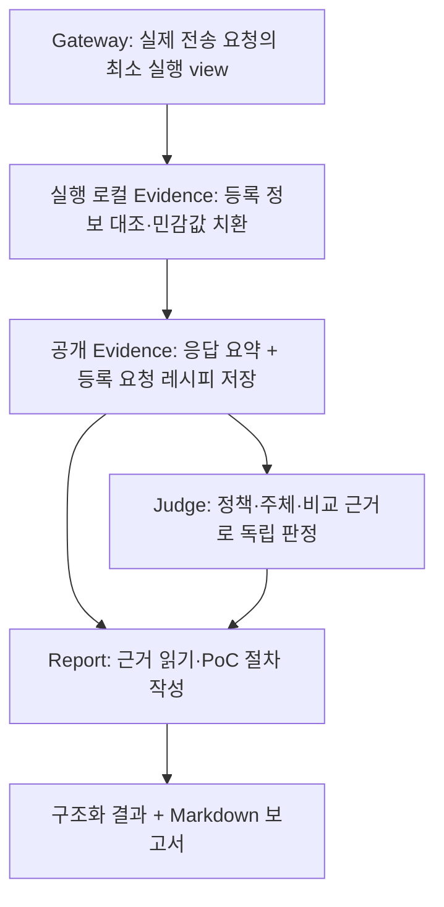

# S1 PoC 포함 진단 보고서 설계 v0.1

상태: **팀 검토용 설계안**. [S1 API 상세 규격](s1-api-spec.md)의 보고 기능을 구체화한다. 실제 진단·PoC 실행·보고 생성기가 구현됐다는 뜻이 아니다. 출력 형태는 [가상 보고서 예시](../examples/s1-poc-report.example.md)에서 확인한다. 현재 소유자·검토자는 [담당 배정표](../module-development.md#담당-배정)를 따른다.

목표는 발견 결과마다 **어떤 조건에서, 어떤 요청으로, 무엇을 확인했는지**를 근거에 연결해 사람이 재현할 수 있는 보고서를 만드는 것이다. 최초 범위는 등록된 A/B 두 계정과 기존 A 소유 객체의 GET 비교다. SQLi/XSS payload 생성과 자동 재실행은 이번 확장에 포함하지 않는다.

## 1. 보고서에 포함할 내용

| 항목 | 내용과 출처 |
|---|---|
| 문제와 판정 | 유형·대상 별칭·Judge 판정/ref/revision·충족/미충족 조건 |
| 재현 전제 | 허가된 대상·기대 접근 정책·기존 객체·두 계정·정상 인증 프로필의 버전/ref |
| 요청 절차 | A/B 주체 확인 → A 자기 객체 읽기 → B의 같은 객체 읽기. 실제 관찰에서 파생한 등록 요청 템플릿 |
| 기대와 관찰 | 등록 정책에서 기대한 접근과 저장된 비교 결과. 원문 대신 응답 분류·객체/주체/비자명 데이터 비교 신호 |
| 근거 연결 | 원 실행의 request/attempt/identity/evidence/comparison/verdict와 감사 출처 |
| 한계 | 누락·전송 불명·부분 저장·템플릿 미지원·감사 미확인·재실행 미수행 |
| 검토할 조치 | S1 유형별 고정 설명 템플릿. 대상 코드나 미확인 구현 원인을 추측해 채우지 않음 |

최초 출력 형식은 저장된 구조화 DiagnosisReport와 사람이 읽는 Markdown이다. PDF/HTML·독립 실행 스크립트·원문 HTTP 덤프는 후속 출력 어댑터다. Report는 저장된 자료를 읽어 출력하며 Gateway 실행 포트를 주입받지 않는다.

## 2. 실제 요청에서 보고서까지

1. Gateway는 전송에 실제 사용한 불변 요청 snapshot에서 ExecutedRequestView를 만든다. 사용자나 LLM이 만든 “재현 문자열”을 실행 사실로 받아들이지 않는다.
2. 동기 capture가 app이 주입한 메모리 등록 정보와 이 view/캡처 맥락을 유한 범위에서 대조한다. run/request/attempt·등록 origin/method/operation·계정/세대가 다르거나, 지원하는 객체 GET의 경로·파라미터·자원 바인딩이 다르면 `CaptureResult.failed`, capture_ref=None, capture_binding_mismatch로 반환하고 인계받은 원문/view를 해제한다. 정상 EvidenceSummary나 비교는 발행하지 않는다. Gateway는 이미 발생한 전송을 sent/unavailable로 보존한다. 올바른 실행이지만 레시피 형식이 미지원이거나 공개할 수 없는 경우는 정상 캡처를 유지하고 recipe만 None으로 둔다.
3. 레시피에는 실제 origin·객체 ID·파라미터 값·인증 비밀을 넣지 않는다. 등록 별칭·placeholder와 동작/바인딩 revision을 사용한다. 허용된 고정 경로 구조도 민감하면 치환하거나 레시피 unavailable로 남긴다.
4. seal/compare가 소유한 캡처에서 레시피를 만들고 응답 요약과 같은 Evidence artifact의 불변 내용으로 저장한다. StoreReceipt fingerprint는 레시피까지 포함한다. 저장/감사 확인을 완료한 자료만 Report에서 사용한다. capture 안에서 저장·네트워크 I/O는 수행하지 않는다.
5. Report가 owner/cross 근거와 주체 확인·판정·감사를 연결해 절차를 렌더링한다. 누락된 경로·요청·payload·응답을 LLM이나 보고 템플릿으로 보충하지 않는다.

원문 응답·캡처 핸들·HMAC 키·인증 값은 기존 실행영역 경계를 유지한다. ExecutedRequestView도 실행 전용 메모리 값이다. 이 확장 때문에 headers/cookies/body 전체를 새로 캡처하거나 저장하지 않는다.

## 3. 최소 추가 타입

기존 [공통 타입](s1-api-spec.md#2-표기공통-값)을 재사용한다. 모든 필드는 필수이며 `?`만 None을 허용한다. 실제 Python 타입·Protocol은 관련 제공자/소비자가 검토한 작은 계약 PR에서 정의한다.

| Record | 필드와 제약 |
|---|---|
| `ExecutedRequestView` | `run_key, request_ref, attempt_ref, operation_ref, operation_revision: Revision, resource_ref: Ref?, resource_binding_ref: Ref?, resource_binding_revision: Revision?, account_ref: Ref?, session_generation: int?, purpose: Purpose, method: str, actual_origin: str, actual_path: str, actual_parameters: tuple[RequestParameter]`. Gateway의 실제 요청에서 파생하며 로컬 Evidence 안에서만 대조·치환 후 폐기. actual_parameters는 지원하는 객체 GET의 비인증 path/query 입력만 포함하고 인증/identify 등 비대상 동작에는 빈 tuple. headers/cookies/form/body·인증 파라미터는 view에 넣지 않음 |
| `RecipeParameter` | `name: str, location: path/query, value_placeholder: str`. 값은 app에 등록된 슬롯의 placeholder만 허용, 실제 값/표현식/임의 문자열은 금지 |
| `RegisteredRequestRecipe` | `schema_version: str` 고정 `poc.v0.1`, `operation_ref, operation_revision, resource_ref, resource_binding_ref, resource_binding_revision, method: GET, origin_placeholder: str, path_template: str, parameters: tuple[RecipeParameter], authentication: fresh_registered_session, source: SourceVersion` |
| `PocStep` | `sequence: int, action: verify_owner/verify_evaluated/read_owner/read_cross, account_ref, identity_ref: Ref?, request_recipe: RegisteredRequestRecipe?, evidence_ref: Ref?`. identity 확인 단계는 등록 whoami 프로필과 해당 identity 근거를 참조하며 객체 GET 레시피를 임의로 생성하지 않음 |
| `PocReport` | `case_ref, verdict_ref, state: documented/incomplete/unavailable, replay_status: not_run, comparison_ref: Ref?, steps: tuple[PocStep], evidence_refs: tuple[Ref], audit_links: tuple[AuditLink], reason_codes`. S1의 replay_status는 항상 not_run |

documented에는 verify_owner/verify_evaluated/read_owner/read_cross 네 action이 각각 한 단계씩 있어야 한다. read_owner/read_cross에는 둘 다 유효한 GET request_recipe와 저장 완료 evidence_ref가 필수다. verify_owner/verify_evaluated는 각각 대응하는 유효 identity_ref·주체 확인 근거·감사를 참조하며 request_recipe=None을 허용한다. 정상 로그인 POST가 레시피 미지원이라는 이유로 identity 근거를 버리거나 documented를 막지 않는다. 검증 단계를 객체 GET 레시피로 대신하지 않는다.

whoami는 subject 일치 플래그만 반환하지 않고, 실행 로컬 Evidence의 seal과 identity journal의 commit을 확인한 뒤에만 verified/confirmed를 발행한다. A/B identity 근거와 감사가 누락되면 Report는 documented를 만들지 않는다. Host는 기존 IdentityResult와 비교·판정 참조를 전달하며 ReportInput에 원문·인증 값·PoC 명령을 추가하지 않는다. 상세 세션 발행 조건은 [S1 규격 §4](s1-api-spec.md#4-인증세션-통제)를 따른다.

RegisteredRequestRecipe는 대상·입력 값을 새로 선택하는 실행 API가 아니다. 실제 실행의 등록 동작·자원 바인딩을 설명하는 자료다. `${REGISTERED_ORIGIN}`, `${RESOURCE_ID}`, `${SESSION_A}`, `${SESSION_B}` 등 고정 슬롯은 운영자가 허용된 로컬 설정·새 인증으로 채운다. 레시피에 포함된 임의 URL이나 인증 값을 실행기가 받아들이는 경로를 추가하지 않는다.

인증 단계와 객체 요청의 account/generation/identity 연결은 저장된 원 실행을 설명한다. 사람이 다시 검사할 때에는 현재 허가·기대 정책·프로필·기존 객체의 유효성부터 확인하고 새 로그인으로 주체를 검증한다. 과거 cookie/token·PolicyDecision·prepared handle·generation을 재사용하지 않는다. 실제 재검사는 기존 Host → WebDiag → Policy/Gateway 경로로 새로운 run/attempt/evidence를 남긴다.

## 4. 기존 API에 연결

| 기존 경계 | 추가할 내용 | 소유자/검토자 |
|---|---|---|
| Gateway → 실행 로컬 Evidence의 동기 capture | CaptureRequest에 `executed_request: ExecutedRequestView` 추가. 기존 캡처 맥락과 run/request/attempt/계정/generation이 같아야 함 | Gateway 최민준·Evidence 이경준·contracts 이동찬 |
| 로컬 Evidence → 공개 Evidence 저장 | EvidenceSummary에 `request_recipe: RegisteredRequestRecipe?`, `recipe_reason_codes: tuple[ReasonCode]` 추가. 저장 내용/receipt에 함께 결합 | Evidence 이경준·소비자 Judge/Report 최민준·contracts 이동찬 |
| Host → Report | 기존 comparisons/verdicts와 주입된 Evidence/감사 읽기 포트에서 자료를 모음. ReportInput에 원문이나 임의 PoC 명령을 추가하지 않음 | Host 이경준·Report 최민준·contracts 이동찬 |
| Report 반환 | DiagnosisReport에 `pocs: tuple[PocReport]` 추가. 포함된 각 Verdict에 case_ref/verdict_ref가 일치하는 PoC 상태를 하나씩 남김 | Report 최민준·소비자 app/contracts 이동찬 |
| app 조립 | 등록 레시피/표시 규칙을 로컬 Evidence와 Report에 주입. fake와 실제 구현을 같은 필드로 교체 | 이동찬 |

새 서비스나 공개 실행 API는 추가하지 않는다. 기존 27개 포트의 async/def 구분도 유지한다. Knowledge는 기존 Observation/Evidence 참조로 연결하고, PoC 생성 여부를 새 소유/권한 사실로 투영하지 않는다.

S1은 객체 GET·path/query 슬롯에 대해 일치가 확인되는 레시피만 발행한다. 정당한 인증용 POST·지원하지 않는 형식·공개할 수 없는 경로는 정상 capture_ref/응답 근거를 유지하고 request_recipe=None과 recipe_unsupported 또는 recipe_not_exportable을 남긴다. 이 제한은 인증 실행 실패를 뜻하지 않는다. 실제 view 불일치는 앞 절의 capture 실패와 원문 해제 규칙을 따른다. 호출자/자료 권한 검사는 기존 Evidence 읽기 계약을 따른다.

## 5. 상태와 완료 조건

| PoC state | 의미 |
|---|---|
| `documented` | Judge의 저장된 CONFIRMED와 원 실행의 A/B 주체·두 근거·완료 비교·유효한 요청 레시피·필요 감사 연결을 확인해 재현 절차를 작성 |
| `incomplete` | 후보/의심/판단불가, 부분 근거·레시피·감사 누락 등으로 완성된 취약점 PoC를 작성할 수 없음. 확보한 참조와 사유는 보존 |
| `unavailable` | 현재 형식이 미지원이거나 공개 허용 정보로 레시피를 만들 수 없음. 원래 판정은 보존 |

`documented`는 **원 실행의 근거에 연결된 절차가 작성됐다**는 뜻이다. 보고서 생성 중 새 요청을 실행하거나 재현에 재성공했다는 뜻이 아니다. S1의 replay_status=not_run을 항상 표시한다. 실제 재실행 성공 표기는 새 run의 비교·판정·감사 연결까지 검증하는 후속 계약에서 추가한다.

Report는 Evidence 소유자의 저장 조회/검증과 생산자 감사로 자료를 확인한다. 특히 레시피의 operation/resource binding/revision, 근거의 run/attempt/account/generation, ComparisonPayload의 owner/cross evidence refs, Verdict의 case/comparison refs가 서로 일치해야 한다. 템플릿 외형이나 같은 ref 문자열만으로 정상 PoC를 만들지 않는다.

PoC 미완료가 기존 Judge의 CONFIRMED를 바꾸지는 않는다. Report는 판정과 PoC 상태를 각각 기록한다. CONFIRMED 사례의 필수 PoC가 incomplete/unavailable이면 ReportResult.partial 및 해당 사유를 남기며 report 자체는 제공한다. SUSPECTED/UNDECIDABLE의 불충분한 근거를 정확히 설명한 보고는 PoC가 incomplete라는 이유만으로 생성 실패나 partial이 되지는 않는다. 저장된 보고서 artifact를 발행하기 전에 생성/저장이 취소되거나 실패하면 완료 report ref를 발급하지 않는다. 보고 완료와 audit_completeness도 별도 필드로 유지한다.

추가 사유 코드: `recipe_missing`, `recipe_unsupported`, `recipe_not_exportable`, `recipe_binding_mismatch`, `poc_evidence_incomplete`, `poc_verdict_unconfirmed`, `poc_audit_incomplete`.

## 6. 예시와 구현 검증

[예시 보고서](../examples/s1-poc-report.example.md)는 존재하지 않는 대상·별칭·참조로 작성한 **미실행 가상 자료**다. 그 안의 CONFIRMED/documented는 출력 형식을 보여 주는 가정값이다. 실제 취약점을 발견했거나 보고 생성기가 구현됐다는 증거로 사용하지 않는다. 제품 실행 경로는 이 예시나 eval 정답을 읽지 않는다.

아래는 **후속 구현에서 작성할 테스트 요구사항**이다.

| ID | 입력/장애 | 확인할 결과 |
|---|---|---|
| S1-29 | CONFIRMED·양쪽 레시피·주체·완료 비교·감사 정상 | 실제 참조와 연결된 documented PoC, replay_status=not_run |
| S1-30 | CONFIRMED의 필수 객체 recipe 누락/미지원/공개 불가, 또는 미확정 Verdict | CONFIRMED의 필수 PoC 부족은 incomplete/unavailable·partial 보고. SUSPECTED/UNDECIDABLE은 PoC 부족만으로 partial이 되지 않고 상태를 정확히 설명한 complete 보고 가능. 정당한 인증 POST recipe=None은 identity 근거/정상 documented를 막지 않음. 원래 Verdict와 성공 receipt 보존 |
| S1-31 | origin/path/query 값과 인증/응답의 비밀 canary | 레시피·보고서·로그에 canary/원문/인증 값 없음. 등록 placeholder만 출력 |
| S1-32 | build_report 호출 전후 실행 기록 비교 | Gateway 호출·attempt·전송 건수 증가 0. 보고서 작성은 조회/렌더링/저장만 수행 |
| S1-33 | 다른 run/객체/계정/generation/revision의 실행 view/recipe 결합 | 실행 view는 capture_binding_mismatch로 거부, 저장 recipe 변조는 recipe_binding_mismatch/source_unverified. 유효 관찰·비교/가짜 documented 발행 없음 |
| S1-34 | 전송 unknown·부분 근거·미확정 판정·감사 누락 | 원래 상태/누락 사유 보존, 완료된 취약점 PoC로 표시하지 않음 |
| S1-35 | 보고 생성/저장 중 취소 또는 저장 실패 | 저장 완료가 확인되지 않은 report ref 발행 없음, CancelledError 전파, 원 실행 근거/이미 commit된 보고 보존, 재렌더링에 대상 재전송 없음 |
| S1-36 | 같은 artifact/ref에서 recipe 또는 판정 내용 변조 | 불변 내용/receipt 검증 실패, 기존 record 덮어쓰기·가짜 절차 보충 없음 |

계약/조립은 이동찬, 실행 요청과 비교 연결은 최민준·이경준, 근거 저장은 Evidence 담당 이경준, 판정과 보고 출력은 Judge/Report 담당 최민준이 관련 경계를 검토한다. 평가 GT는 이동찬의 루트 `eval/`에서 관리하며 제품의 근거·판정·보고 경로에 입력하지 않는다. 첫 구현은 두 계정의 가상 fixture로 보고를 생성하는 Report 단위 경로이며, 이후 실제 Evidence/Judge 결과로 교체해 같은 사례를 검증한다.
