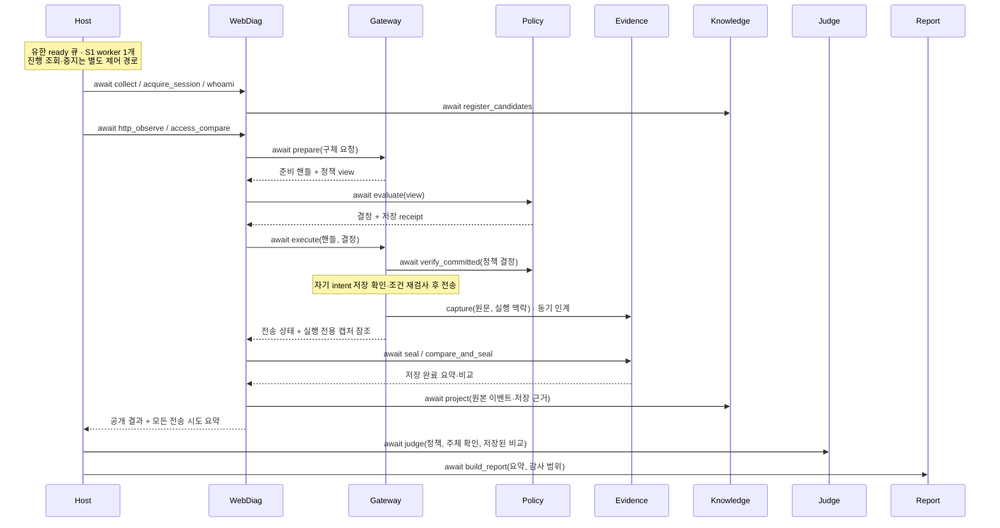

# S1 모듈 간 API 설계 v0.3

상태: **초기 설계안 / 팀 더블 체크 전**. [초안의 흐름·담당·수용 사례](s1-api-draft.md)를 구현 가능한 입력·반환 규격으로 구체화한다. 아래 선택은 이번 설계의 기준안이며 팀 합의나 구현 완료를 뜻하지 않는다. `contracts`·서비스 코드·의존성은 이번 문서 변경에 포함하지 않는다.

목표는 **상대 구현 없이 같은 입력과 실패 사례로 개발·테스트하기**다. Python 직접 호출에서 **I/O 서비스 포트는 비동기, 순수 계산과 제한된 메모리 상태 인계는 동기**로 구분한다. Host는 단일 프로세스의 유한 작업 큐와 S1 worker 1개로 실행한다. REST·MCP·배포 프로토콜은 정의하지 않는다. 상위 [아키텍처](mcp-architecture.md)와 [모듈 설계](module-design-confirmed.md)가 우선한다.

v0.3 변경: v0.2의 일괄 동기 호출을 수정했다. 아래 포트 27개 중 I/O 서비스 포트 24개는 `async def`, 실행 내부의 메모리 전용 포트 3개는 `def`다. 데이터 소유권과 원문 비노출 경계는 유지하며, 비동기 실행·취소·동시성 설정과 S1-21~28 수용 사례를 추가한다.

## 1. 이번에 선택한 기준

| 결정 | v0.3 선택 | 검토할 담당 |
|---|---|---|
| D1 요청 전달 | WebDiag가 구체 요청을 값으로 전달 → Gateway가 불변 요청과 정책 view를 함께 보관 → Policy가 view를 평가 → Gateway가 재검사·전송. 준비 핸들은 Gateway만 해석 | 최민준·이경준 |
| D2 기대 권한 | 운영자가 등록한 기대 접근 정책을 `app`이 검증·run에 결합해 불변 값으로 주입. 실행 안전 정책과 별개 | 이동찬·최민준·이경준 |
| D3 세션/원문 | WebDiag가 세션 상태·generation·주체 확인을 소유. Gateway는 인증 비밀·계정별 통신 context를 소유. 로컬 Evidence만 원문 버퍼·캡처 수명을 소유 | 이경준·최민준·윤재상 |
| D4 감사 | 생산자별 journal. `verify_committed`로 정책 결정과 전송 intent의 실제 저장을 확인한 뒤 전송. 다른 모듈 DB 직접 조회 없음 | 최민준·윤재상·이동찬 |
| D5 타입/호출 | I/O 포트 async + 순수 계산/메모리 인계 sync, Host 유한 큐·S1 worker 1개. 불변 dataclass/enum/Protocol과 결과 완성도·전송 상태·판정을 분리 | 전원 |

S1의 첫 입력은 **등록된 테스트 앱·두 계정·읽기 GET 동작 한 개·A 소유 객체 한 개**로 제한한다. `app`이 동작 템플릿, 객체 별칭과 실제 요청 값의 연결, 인증/주체 확인 프로필, 기대 정책을 주입한다. 발견기는 등록 seed에서 이 동작의 후보를 제출한다. 동적 미등록 객체는 후보로 남길 수 있지만 소유/정책 연결 없이 교차 실행하지 않는다. B 자기 객체, 범용 크롤러, MFA/SSO, 브라우저, LLM, AGE는 이 최초 경로의 전제 조건이 아니다.

## 2. 표기·공통 값

표의 필드는 **전부 필수**다. `T?`는 필수 필드이되 값이 `None`일 수 있다는 뜻이다. 목록은 불변 `tuple[T, ...]`이며 0개는 빈 tuple이다. 같은 필드명은 앞서 정의한 타입을 재사용한다. 별도 표기가 없는 `*_ref`는 `Ref`, `*_revision`은 `Revision`, `status`는 `ResultStatus`, `reason_codes`는 `tuple[ReasonCode, ...]`, `attempt_summaries`는 `tuple[AttemptSummary, ...]`다. 임의 dict·`Any`를 경계의 빈칸으로 사용하지 않는다. 문서의 record를 모두 한 파일·거대 모델로 합치지 않는다.

| 이름 | 값/필드 | 발급·의미 |
|---|---|---|
| `Ref` | 비어 있지 않은 불투명 문자열 | 발급 서비스의 동일 run 범위. ID 소지만으로 권한 없음 |
| `Revision` | 1 이상의 정수 | 같은 ref/revision 내용은 불변 |
| `UtcTime` | timezone-aware UTC datetime | 외부 표기 시 `2026-10-21T00:00:00.000000Z` |
| `RunKey` | `organization_ref: Ref`, `target_ref: Ref`, `environment_ref: Ref`, `run_ref: Ref` | Host가 run_ref 생성. 네 값 모두 일치해야 결합 |
| `SourceVersion` | `issuer: Ref`, `source_ref: Ref`, `revision: Revision` | 주입 시 검증한 출처. 자체 선언 문자열만으로 신뢰하지 않음 |
| `ResultStatus` | `complete / partial / failed` | 호출 결과의 완성도. 취약점·전송 상태와 별개 |
| `SendStatus` | `sent / not_sent / unknown` | Gateway가 관찰한 실제 전송 상태 |
| `CaptureStatus` | `captured / unavailable / not_applicable / indeterminate` | 허용 조합은 §6 |
| `CheckState` | `yes / no / unknown` | 확인하지 못한 조건은 `unknown` |
| `ResponseClass` | `normal / login / error / unknown` | HTTP status와 별개인 등록 규칙의 응답 분류 |
| `ReasonCode` | §11의 snake_case 문자열 | 비밀·원문 예외를 넣지 않음. 새 코드는 관련 계약 PR에 추가 |
| `ReadContext` | `caller_ref: Ref`, `authorization_ref: Ref` | `app`이 주입한 인증된 호출 맥락. 서비스가 자료 범위까지 검사 |
| `AuditLink` | `producer: Ref`, `event_ref: Ref` | 감사 원본 조회용 연결 |
| `CloseResult` | `run_key`, `status: ResultStatus`, `reason_codes` | complete는 정리 확인, failed는 미확인/실패. 정리 실패도 알려진 전송 상태를 바꾸지 않음 |

실행 후 결과는 `run_key`를 포함한다. 요청에도 `RunKey`를 명시하며 전역 현재 run에서 찾지 않는다. `request_ref`는 논리 요청, `attempt_ref`는 Gateway 실행 호출 한 번, `binding_id`는 준비 요청 한 개다. `operation_ref`는 등록된 대상 동작, `submission_ref`는 저장/제출 호출의 멱등 키다. 같은 동작을 여러 번 호출해도 submission_ref는 별개이며, 같은 제출의 재호출에서만 재사용한다. 이 식별자를 서로 대체하지 않는다.

복구 가능한 운영 실패는 `status/reason_codes`로 반환한다. `asyncio.CancelledError`는 정리·기록 후 상위로 전파하며 정상 결과로 삼키지 않는다. 타입 위반·불변조건을 깨는 프로그래밍 오류도 숨기지 않는다. 경계에서 예상하지 못한 예외가 나면 Host가 해당 작업을 실패·감사 미확인으로 남긴다. 반환을 못 받았다는 이유로 미전송으로 처리하거나 자동 재호출하지 않는다.

아래 API 표의 입력/출력 필드 목록은 시그니처에 적힌 각 named record의 전체 필드 정의다. 별도 record 표는 그 안에 중첩되는 값을 정의한다. `tuple[T]`는 문서에서 가변 길이 `tuple[T, ...]`의 축약이며, 필드별 길이 제한은 §11을 따른다.

| 결과 종류 | complete | partial | failed |
|---|---|---|---|
| Prepare/세션 context/세션 읽기/Capture | 필수 출력 존재 | 사용하지 않음 | 선택 출력 None, 사유 보존 |
| Seal | 저장된 evidence와 receipt 존재 | 성공 receipt만 보존, 완료 evidence 없으면 None | evidence None; 전송 상태 별도 보존 |
| Compare/Store | 모든 요청 artifact 저장 완료 | 성공 receipt 보존, StoredComparison 없음 | 완료 artifact 없음, 사유 보존 |
| Evidence/Knowledge 조회 | 요청 범위를 모두 확인 | 허용/조회된 값과 누락·상한 사유 | 자료 tuple은 비우고 조회 실패/거부 사유 |
| 후보 등록 | 후보와 revision 발급, 등록된 중복은 같은 ID | 수락 후보·revision과 거부 항목 사유 | candidates 비어 있음, revision None |
| Project | applied 또는 duplicate | deferred, 아직 반영된 것으로 읽지 않음 | rejected, 사유 보존 |
| Judge | 저장된 Verdict 존재. UNDECIDABLE도 가능 | 사용하지 않음 | verdict None |
| Report | 요청한 범위와 감사가 확인된 보고서 | report 존재, 미확인/미완료 사례 보존 | report None |

자료가 일부 존재하는 실패는 성공 receipt/attempt를 삭제해 failed로 단순화하지 않는다. Project.deferred에서 실제 적용은 0건이다. 이 표의 조회 partial은 권한 없는 자료의 존재/내용을 노출하라는 뜻이 아니며 읽기 어댑터가 허용된 사유만 반환한다.

### 2.1 설정과 기대 접근 정책

`app`은 `RunRegistration`을 검증하고 각 모듈에 필요한 부분만 생성자로 주입한다. 이것은 새 중앙 설정 서비스나 모든 호출에 붙는 RunContext가 아니다. S1은 실행 중 설정을 수정하지 않고 취소 신호만 별도로 전달한다. 설정을 바꾸면 새 revision/run을 사용한다.

| Record | 필드 |
|---|---|
| `RunRegistration` | `run_key`, `scope: ScopeSnapshot`, `execution_profile: ExecutionProfileSnapshot`, `budget: BudgetSnapshot`, `accounts: tuple[AccountRegistration]`, `operations: tuple[OperationRegistration]`, `expected_policies: tuple[ExpectedAccessPolicySnapshot]`, `comparison_rules: ComparisonRules`, `limits: RunLimits` |
| `ScopeSnapshot` | `source: SourceVersion`, `allowed_origins: tuple[str]`, `allowed_operation_refs: tuple[Ref]`, `valid_from: UtcTime`, `valid_until: UtcTime` |
| `ExecutionProfileSnapshot` | `source: SourceVersion`, `allowed_methods: tuple[str]`, `allowed_purposes: tuple[Purpose]`, `allow_redirects: bool`, `valid_until: UtcTime` |
| `BudgetSnapshot` | `source: SourceVersion`, `max_attempts: int`, `max_duration_ms: int`, `max_response_bytes: int`. 모두 양수 |
| `RunLimits` | `request_timeout_ms: int`, `prepared_ttl_ms: int`, `capture_ttl_ms: int`, `session_ttl_ms: int`, `identity_ttl_ms: int`, `session_lease_ms: int`, `max_recoveries_per_account: int`, `max_active_captures: int`, `max_candidates: int`, `max_page_size: int`. 초기값은 §11; 복구 횟수는 0도 허용 |
| `AccountRegistration` | `account_ref: Ref`, `expected_subject_ref: Ref`, `auth_profile_ref: Ref`, `identity_profile_ref: Ref`. 실제 자격 증명은 Gateway/Vault가 별도로 주입 |
| `OperationRegistration` | `source: SourceVersion`, `operation_ref: Ref`, `allowed_purposes: tuple[Purpose, ...]`, `auth_profile_ref: Ref?`, `method: str`, `origin: str`, `path_template: str`, `resource_bindings: tuple[ResourceBinding]`. authenticate/identify 동작에는 auth_profile_ref 필수 |
| `ResourceBinding` | `resource_binding_ref: Ref`, `source: SourceVersion`, `resource_ref: Ref`, `owner_subject_ref: Ref`, `parameters: tuple[RequestParameter]`. 매개변수의 실제 값은 실행 설정/실행 영역에서만 볼 수 있음 |
| `ExpectedAccessPolicySnapshot` | `source: SourceVersion`, `policy_ref: Ref`, `target_ref: Ref`, `environment_ref: Ref`, `resource_ref: Ref`, `operation_ref: Ref`, `owner_subject_ref: Ref`, `evaluated_subject_ref: Ref`, `expected_access: allow/deny/unknown`, `sharing: resolved_none/resolved_allow/unknown`, `delegation: resolved_none/resolved_allow/unknown`, `valid_from: UtcTime`, `valid_until: UtcTime` |
| `CrossExecutionConfirmation` | `source: SourceVersion`, `run_key`, `resource_ref`, `operation_ref`, `owner_account_ref`, `evaluated_account_ref`, `valid_until` |
| `ComparisonRules` | `source: SourceVersion`, `normalizer_ref: Ref`, `oracle_ref: Ref`, `canary_profile_ref: Ref`. 선언형 규칙 내용은 app이 실행 로컬 Evidence와 함께 주입 |

`ExpectedAccessPolicySnapshot`은 운영자가 특정 A/B 사례에 대해 등록한 선언이며, 권한 일반 추론 엔진이 아니다. 복잡한 역할/위임을 아직 해석하지 못하면 `unknown`을 반환하고, 관계 조회 확장은 S2에서 다룬다. `sharing/delegation=resolved_none`에는 반드시 등록 출처가 있어야 하며, 조회하지 않았다는 사실을 없음으로 해석할 수 없다. Policy의 실행 허가, HTTP 성공, owner 필드 또는 `eval/` GT로 이 정책을 생성할 수 없다.

공개 요청의 구성 ref는 현재 run에 주입된 기록과 일치해야 하며, 그렇지 않으면 `configuration_missing`이다. WebDiag는 등록 값으로 실제 요청을 구성하고 Gateway가 독립적으로 재검증한다. Knowledge는 별칭·출처·발견 사실만 저장하며, 자격 증명이나 선언되지 않은 RequestSpecRef를 해석하거나 저장하지 않는다.

등록 인증 프로필의 최소 의미는 로그인/주체 확인 operation 연결, 허용 method/origin, 계정별 Vault 연결, 등록된 성공·만료 신호와 subject 추출/별칭 매핑이다. 실제 로그인 필드·CSRF·원래 subject 값의 매핑은 Gateway 소유 비공개 설정 타입이며 app이 주입한다. WebDiag/Policy에는 비밀 없는 operation 연결·프로필 버전만 주입한다. 첫 whoami는 등록 JSON 경로의 값을 등록된 subject 별칭으로 매핑하는 방식으로 제한하고, 지원하지 못하면 unsupported_authentication을 반환한다.

객체 GET은 observe/access_compare만, 로그인은 authenticate만, 주체 확인은 identify만 허용하도록 등록한다. app이 이 구분을 검증하고 Gateway/Policy가 요청 purpose의 포함 여부를 검사한다. 호출자가 purpose만 authenticate로 바꿔 객체 GET을 허용받을 수 없다. scope/profile에도 해당 동작·목적을 명시한다.

### 2.2 비동기 호출과 작업 실행

포트 표의 `async def f(Request) -> Result`는 `await f(request)`로 **Result를 얻는다**는 뜻이다. 반환 타입을 `Coroutine`으로 중복 감싸지 않는다. 실제 I/O 대신 메모리 fake를 주입해도 이 호출 규격을 지킨다. `async`는 대기 중 다른 작업이 실행될 수 있다는 뜻이며, 같은 사례의 단계 순서를 자동으로 병렬화하지 않는다.

| 경계 | 호출 규격 | 내부 책임 |
|---|---|---|
| Host·WebDiag 공개 포트 | async | 작업 저장/조정, 인증·관찰·비교 대기 |
| Gateway prepare/execute·전송 context 생성/종료 | async | Vault/전송 어댑터·감사·상태 검증 및 정리 대기 |
| Policy.evaluate·Judge.judge·Report.build_report | async | 읽기·감사·결과 저장까지 포함. 내부 정책 조건·오라클·보고 데이터 변환은 동기 함수 |
| Evidence seal/compare_and_seal·공개 저장/조회 | async | 캡처 소유권을 먼저 확보하고 비교 후 저장 완료까지 await |
| Knowledge 등록/투영/조회·생산자 감사 검증/조회 | async | 저장·출처 확인·revision 조회 대기. 메모리 구현도 같은 Protocol |
| SessionBindingReader.read_session_binding | sync | 이미 발행된 불변 메모리 snapshot만 즉시 반환. 네트워크/DB/잠금 대기 없음 |
| 실행 로컬 Evidence.capture/release_captures | sync | 유한 메모리의 원자적 소유권 인계/해제. I/O·저장·장시간 계산 없음 |

동기 메모리 포트는 소유 event loop의 같은 스레드에서 호출한다. 상태 교체·핸들 소비·예산 차감의 임계 구역에는 `await`를 두지 않는다. I/O를 수행한 뒤에는 run 취소·세션 generation·유효기간을 다시 확인하고 다음 부작용으로 넘어간다. 동기 순수 함수나 상태 조회 안에서 `asyncio.run()`으로 이벤트 루프를 중첩하지 않는다.

**Host의 실행 계약:**

1. start_run은 등록 검증·유한 수용 슬롯 예약·작업 정본의 수락 기록·큐 수용을 확인한 뒤 RunHandle을 반환한다. 진단 전체 완료를 기다리지 않는다. 수용 공간이 없으면 queue_full로 명시적으로 거절한다. 실제 enqueue는 수락 commit 확인 뒤에 하며, commit 확인/응답 중 취소되어도 정본에 이미 수락된 작업을 버리거나 두 번 enqueue하지 않는다. 같은 submission_ref의 재호출은 기존 run을 조회하고, 같은 키의 다른 입력은 idempotency_conflict다. 큐에 넘기기 전 중단된 수락 작업은 Host가 정본에서 복구한다.
2. Scheduler는 크기가 정해진 ready 큐와 worker를 소유한다. 실행 가능한 작업만 배정하고, 의존 작업의 완료를 기다리는 사례는 정본 상태로 관리한다. worker 내부에서 같은 큐에 하위 작업을 넣고 그 완료를 기다리지 않고, 필요한 서비스 포트를 직접 await한다. 유한 큐의 put/get 대기와 종료에도 deadline을 적용한다.
3. get_status와 stop은 검사 worker/대상 요청 semaphore를 기다리지 않는 제어 경로다. 저장 어댑터 자체의 제한된 대기는 있을 수 있지만, 느린 대상 응답 때문에 검사 완료 뒤로 밀리지 않는다. stop은 먼저 취소 플래그를 공개하고 새 배정/전송을 막은 뒤 requested를 반환하며 정리 완료를 별도로 추적한다.
4. 각 worker와 실행 중 작업은 Host/app이 Task 참조·종료 책임을 보유한다. 함께 실패·정리해야 하는 한 run의 자식 작업에 TaskGroup을 사용한다. 독립 작업의 예상 실패는 해당 작업의 결과로 처리하고, 무관한 run까지 취소시키지 않는다. 프로그래밍 오류는 해당 run의 supervisor로 전파한다. Host의 run별 supervisor가 ExceptionGroup/예상 밖 예외를 받아 실패·미확인 시도를 기록하고 해당 run/task를 failed로 처리한 뒤 소유 자원을 정리한다. 정리가 확인된 lease만 반환하고 worker 루프는 다음 실행 가능한 작업을 계속 처리한다. 정리가 미확정이면 해당 실행 참조/permit을 보유하며 상충하는 배정은 차단한다. 오류를 빈 성공으로 삼키거나 유일한 worker가 조용히 끝나게 두지 않는다. 명시적인 치명적 Scheduler 오류만 새 수락/배정을 중지하며, 이때에도 실패 범위와 남은 작업을 보고한다. Host 종료를 위한 CancelledError는 이 오류 처리로 흡수하지 않고 종료 프로토콜로 전달한다.
5. 큐는 유한 전달 장치다. Task 상태·lease·중복·재시작 복구의 정본은 Host의 저장 포트다. queue.task_done/join 또는 강제 큐 종료를 진단·근거·감사 완료 증거로 사용하지 않는다. 대기열 한도 전에 후보/계획 생성도 제한하고, 항목마다 무제한 create_task한 뒤 semaphore에서 기다리게 만들지 않는다.

SchedulerLimits는 app/Host의 내부 설정 타입이며 공유 요청마다 붙이지 않는다. 필드는 `ready_queue_capacity: int`, `worker_count: int`, `max_active_runs: int`, `queue_wait_timeout_ms: int`, `max_concurrent_attempts: int`, `max_concurrent_attempts_per_account: int`, `cleanup_grace_ms: int`다. 초기값은 §11이다. 큐 대기를 포함한 run deadline, request timeout, 정리 유예는 서로 구분한다.

**요청 실행 순서와 동시성:** WebDiag의 계정 lease 획득 → prepare → evaluate 및 정책 commit → Gateway execute 내부의 전송 permit 획득·intent commit·현재 조건 재검사 → transport → capture → 근거 저장 → 판정을 순서대로 수행한다. permit/commit 대기 중 준비 TTL이 지났으면 전송하지 않는다. 계정 lease는 WebDiag, 실제 요청 semaphore/예산은 Gateway, 작업 수 상한은 Host가 소유한다. 상한은 app이 일치하게 주입하며 Gateway permit을 WebDiag가 공유 전역값이나 미정 acquire API로 얻지 않는다.

Gateway의 전송 permit은 실제 I/O와 해당 전송의 정리가 끝난 뒤 반납한다. await 취소만 끝나고 실제 I/O가 남으면 소유자가 permit과 실행 참조를 보유하고 추가 배정을 차단한다. 정리 유예 만료는 permit 반납/종료 확인을 대신하지 않는다.

계정별 인증·복구·generation 교체는 한 번에 하나만 진행한다. A/B 두 계정 lease가 필요하면 account_ref 순으로 획득하고 역순으로 반납한다. 같은 실행이 이미 가진 lease를 중첩 호출에서 다시 획득해 스스로 기다리지 않는다. await 이후 폐기된 세대의 바인딩·주체 확인은 재사용하지 않는다. 서로 다른 사례의 동시 실행 수를 늘리는 후속 PR에서는 이 경합과 캡처 메모리 상한을 함께 검증한다.

**취소·timeout·부분 완료 계약:**

- transport 진입 전 미전송이 확실한 시도만 not_sent다. 진입 후 취소/timeout은 전송을 입증하면 sent, 입증하지 못하면 unknown이다. TimeoutError/CancelledError 자체는 미전송 증거가 아니다.
- Gateway는 transport 진입 전 attempt를 소유 기록에 연결한다. execute의 호출자가 반환을 못 받아도 Gateway journal과 제한된 정리 작업이 시도 상태를 보존한다. Host는 생산자 감사 조회로 확인하며, 조회 실패는 audit_gap/unknown이다. 같은 요청을 자동 재전송해 결과를 채우지 않는다.
- raw 응답/캡처 인계와 현재 소유자 등록 사이에는 await가 없다. execute 반환 직전 취소로 WebDiag가 capture_ref를 못 받아도 Gateway/로컬 Evidence가 해당 핸들을 정리한다. seal/compare는 첫 await 전에 캡처들을 원자적으로 취득하고, 성공·실패·취소의 finally에서 동기 release한다. 취소와 실제 정리가 끝나기 전에 run key나 사용 중인 버퍼를 폐기하지 않는다.
- 저장 중 취소는 해당 기록의 rollback을 보장하지 않는다. 같은 submission_ref/불변 내용으로 생산자의 저장 상태를 재조회·확인하고 성공 receipt를 보존한다. 전송 재시도와 저장 멱등 재확인은 별개다. commit 여부가 불명하면 완료 artifact나 StoredComparison을 새로 발행하지 않는다.
- CancelledError를 처리하면 정리·최소 감사 후 다시 발생시킨다. 불가피한 await 정리에는 Host/app이 소유한 별도 Task 참조와 유한 cleanup_grace_ms를 사용한다. shield는 이 제한된 정리에만 사용하고 대상 요청 전체를 취소로부터 숨기지 않는다. 유예가 지나면 cleanup_timeout/미확인 범위를 남기며, 실제 실행 종료를 확인하기 전 stopped로 표시하거나 실행 중 lease를 다른 작업에 재배정하지 않는다.
- 이벤트 루프에서 동기 HTTP/DB I/O를 직접 실행하지 않는다. 불가피한 blocking 어댑터를 별도 스레드로 옮겨도 await 취소만으로 그 스레드/실제 I/O가 멈췄다고 처리하지 않는다. 원문을 처리하는 스레드의 소유·완료/중단 확인 전 버퍼를 해제하지 않는다. S1은 비동기 HTTP/저장 어댑터와 유한 동기 계산을 우선한다.

Python 3.13의 [Task 취소·TaskGroup·timeout](https://docs.python.org/3.13/library/asyncio-task.html), [유한 Queue와 종료](https://docs.python.org/3.13/library/asyncio-queue.html), [비동기 동기화 도구](https://docs.python.org/3.13/library/asyncio-sync.html)를 기준으로 구현한다. 라이브러리의 취소 동작을 실제 HTTP 전송·DB commit의 증명으로 대체하지 않는다.

## 3. Host와 WebDiag의 공개 경계

| 제공자 → 소비자 | 비동기 시그니처 |
|---|---|
| Host → 진입점 | `async def start_run(StartRunRequest) -> StartRunResult`, `async def get_status(RunKey) -> RunStatus`, `async def stop(RunKey) -> StopReceipt` |
| WebDiag → Host | `async def collect(DiscoveryRequest) -> CandidateBatch`, `async def http_observe(ObserveRequest) -> ObserveResult`, `async def access_compare(AccessCompareRequest) -> AccessCompareResult` |
| WebDiag → Host/자체 관찰 흐름 | `async def acquire_session(SessionRequest) -> SessionResult`, `async def whoami(IdentityRequest) -> IdentityResult` |

| 입력 record | 필수 필드 |
|---|---|
| `StartRunRequest` | `organization_ref`, `target_ref`, `environment_ref`, `registration_ref: Ref`, `submission_ref: Ref`. 진입점은 검증된 등록 구성을 선택하고 호출 멱등 키를 제공하며, 비밀번호나 임의 URL을 제출하지 않음 |
| `DiscoveryRequest` | `run_key`, `seed_operation_refs: tuple[Ref]`, `account_ref: Ref`, `max_candidates: int` |
| `ObserveRequest` | `run_key`, `request_ref`, `candidate_ref: Ref`, `candidate_revision: Revision`, `account_ref`, `observation_profile_ref: Ref` |
| `AccessCompareRequest` | `run_key`, `case_ref: Ref`, `candidate_ref`, `candidate_revision`, `owner_account_ref`, `evaluated_account_ref`, `expected_policy: ExpectedAccessPolicySnapshot?`, `cross_confirmation: CrossExecutionConfirmation?` |
| `SessionRequest` | `run_key`, `account_ref`, `auth_profile_ref` |
| `IdentityRequest` | `run_key`, `session: SessionHandle`, `identity_profile_ref` |

candidate는 §8의 `get_case_view`를 통해 읽고 요청 revision을 검증해야 한다. 등록되지 않은 객체의 본인/타인 소유가 불명확하면 `http_observe`는 객체 요청을 실행하지 않으며, `access_compare`를 우회하는 교차 호출로 변질될 수 없다. 후보가 없으면 `not_found`, revision이 일치하지 않으면 `revision_conflict`이다.

| 출력 record | 필수 필드/상태 |
|---|---|
| `StartRunResult` | `status`, `run: RunHandle?`, `reason_codes`. 수락 시 complete이고, 수락하지 않으면 failed/None |
| `RunHandle` | `run_key`, `created_at: UtcTime` |
| `RunStatus` | `run_key`, `state: queued/running/stopping/completed/failed/stopped`, `tasks: tuple[TaskSummary]`, `send_counts: SendCounts`, `audit_completeness: complete/unknown`, `reason_codes` |
| `TaskSummary` | `task_ref`, `kind: collect/observe/compare/judge/report`, `state: queued/running/complete/partial/failed/cancelled`, `attempt_summaries: tuple[AttemptSummary]`, `reason_codes` |
| `StopReceipt` | `run_key`, `status`, `stop_state: requested/stopped/unknown`, `requested_at: UtcTime`, `reason_codes`. requested는 이미 종료되었다는 뜻이 아님 |
| `CandidateBatch` | `run_key`, `status`, `candidates: tuple[Candidate]`, `knowledge_revision: Revision?`, `attempt_summaries`, `reason_codes` |
| `ObserveResult` | `run_key`, `status`, `observation: Observation?`, `attempt_summaries`, `reason_codes` |
| `AccessCompareResult` | `run_key`, `case_ref`, `status`, `owner_identity: IdentityResult?`, `evaluated_identity: IdentityResult?`, `owner_observation: Observation?`, `stored_comparison: StoredComparison?`, `stored_evidence_refs: tuple[Ref]`, `attempt_summaries`, `reason_codes` |
| `Observation` | `run_key`, `observation_ref`, `candidate_ref`, `resource_ref`, `operation_ref`, `account_ref`, `session_generation: int`, `identity_ref: Ref`, `response_class: ResponseClass`, `evidence_ref: Ref`, `source_event: AuditLink`, `observed_at: UtcTime`, `reason_codes` |

`Observation`은 공개 Evidence가 저장된 경우에만 존재한다. `complete`는 관찰/비교 작업이 완료되었다는 뜻이며, 권한이 올바르거나 취약점이 존재한다는 뜻은 아니다. `AccessCompareResult.complete`에는 `stored_comparison`이 있어야 한다. partial은 저장된 한쪽 결과를 보존할 수 있고, failed도 이미 발생한 attempt를 보존해야 한다. collect의 인증/발견 요청도 attempt_summaries에 포함한다.

S1 Host는 같은 사례의 A 기준 요청과 B가 A 객체에 수행하는 교차 비교 작업을 생성하며, B 자신의 객체는 요구하지 않는다. `access_compare`는 호출 내부에서 A/B의 유효 세션과 기준 응답을 다시 얻고 Host가 전달한 원문/캡처 핸들을 받지 않는다. 첫 버전은 비동기 worker 1개로 사례별 순서를 검증하고, 대기 중에도 상태 조회·중지는 처리한다. 작업 큐의 lease/complete는 Host 내부 프로토콜이다.

## 4. 인증·세션 통제

| Record | 필드 |
|---|---|
| `SessionHandle` | `session_ref: Ref`, `run_key`, `account_ref`, `generation: int`, `expires_at: UtcTime` |
| `SessionResult` | `run_key`, `status`, `session: SessionHandle?`, `session_state: SessionState`, `attempt_summaries`, `reason_codes` |
| `IdentityResult` | `run_key`, `identity_ref: Ref?`, `status: verified/unknown/expired/mismatch`, `session_ref: Ref`, `account_ref`, `generation: int`, `subject_ref: Ref?`, `evidence_ref: Ref?`, `verified_at: UtcTime?`, `valid_until: UtcTime?`, `audit_receipt: AuditReceipt?`, `attempt_summaries`, `reason_codes` |
| `IdentityBindingSummary` | `identity_ref`, `session_ref`, `account_ref`, `subject_ref`, `generation: int`, `verified_at: UtcTime`, `valid_until: UtcTime`. verified 상태만 이 최소 값으로 투영 |
| `SessionBinding` | `session: SessionHandle`, `state: SessionState`, `identity: IdentityResult?`, `transport_context_ref: Ref`, `cancelled: bool`. 실행 영역에서만 읽음 |

`SessionState`: `not_ready -> authenticating -> confirmed`; 실패 시 `unavailable`; 만료 의심 시 `expiry_suspected -> recovering -> confirmed/unavailable`; 종료 시 `closed`. `confirmed`에는 `whoami`가 실제 subject·계정·generation을 검증하고 Evidence와 identity 감사 기록의 저장을 완료해야 한다. 이때 IdentityResult의 선택 필드는 모두 존재한다. 로그인만 성공한 세션은 authenticating 상태이다. subject가 일치하지 않으면 대상 계정으로 계속 사용할 수 없다.

세션은 호출자가 상태를 위조할 수 있는 증명이 아니다. WebDiag가 상태 머신/generation/주체 검증의 유일한 기록자이다. Gateway는 계정별 독립 cookie jar와 인증 비밀을 보유하고, 주입된 읽기 전용 `SessionBindingReader`의 `def read_session_binding(run_key: RunKey, session_ref: Ref) -> SessionBindingResult`로 현재 상태를 얻는다. `SessionBindingResult` 필드는 `run_key, status, binding: SessionBinding?, reason_codes`이다. 이는 네트워크나 로그인 부작용 없이 이미 존재하는 상태를 읽는 포트이며, Gateway 콜백에서 WebDiag workflow를 진행하지 않는다.

전송 context가 암묵적인 공유 레지스트리가 되지 않도록 Gateway는 다음 **실행 전용** 제어 포트를 WebDiag에 제공한다. 로컬 fake를 사용할 수 있다.

| 시그니처 | 필수 필드와 효과 |
|---|---|
| `async def open_session_context(SessionContextRequest) -> SessionContextResult` | 입력 `run_key, session_ref, account_ref, generation, auth_profile_ref`; 출력 `run_key, status, transport_context_ref: Ref?, reason_codes`. 격리된 jar만 할당하고 로그인·전송은 하지 않으며, 같은 run/session/generation의 반복 호출은 멱등 |
| `async def close_session_context(SessionContextCloseRequest) -> CloseResult` | 입력 `run_key, transport_context_ref`; 출력 `run_key, status, reason_codes`. 이후 새 요청을 금지하고 비밀을 정리한다. 반복 종료는 멱등이며, 진행 중인 미확정 전송을 미전송으로 바꾸지 않는다. |

open 성공 직후 WebDiag는 반환된 context_ref를 자신이 소유한 해당 session/generation의 SessionBinding에 원자적으로 기록하고 나서만 인증을 시작한다. open 실패 시 binding을 발행하지 않는다. generation 변경/종료 시 먼저 이전 binding을 비활성화하고 close를 요청한다. close 실패는 감사에 남기며 Gateway도 context의 run/계정/generation을 독립 대조하므로 이전 참조가 재활성화되지 않는다.

WebDiag의 인증 흐름은 generation/context 생성 → §5의 `authenticate` 목적에 등록된 로그인 동작 실행 → `identify` 목적에 등록된 whoami 실행 → Gateway가 등록된 추출 규칙에 따라 최소 `AuthSignal` 반환 → WebDiag가 저장된 Evidence와 함께 실제 subject를 검증하고 상태를 갱신하는 순서다. `AuthSignal`은 `kind: login_result/identity/expiry, state: accepted/rejected/unknown, subject_ref: Ref?`만 포함하며 임의 응답 JSON이 아니다. Gateway는 실행 영역에서 등록된 subject 별칭을 해석·매핑하고 비밀번호·원래 사용자명·응답을 공용 흐름에 전달하지 않는다.

인증 요청 자체도 Policy·예산·감사를 거친다. 아직 verified가 아닌 세션은 등록된 authenticate/identify 동작만 허용하며, 이를 이용해 객체를 관찰·비교할 수 없다. 계정마다 동시에 하나의 인증/복구만 수행한다. 실행 중 내부 짧은 lease를 얻고 finally에서 반환하므로 Host가 수동 release할 필요가 없다. 복구는 먼저 해당 계정의 새 작업 배정을 중단하고 generation을 증가시켜 이전 lease·주체 검증·준비 핸들을 무효화한 뒤, 정상 재로그인과 신원 재검증을 최대 한 번 수행한다. Guest로 강등하지 않는다. 복구 중 발생한 각 HTTP 동작은 별도로 감사한다.

acquire_session은 필요한 로그인과 whoami까지 마쳐 confirmed 세션을 반환한다. 이미 같은 generation의 유효한 확인이 있으면 재사용한다. 명시적 whoami도 아직 유효한 확인을 반환할 수 있으며, 새 전송이 없으면 새 attempt를 만들지 않는다. 내부 재사용으로 과거 AttemptSummary를 다시 포함해도 Host는 attempt_ref로 중복 제거한다. 인증 실패는 SessionResult.failed/None이며, 확보한 세션을 verified인 것처럼 partial로 발행하지 않는다.

## 5. Gateway와 Policy의 실행 경계

| 제공자 → 소비자 | 시그니처 |
|---|---|
| Gateway → WebDiag | `async def prepare(ExecutionRequest) -> PrepareResult`, `async def execute(ExecuteRequest) -> AttemptResult` |
| Policy → WebDiag | `async def evaluate(PolicyInput) -> PolicyDecisionResult` |

| Record | 필드 |
|---|---|
| `Purpose` | `observe / authenticate / identify / access_compare` |
| `RequestParameter` | `name: str`, `location: path/query/form`, `value: str`. 실행 전용이며 인증 비밀을 포함할 수 없음 |
| `PrivateHttpRequest` | `origin: str`, `method: str`, `path: str`, `parameters: tuple[RequestParameter]`, `timeout_ms: int`. 요청 입력은 등록된 동작에서 오며 인증 비밀은 Gateway 내부에서 결합 |
| `ExecutionRequest` | `run_key`, `request_ref`, `operation_ref`, `operation_revision: Revision`, `resource_ref: Ref?`, `resource_binding_ref: Ref?`, `resource_binding_revision: Revision?`, `purpose: Purpose`, `http: PrivateHttpRequest`, `session: SessionHandle?`, `owner_session: SessionHandle?`, `scope_revision`, `profile_revision`, `expected_policy: ExpectedAccessPolicySnapshot?`, `cross_confirmation: CrossExecutionConfirmation?` |
| `PreparedRequestHandle` | 불투명한 `Ref`. Gateway 인스턴스가 발급하고 독점적으로 해석하며 공개 Host/로그에서는 사용하지 않음 |
| `PrepareResult` | `run_key`, `status`, `prepared_handle: PreparedRequestHandle?`, `policy_input: PolicyInput?`, `reason_codes`. 성공 시 두 값이 모두 존재하고 실패 시 모두 None이며, prepare는 전송하지 않음 |
| `PolicyAttributes` | `registered_path_matches: bool`, `parameter_names: tuple[str]`, `parameters_match_registration: bool`, `resource_ref: Ref?`, `resource_binding_ref: Ref?`, `resource_binding_revision: Revision?`, `resource_owner_subject_ref: Ref?`, `provenance: SourceVersion`. 매개변수의 실제 값은 노출하지 않음 |
| `PolicyInput` | `schema_version: str` 고정값 `s1.v0.3`, `run_key`, `request_ref`, `binding_id`, `binding_issuer: Ref`, `expires_at: UtcTime`, `origin: str`, `method: str`, `operation_ref`, `operation_revision: Revision`, `purpose`, `policy_attributes: PolicyAttributes`, `account_ref: Ref?`, `session_generation: int?`, `identity_ref: Ref?`, `subject_ref: Ref?`, `identity_status: verified/unknown/anonymous`, `owner_identity: IdentityBindingSummary?`, `scope: ScopeSnapshot`, `profile: ExecutionProfileSnapshot`, `budget: BudgetSnapshot`, `expected_policy: ExpectedAccessPolicySnapshot?`, `cross_confirmation: CrossExecutionConfirmation?` |
| `PolicyDecision` | `run_key`, `decision_ref`, `binding_id`, `evaluated_view_fingerprint: str`, `outcome: allow/block`, `policy_version: SourceVersion`, `issued_at`, `expires_at`, `audit_receipt: AuditReceipt`, `reason_codes` |
| `PolicyDecisionResult` | `run_key`, `status`, `decision: PolicyDecision?`, `reason_codes`. 감사 기록에 실패하면 failed/None이며 실행 가능한 allow를 발급하지 않음 |
| `ExecuteRequest` | `run_key`, `request_ref`, `prepared_handle`, `decision: PolicyDecision?`. 유효 핸들의 request_ref와 반드시 일치. None 또는 block은 감사 가능한 not_sent를 생성하고 transport로 진입하지 않음 |
| `AttemptResult` | `run_key`, `request_ref`, `attempt_ref`, `decision_ref: Ref?`, `binding_id: Ref?`, `send_status`, `capture_status`, `capture_ref: Ref?`, `auth_signal: AuthSignal?`, `audit_links: tuple[AuditLink]`, `reason_codes` |

S1은 임의 요청 헤더·스크립트·자격 증명 필드의 전달을 지원하지 않는다. 인증 필드/CSRF/secret은 등록된 인증 어댑터가 Gateway 내부에서 결합한다. 실제 전송할 method·URL·인코딩된 매개변수/본문·인증 context/generation·전송 옵션은 준비 snapshot에 고정하며, 변경 가능한 dict/객체가 prepare 이후 이에 영향을 줄 수 없다. 전송 전에 비밀 세대나 일회성 값을 바꿔야 하면 이전 준비 결과를 폐기하고 다시 prepare/evaluate한다.

**준비 핸들 규칙:** 단일 인스턴스·단일 run·단일 계정/generation에 귀속되고 TTL은 15초이며 execute는 한 번만 허용한다. 유효한 핸들은 execute에 진입하는 순간 원자적으로 소비되며, 이후 거부되거나 예산이 부족해도 재사용할 수 없다. not_sent가 확정된 뒤 같은 논리 request를 새 binding/attempt로 명시적으로 다시 준비할 수 있지만 S1은 자동 재시도하지 않는다. 재전송 금지를 피하기 위해 unknown인 동일 논리 작업을 다시 준비하지 않는다.

핸들을 해석하지 못한 거부도 입력의 request_ref에 새 attempt_ref를 연결해 기록한다. 이때 decision_ref/binding_id는 검증된 값이 없으면 None이다. 입력 ref만으로 다른 run의 저장된 요청 정보를 노출하지 않는다.

**view 일관성:** Policy는 수신한 전체 `PolicyInput`으로 SHA-256을 계산한다. 정규 바이트는 UTF-8 JSON, 필드명 정렬, 공백 없는 구분, `ensure_ascii=False`, NaN/float 금지를 사용한다. enum은 위 문자열, tuple은 배열, None은 null, 시간은 소수점 이하 6자리 마이크로초 UTC `Z`로 표현한다. 호출자가 별도로 채울 수 있는 fingerprint를 제외한 모든 필드를 포함한다. Gateway는 자체 저장한 동일 view를 다시 계산해 비교하고 실제 요청 snapshot·구성·현재 세션도 검사한다. 이 fingerprint는 값의 일관성에만 사용하며, 신뢰할 출처는 app이 주입한 Policy 인스턴스와 §10의 journal 검증에 의존하고 서명이나 bearer permit이 아니다.

Policy의 기본값은 block이다. 등록되지 않은 origin/operation/매개변수 구조, 만료된 구성, 불일치하는 신원, 누락된 교차 확인, 취소 또는 판정 불가는 모두 거부한다. Policy는 view의 ‘검사 통과’ 선언으로 주입된 등록 규칙을 대체하지 않으며 출처/revision과 등록 allowed_purposes/auth_profile이 일치해야 한다. Gateway는 등록된 resource_binding의 정확한 실제 값과 인코딩된 요청을 대조하며, Policy는 바인딩 ref/revision과 등록 소유자·현재 subject의 관계를 재검사한다. raw 값이나 민감값의 단순 hash를 정책 view로 내보내지 않는다.

교차 실행에는 유효하면서 서로 다른 A/B 주체, 특정 객체·동작·계정에 맞는 확인과 기대 정책이 필요하다. Gateway는 owner_session과 실제 실행 session을 읽기 포트로 각각 확인해 owner_identity/실행 subject를 구성하며 caller의 신원 주장을 복사하지 않는다. 교차 외에는 owner_session/owner_identity/expected_policy/cross_confirmation을 None으로 둔다. 초기 S1은 등록된 `deny + resolved_none/resolved_none` 사례만 실행한다. Policy와 Gateway가 주입된 기대 정책 원본에 snapshot을 대조한다. 확인은 신뢰된 등록 입력으로 생성하며 Host/LLM이 같은 이름의 문자열을 직접 입력해 권한을 얻을 수 없다.

Gateway가 다시 검증한다. Policy 기록이 실제 해당 binding/view의 allow인지, run/구성이 취소되거나 만료되지 않았는지, 현재 목적지/Host/SNI/DNS가 범위 내인지, 세션 generation/신원이 유효한지, 준비 내용이 바뀌지 않았는지, 예산을 원자적으로 차감할 수 있는지를 확인한다. redirects, transport 자동 재시도, origin 간 이동은 기본적으로 끈다. 차단된 이동이 두 번째 암묵적 전송을 일으켜서는 안 된다. 파생 요청을 지원할 때는 각각 새 준비/정책/감사가 필요하다.

## 6. 전송·캡처와 공개 결과

| send_status | capture_status | capture_ref | 의미 |
|---|---|---|---|
| sent | captured | 필수 | 전송이 확인되었고 완전한 캡처를 실행 메모리에 등록 |
| sent | unavailable | None | 전송되었으나 응답/캡처가 실패하거나 한도를 초과했으므로 미전송으로 볼 수 없음 |
| not_sent | not_applicable | None | Gateway가 전송 단계에 진입하지 않았음을 증명할 수 있음 |
| unknown | indeterminate | None | 전송 여부를 확인할 수 없음. 자동 재전송하지 않음 |

`AttemptSummary` 필드: `run_key, request_ref, attempt_ref, send_status, audit_links, reason_codes`. WebDiag는 각 인증·신원 확인·기준·교차 요청의 이 요약을 실패/partial인 경우에도 Host에 전달한다. 캡처/준비/context 핸들, 인증 신호 또는 원문은 포함하지 않는다. 아직 prepare/execute하지 않은 요청 없는 실패에 가짜 attempt를 만들지 않는다.

`SendCounts` 필드: `sent: int, not_sent: int, unknown: int`. Host/Report는 고유 attempt_ref로 중복 제거한다. 같은 ID의 내용이 충돌하면 감사 상태는 unknown이다. 기록을 찾지 못했다고 not_sent로 보지 않고 감사 공백으로 남긴다. 중지할 때는 새 준비/전송을 먼저 금지한 뒤 정리하며, 이미 전송된 HTTP를 취소한다고 보장할 수 없다.

## 7. Evidence: 실행 전용과 공개 저장

| 영역 | 시그니처 | 입력/출력 record |
|---|---|---|
| 전용: Gateway → 로컬 Evidence | `def capture(CaptureRequest) -> CaptureResult` | 입력 `run_key, attempt_ref, request_ref, operation_ref, resource_ref: Ref?, account_ref: Ref?, session_generation: int?, identity_ref: Ref?, observed_at, raw_response: RawResponse`; 출력 `run_key, status, capture_ref: Ref?, reason_codes` |
| 전용: WebDiag → 로컬 Evidence | `async def seal(SealRequest) -> SealResult` | 입력 `run_key, submission_ref: Ref, capture_ref, rules: ComparisonRules`; 출력 `run_key, status, evidence: EvidenceSummary?, receipts: tuple[StoreReceipt], reason_codes` |
| 전용: WebDiag → 로컬 Evidence | `async def compare_and_seal(CompareRequest) -> CompareOutcome` | 입력 `run_key, case_ref, submission_ref, resource_ref, operation_ref, owner_capture_ref, cross_capture_ref, owner_identity: IdentityResult, evaluated_identity: IdentityResult, rules`; 출력 `run_key, status, stored_comparison: StoredComparison?, receipts, reason_codes` |
| 공개: 로컬 Evidence → Evidence 저장 서비스 | `async def store_evidence(RedactedBundle) -> StoreOutcome` | 출력 `run_key, status, receipts, reason_codes` |
| 공개: 읽기 호출자 → Evidence | `async def evidence_read_summary(EvidenceReadRequest) -> EvidenceReadResult` | 입력 `run_key, context: ReadContext, evidence_refs: tuple[Ref], comparison_refs: tuple[Ref]`; 출력 `run_key, status, evidence: tuple[EvidenceSummary], comparisons: tuple[StoredComparison], reason_codes` |

| Record | 필드/제약 |
|---|---|
| `RawResponse` | `status_code: int`, `headers: tuple[RawHeader]`, `body: bytes`. 실행 메모리에만 존재하며 비밀을 포함할 수 있음. `RawHeader`는 `name: str, value: str` |
| `EvidenceSummary` | `run_key, evidence_ref, attempt_ref, operation_ref, resource_ref: Ref?, account_ref: Ref?, session_generation: int?, identity_ref: Ref?, response_class, http_status: int, observed_at, redaction_version: SourceVersion, source_event: AuditLink` |
| `ComparisonSignals` | `same_resource: CheckState`, `distinct_verified_subjects: CheckState`, `owner_normal_data: CheckState`, `cross_normal_data: CheckState`, `nontrivial_data_match: CheckState`, `reflection_excluded: CheckState`, `template_excluded: CheckState` |
| `ComparisonPayload` | `run_key, comparison_ref, case_ref, resource_ref, operation_ref, owner_evidence_ref, cross_evidence_ref, owner_identity_ref, evaluated_identity_ref, signals: ComparisonSignals, rules: ComparisonRules` |
| `RedactedBundle` | `run_key, submission_ref, evidence: tuple[EvidenceSummary], comparison: ComparisonPayload?, source: SourceVersion`. 원문/가역적인 본문/임의 확장 JSON을 받지 않음 |
| `StoreReceipt` | `run_key, submission_ref, artifact_ref, artifact_kind: evidence/comparison, source: SourceVersion, committed_at, content_fingerprint: str` |
| `StoredComparison` | `payload: ComparisonPayload`, `receipts: tuple[StoreReceipt]`. 양쪽 Evidence와 Comparison에 해당하는 완료 receipt 세 개가 있어야 함 |

`RedactedBundle.comparison`의 증거 ref는 현재 bundle 또는 같은 run에 이미 저장된 기록에서 올 수 있다. 저장 서비스는 모든 의존성과 출처를 검증한 뒤에만 Comparison을 저장한다. 어떤 의존성이라도 조회할 수 없으면 StoredComparison을 발행하지 않는다. 같은 submission_ref와 정규 내용의 반복 기록은 원래 receipt를 반환하고, 같은 ID의 내용이 다르면 `idempotency_conflict`이다. partial은 성공한 receipt를 보존하지만 한쪽이 빠진 비교를 공개하지 않는다.

EvidenceSummary의 response_class/ComparisonSignals는 주입된 규칙으로 로컬 캡처에서 계산하며, 호출자가 임의 원문을 ‘비식별화됨’으로 포장해 검사를 건너뛸 수 없다. 규칙과 canary의 내용/버전은 Judge 담당자가 제공하고 Evidence가 실행한다. hash/HMAC가 같다는 사실만으로 `nontrivial_data_match=yes`를 만들 수 없다. 정상 객체의 비자명한 내용과 반사/템플릿 반례를 검증해야 하며, 검증할 수 없으면 unknown이다.

캡처 상태는 `active -> released/expired`이며 TTL은 60초, 캡처 하나의 한도는 1 MiB, run당 active 캡처는 최대 8개다. `capture`가 원문을 받은 뒤 독점 버퍼를 사용하고, seal/compare가 필요한 핸들을 원자적으로 가져가며 성공·실패·취소 후 finally에서 해제한다. 핸들 만료·중복 소비·run/리소스/계정/generation 불일치는 모두 실패로 처리하고 공용 DB에서 원문을 복구하지 않는다. 양쪽이 필요하면 같은 compare에서 생성된 A/B 캡처를 사용한다. 한도/파싱 실패가 있어도 sent는 보존하며, 응답을 잘라 비교가 완전하다고 선언하지 않는다.

실행 로컬 구성 요소는 `def release_captures(ReleaseCapturesRequest) -> CloseResult`도 제공한다. 입력은 `run_key, capture_refs: tuple[Ref]`이며 빈 tuple은 해당 run의 모든 active를 뜻한다. WebDiag가 실패와 run 종료 시 호출하고 반복 해제는 멱등이다. 중지/TTL 정리도 Evidence가 자체 수행하므로 호출자가 해제를 기억하는 것에만 의존하지 않는다. run HMAC key는 로컬 메모리에만 두고 run 종료 시 폐기한다.

## 8. Knowledge의 후보와 투영

| 시그니처 | 입력 | 출력 |
|---|---|---|
| `async def register_candidates(CandidateSubmission) -> CandidateAck` | `run_key, submission_ref, hints: tuple[CandidateHint]` | `run_key, status, candidates: tuple[Candidate], knowledge_revision: Revision?, reason_codes` |
| `async def project(ProjectionSubmission) -> ProjectionAck` | `run_key, source_event: ProjectionEvent` | `run_key, status, disposition: applied/duplicate/rejected/deferred, knowledge_revision: Revision?, reason_codes` |
| `async def get_case_view(CaseReadRequest) -> CaseReadResult` | `run_key, context: ReadContext, candidate_refs: tuple[Ref], at_revision: Revision?, limit: int` | `run_key, status, candidates, events: tuple[ProjectionEvent], knowledge_revision: Revision?, truncated: bool, reason_codes` |

| Record | 필드 |
|---|---|
| `CandidateHint` | `operation_ref, resource_ref: Ref?, discovery_kind: registered_seed/observed_link, source: SourceVersion, evidence_refs: tuple[Ref], unresolved: tuple[ReasonCode]` |
| `Candidate` | `run_key, candidate_ref, revision, operation_ref, resource_ref: Ref?, source: SourceVersion, evidence_refs, unresolved` |
| `ProjectionEvent` | 다음 폐쇄형 union이며 각 항목에 `event_ref, run_key, producer: Ref, source_revision: Revision, source_receipt: AuditReceipt`가 있음. event_ref/producer는 원본 receipt와 일치 |
| `ObservationProjected` | `kind=observation, observation: Observation` 추가 |
| `ComparisonProjected` | `kind=comparison, comparison: StoredComparison` 추가 |
| `VerdictProjected` | `kind=verdict, verdict: Verdict` 추가 |
| `PolicyRegistered` | `kind=expected_policy, policy: ExpectedAccessPolicySnapshot` 추가. 신뢰할 수 있는 등록 생산자만 제출 가능 |

후보 ID/중복 제거와 graph revision은 Knowledge가 생성한다. WebDiag가 Knowledge ID를 임의로 만들지 않는다. 완전한 candidate는 명시적으로 읽어 얻으며, candidate_ref를 모듈 간에 정의되지 않은 실행 요청 resolver로 사용하지 않는다.

투영은 생산자가 저장한 이벤트를 읽는다. Knowledge는 app이 주입한 생산자의 `verify_committed`와 Evidence 요약 읽기 포트로 원본/출처와 의존성을 검증한다. 검증할 fingerprint는 투영 안의 실제 원본 payload에서 계산한다. Observation은 WebDiag, ComparisonPayload는 Evidence, Verdict는 Judge, 기대 정책은 app의 등록 journal이 원본 생산자다. 전달자인 WebDiag/Host가 이 소유권을 바꾸지 않는다. 존재하지 않는 Evidence, 출처 없는 이벤트, 같은 event_ref의 다른 내용은 모두 거부한다. 일시적으로 검증할 수 없으면 deferred를 사용하고 applied로 위장하지 않는다. 이미 완전히 적용된 같은 이벤트는 멱등적으로 duplicate를 반환한다. Graph는 작업/Policy/감사의 정본이 아니며, 접근 관찰로 OWNS를 추론하지 않는다. S1은 메모리 graph를 사용하고 프로세스 재시작 시 각 정본에서 재구성할 수 있다.

at_revision=None이면 현재 일관된 snapshot을 가져온다. 지정한 revision이 없거나 더 이상 읽을 수 없으면 failed/revision_unavailable을 반환하며 최신 값으로 조용히 바꾸지 않는다. limit를 초과하면 partial/truncated를 반환하고, 한 번의 limit 범위는 1–100이다. S1은 모든 메모리 snapshot의 무기한 보존을 약속하지 않으며, 이력 저장소가 없을 때는 현재 revision만 지원하고 이전 값을 명시적으로 거부한다.

## 9. Judge와 Report

| 시그니처 | 입력 | 출력 |
|---|---|---|
| `async def judge(JudgeRequest) -> JudgeResult` | `run_key, case_ref, submission_ref, expected_policy: ExpectedAccessPolicySnapshot?, owner_identity: IdentityResult?, evaluated_identity: IdentityResult?, comparison_ref: Ref?` | `run_key, status, verdict: Verdict?, reason_codes` |
| `async def build_report(ReportInput) -> ReportResult` | `run_key, context: ReadContext, tasks: tuple[TaskSummary], observations: tuple[Observation], comparisons: tuple[AccessCompareResult], verdicts: tuple[Verdict], audit_expectations: tuple[AuditExpectation]` | `run_key, status, report: DiagnosisReport?, reason_codes` |

| Record | 필드 |
|---|---|
| `Verdict` | `run_key, verdict_ref, revision, case_ref, value: CONFIRMED/SUSPECTED/UNDECIDABLE, policy_check: CheckState, identity_check: CheckState, data_check: CheckState, expected_policy_source: SourceVersion?, comparison_ref: Ref?, evidence_refs, oracle_version: SourceVersion, source_event: AuditLink, reason_codes` |
| `AuditExpectation` | `producer, first_sequence: int, last_sequence: int?, expected_event_refs: tuple[Ref], request_refs: tuple[Ref], attempt_refs: tuple[Ref]`. 종료 수위가 없으면 완전하다고 선언할 수 없음 |
| `AuditGap` | `producer, request_ref: Ref?, attempt_ref: Ref?, event_ref: Ref?, reason_code` |
| `DiagnosisReport` | `run_key, report_ref, verdicts, send_counts: SendCounts, incomplete_task_refs: tuple[Ref], audit_completeness: complete/unknown, audit_gaps: tuple[AuditGap], evidence_refs: tuple[Ref], comparison_refs: tuple[Ref], comparison_limits: tuple[CaseLimit], reason_codes` |
| `CaseLimit` | `case_ref`, `status: ResultStatus`, `stored_evidence_refs: tuple[Ref]`, `comparison_ref: Ref?`, `reason_codes`. 판정 전 실패/partial 사례도 보존 |

Judge는 Evidence 읽기 포트로 저장된 comparison과 모든 receipt를 가져와 실제 주체·유효 기간·자원·정책의 대응을 검증하며, 호출자가 임의로 구성한 StoredComparison을 신뢰하지 않는다. WebDiag의 verify_committed로 IdentityResult의 정확한 내용과 identity 감사 receipt도 확인한다. 주체/정책 유효성은 각 근거의 observed_at 당시 유효했는지 확인하며, 판정 시각에 이미 TTL이 지났다는 이유만으로 당시 유효한 근거를 버리지 않는다. 정책이 없거나 실행 당시 만료되었거나 자료를 검증할 수 없으면 `UNDECIDABLE` Verdict를 반환한다. 이는 판정 작업 자체는 완료되었으므로 JudgeResult.complete일 수 있다. Judge가 판정/감사를 저장하지 못하면 failed/None이다. 같은 submission_ref를 다시 호출하면 멱등이며, 자료를 읽지 못했다고 Gateway에 재전송을 요구하지 않는다.

다음 세 항목이 모두 yes일 때만 CONFIRMED다. (a) 신뢰할 수 있는 정책이 B를 명시적으로 금지하고 공유/위임 예외가 해결됨, (b) A/B가 유효하고 서로 다른 검증된 subject임, (c) 같은 A 객체의 정상적이고 비자명한 실제 데이터가 B의 교차 응답에 나타나며 반사/템플릿이 제외됨. 신호가 부족하지만 구체적인 이상 징후가 있을 때만 SUSPECTED이며, 200/HMAC/ID echo/owner_id만으로 승격할 수 없다. 기대 정책이 허용하거나 유효성이 불명확하거나 증거가 부족한 사례는 취약점으로 확정할 수 없다. 보고서에는 그 이유를 보존하고 ‘안전’ 결론을 꾸며내지 않는다.

Report는 각 생산자의 감사 페이지와 공개 Evidence를 읽고 다른 모듈의 DB는 읽지 않는다. 모든 기대 이벤트/요청 연관, 생산자의 시작·종료 수위와 필요한 저장 기록이 일치할 때만 audit complete이다. A/A 두 건은 기대한 A/B를 충족하지 못한다. 읽기에 실패해도 gap과 unknown을 붙인 partial 보고서를 생성할 수 있으며, 알려진 sent와 unknown을 보존하고 not_sent로 보완하지 않는다.

## 10. 감사 커밋과 조회

각 소유자는 동일한 소형 읽기 Protocol을 제공하며 `app`이 주입한다. 공유하는 것은 필드와 동작이지 공유 데이터베이스가 아니다. Policy는 decision, Gateway는 intent/attempt, WebDiag는 identity, Evidence는 artifact, Judge는 verdict, Host는 task/run을 저장한다.

| 시그니처 | 입력/출력 |
|---|---|
| `async def verify_committed(AuditVerifyRequest) -> AuditVerifyResult` | 입력 `run_key, receipt: AuditReceipt, expected: AuditRecordBinding`; 출력 `run_key, state: verified/invalid/unknown, reason_codes` |
| `async def read_audit(AuditReadRequest) -> AuditPage` | 입력 `run_key, context: ReadContext, producer, cursor: Ref?, snapshot: Ref?, limit: int`; 출력 `run_key, status, producer, events: tuple[AuditEvent], next_cursor: Ref?, snapshot: Ref?, first_sequence: int?, committed_through: int?, terminal_sequence: int?, reason_codes` |

| Record | 필드 |
|---|---|
| `AuditRecordBinding` | `event_kind: run/task/identity/observation/expected_policy/policy_decision/request_intent/attempt/evidence/comparison/verdict`, `record_ref: Ref`, `record_revision: Revision`, `record_fingerprint: str`, `request_ref: Ref?, attempt_ref: Ref?, binding_id: Ref?` |
| `AuditReceipt` | `run_key, producer, event_ref, sequence: int, binding: AuditRecordBinding, committed_at: UtcTime` |
| `AuditEvent` | `receipt: AuditReceipt`, `causal_links: tuple[AuditLink]`, `goal_ref: Ref?`, `task_ref: Ref?`, `case_ref: Ref?`, `account_ref: Ref?`, `session_generation: int?`, `evidence_refs: tuple[Ref]`, `verdict_refs: tuple[Ref]`, `occurred_at: UtcTime`, `recorded_at: UtcTime`, `producer_instance_ref: Ref`, `elapsed_ms: int`, `policy_outcome: allow/block/None`, `send_status: SendStatus?`, `reason_codes` |

verify는 receipt의 겉모양을 검증하는 것이 아니다. 생산자가 자신이 커밋한 기록을 실제로 읽어 run·이벤트 ID·revision·fingerprint와 모든 binding을 비교한 뒤 verified를 반환한다. Gateway는 받은 PolicyDecision의 업무 필드에서 expected fingerprint를 직접 계산해 검증 요청을 만들며 receipt.binding을 그대로 expected에 복사하지 않는다. 따라서 실제 block 기록에 가짜 allow만 덧씌워도 불일치한다. 모든 생산자는 §5의 정규 JSON/SHA-256 규칙을 공유하며 fingerprint는 receipt와 자체 fingerprint를 제외한 원본 record의 모든 업무 필드를 포함하고 원문/비밀은 포함하지 않는다. 자체 revision 없는 불변 artifact의 record_revision은 1이다. 호출자가 가진 digest는 생산자의 확인을 대신하지 않는다.

elapsed_ms는 해당 producer_instance의 단조 시계 시작점 이후 경과 시간이고, sequence는 run/producer의 영속 순번이다. 재시작 시 instance_ref를 새로 만들고 sequence는 이어간다. 생산자 간 인과는 causal_links로 연결하며 시각만으로 순서를 합성하지 않는다. event binding의 request/attempt와 evidence/verdict/task 연결을 함께 대조한다.

Gateway 실행 순서: ① Policy decision과 commit 검증, ② attempt_ref를 생성하고 구체 요청의 intent를 기록한 뒤 자신의 commit 확인, ③ 전송 임계 구역에서 취소/바인딩/신원/범위를 다시 확인하고 예산 원자 차감, ④ transport 진입, ⑤ sent/not_sent/unknown과 캡처 결과 기록. ①②를 입증할 수 없거나 저장에 실패하면 절대 ④로 진입하지 않는다. ③ 이후에도 외부 취소가 발생할 수 있으며 stop은 시작된 전송을 회수한다고 보장할 수 없다.

S1 fake journal은 흐름 테스트를 위해 verified를 반환할 수 있지만 실제 HTTP는 검증된 영속 어댑터만 사용해야 한다. app은 memory fake를 실제 transport에 연결하는 것을 명시적으로 거부한다. 프로세스 장애 후 intent만 있고 완료 이벤트가 확정되지 않은 attempt는 unknown으로 복구하며 재전송으로 감사를 보완하지 않는다. 실행 후 감사가 실패해도 실제 전송 상태, audit_commit_failed 사유와 미확인 공백을 보존한다.

read_audit의 첫 페이지에서 snapshot=None이면 run/producer 일관 snapshot을 생성하고, 이후 cursor에는 같은 snapshot이 있어야 하며 limit는 1–100이다. snapshot이 없거나 만료되면 failed/snapshot_expired를 명시적으로 반환하고 페이지를 섞지 않는다. terminal_sequence는 생산자가 해당 run의 진단 기록을 봉인한 뒤에만 값이 있으며 아직 열려 있으면 None이다. Host는 진단 작업을 종료하고 각 생산자의 최종 수위를 확인한 뒤 최종 보고를 호출한다. 보고 생성 자체의 후속 관리 로그는 이 진단 감사 범위에 포함하지 않으며, 보고 중 상태 조회는 partial/unknown일 수 있다. 빈 페이지·연속 번호·next_cursor=None만으로는 완전성을 증명할 수 없다.

## 11. 초기 한도, 사유 코드와 개발 사례

다음은 **테스트와 첫 구현을 위한 구성 가능한 초기값**이며 성능이나 운영 보장이 아니다. `app` 구성 검증은 유한한 양수를 요구하고, 단위 테스트는 fake clock/작은 한도를 주입하므로 실제 대기가 필요하지 않다.

| 구성 | 초기값 |
|---|---|
| ready 작업 큐 / worker / 동시 active run | 32개 / 1개 / 1개. 큐와 계획 생성 모두 유한 상한 적용 |
| 전역 동시 대상 요청 / 계정별 동시 요청 | 1개 / 1개. 후속 병렬 실행 PR에서 검증 후 조정 |
| 큐 수용 대기 / 취소 정리 유예 | 1초 / 5초. run deadline을 연장하지 않음 |
| 단일 HTTP 요청/전체 run | 5초 / 120초 |
| run당 요청 시도 상한 | 100. 인증/신원 확인도 포함하며 transport 재시도는 0회 |
| prepare / 캡처 TTL | 15초 / 60초 |
| Session 최대 수명 / 주체 검증 유효 기간 / 내부 lease | 300초 / 30초 / 30초이며 run 유효 기간을 넘지 않음 |
| 계정별 정상 복구 횟수 | 1회. run/요청 예산 제약도 받음 |
| 단일 응답 / run의 active 캡처 | 1 MiB / 8개 |
| candidate / case / audit 페이지 상한 | 100 / 100 / 100 |
| redirect | 기본 0회이며 자동으로 따라가지 않음 |

TTL과 deadline에는 단조 시계를 사용하고 모듈 간 기록에는 명시적인 UTC 기한을 사용한다. 시계가 뒤로 가거나 기한 출처가 왜곡되면 다시 검증하거나 거부하며 세션/정책을 연장하지 않는다. 비교 시작 시, A/B 실행 전, 결과 봉인 전에 신원/generation을 검사한다. 변경이 있으면 이전 결과를 같은 유효 비교로 취급하지 않으며 필요하면 partial을 반환하고 요청을 자동으로 보충하지 않는다.

| 사유 코드 그룹 | 초기 코드 |
|---|---|
| 입력/읽기 | `configuration_missing`, `not_found`, `access_denied`, `revision_conflict`, `revision_unavailable`, `snapshot_expired`, `idempotency_conflict`, `unsupported_authentication`, `queue_full` |
| 준비/정책 | `policy_blocked`, `policy_view_mismatch`, `prepared_handle_invalid`, `prepared_handle_expired`, `prepared_handle_foreign_scope`, `prepared_handle_consumed`, `scope_mismatch`, `expected_access_policy_missing`, `expected_access_policy_invalid`, `cross_confirmation_missing`, `sharing_or_delegation_unknown` |
| 세션/중지 | `identity_unknown`, `identity_mismatch`, `session_expired`, `session_generation_changed`, `session_busy`, `recovery_exhausted`, `cancelled`, `budget_exhausted`, `deadline_exceeded`, `cleanup_timeout`, `internal_error`, `scheduler_failed` |
| 전송/증거/감사 | `send_acknowledgement_lost`, `capture_unavailable`, `capture_expired`, `capture_binding_mismatch`, `response_limit_exceeded`, `evidence_store_failed`, `cross_evidence_store_failed`, `comparison_incomplete`, `source_unverified`, `audit_commit_failed`, `audit_verification_unknown`, `audit_gap` |

제공자와 소비자는 [13개 S1 수용 사례](s1-api-draft.md#9-독립-개발초기-통합-수용-기준)의 동일한 case ID를 사용한다. 다음 v0.2~v0.3 필수 테스트 사례도 추가하며, 모두 **앞으로 작성할 테스트**다.

| ID | 입력/장애 | 관찰 가능한 결과 |
|---|---|---|
| S1-14 | prepare 후 매개변수·view·generation 중 하나 변경 | 원래 binding은 전송할 수 없고, 새 준비는 다시 평가해야 하며 암묵적 resolver가 없음 |
| S1-15 | 같은 핸들의 두 번 execute/동시 consume | 최대 한 번만 transport에 진입하고 다른 호출은 not_sent/consumed |
| S1-16 | 가짜 receipt/실제 event에서 outcome 또는 fingerprint 교체 | verify invalid, transport 0회. 생산자 조회 실패 시 unknown이며 0회 |
| S1-17 | 세션 복구 충돌/잘못된 subject/이전 lease | 단일 복구 기록자, generation 무효화, 교차 0회, A/B jar 혼용 없음 |
| S1-18 | compare 취소/캡처 만료/한쪽 저장 실패 | 원문을 finally에서 해제하고 저장된 receipt를 보존하며 불완전한 StoredComparison이 없음 |
| S1-19 | 보고서 페이지 snapshot 만료/종료 수위 미확정/attempt 누락 | partial 보고서, audit unknown, 기존 sent/unknown 불변 |
| S1-20 | 각 모듈 단위 테스트를 독립 실행 | contracts와 자체 구현/fake만 사용하고 네트워크/DB/브라우저를 시작하지 않으며 동료 구현을 import하지 않음 |
| S1-21 | fake transport를 Event로 멈춘 상태에서 상태 조회·stop | 응답 대기 해제 없이 제어 경로가 완료됨. 신규 전송 0건, 실제 종료 전 stop_state는 requested |
| S1-22 | 큐 포화·상한보다 많은 후보·실행 요청 | 유한 개수만 생성/대기, queue_full 또는 제한 사유. 큐/permit 대기도 deadline 적용, 무제한 Task 생성 없음 |
| S1-23 | prepare/commit 전·transport 진입 전·진입 후에 각각 취소/timeout | 전송 전만 not_sent, 진입 후 미확정은 unknown, 확정 전송은 sent. 자동 재전송 0회 |
| S1-24 | 캡처 인계 직후/execute 결과 전달 전·compare 저장 중 취소 | 유실된 반환 핸들도 정리, active 캡처/lease 누수 없음, 완료 receipt 보존, CancelledError 전파 |
| S1-25 | 같은 계정 갱신 경합·A/B 역순 요청·동시 핸들 소비 | 단일 갱신, 결정된 lease 획득 순서, 구세대 전송 0건, 핸들당 최대 1회 전송. worker 상한을 늘린 격리 fake 테스트로 검증 |
| S1-26 | 한 작업의 예상 실패·TaskGroup의 ExceptionGroup·run 종료·cleanup 유예 초과 | run별 supervisor가 실패 기록/정리를 맡고 worker 루프는 다음 실행 가능한 작업을 처리. 무관한 작업까지 취소되지 않음. 미확인 종료를 stopped로 처리하거나 lease/permit을 조기 재배정하지 않음 |
| S1-27 | transport permit/큐를 기다리는 동안 TTL/run deadline 경과 | 재검사로 새 전송 0건. 아직 생성하지 않은 시도는 가짜 not_sent를 만들지 않고 대기 실패 이유 기록 |
| S1-28 | start_run 수락/저장 commit 직후 응답 유실·Queue.join/강제 종료 | 같은 submission_ref로 기존 run/receipt 확인, run 중복 수락/enqueue/추가 전송 0건. 큐가 비어도 기록/증거 누락은 완료가 아님 |

비동기 단위 테스트는 저장소의 pytest-asyncio strict 설정에 맞춰 `@pytest.mark.asyncio`와 명시적 비동기 fixture를 사용한다. 지연/경합은 실제 sleep 대신 제어 가능한 Event·fake clock·fake journal로 주입한다. async 포트 fake는 async def, 위 세 동기 포트 fake는 def로 구현한다. teardown에서 소유 Task 종료와 캡처/lease 반환을 확인하고 미회수 Task·미await coroutine을 통과로 처리하지 않는다. 상한 대기에는 테스트 자체 timeout도 둬 교착을 검출한다.

## 12. 계약 PR과 팀 검토

1. **실행 경계를 먼저 작은 PR로 작업:** 최소 공유 참조/상태와 Gateway/Policy·Evidence 실행 로컬 포트를 정의한다. 실제로 패키지 간 사용하는 타입만 `contracts`에 넣는다. 실행 중인 contracts 서비스를 만들거나 모든 모델을 한 번에 작성하지 않는다.
2. **네 갈래 독립 개발:** 이동찬은 Knowledge 메모리와 app fake 연결, 최민준은 Policy/Gateway와 Judge 순수 판정, 이경준은 WebDiag/Host workflow, 윤재상은 Evidence/Report를 담당한다. 각자의 fake는 자체 tests/fakes에 두고 동일한 필드/상태와 case ID를 사용하며 다른 모듈 구현을 복제하지 않는다.
3. **항목별 교체:** app의 네트워크 없는 경로에서 먼저 한 사례의 run/request/attempt/policy/evidence/verdict를 연결한 다음 실제 모듈로 하나씩 교체한다. 실제 영속화/HTTP 검증은 integration 환경에서 수행한다.

팀 double check에서는 먼저 세 가지만 확인하면 된다. **내 입력이 충분한가? 내 출력은 독립적으로 만들 수 있는가? 나열한 실패를 fake로 재현할 수 있는가?** 필드/상태 수정은 이 문서와 해당 소계약 PR에 기록하고 영향을 받는 소비자도 함께 검토한다. 실제 대상 통신은 여전히 [교차 실행 단일 관문 D-0](module-design-confirmed.md#13-열린-결정-착수-전중-팀이-잠글-것)의 제약을 받는다.

현재 산출물은 **검토 가능한 설계 사양**까지다. API·fake·영속 journal과 위 테스트는 아직 구현되지 않았으며, 문서 검토가 이러한 동작 검증을 대신하지 않는다.
